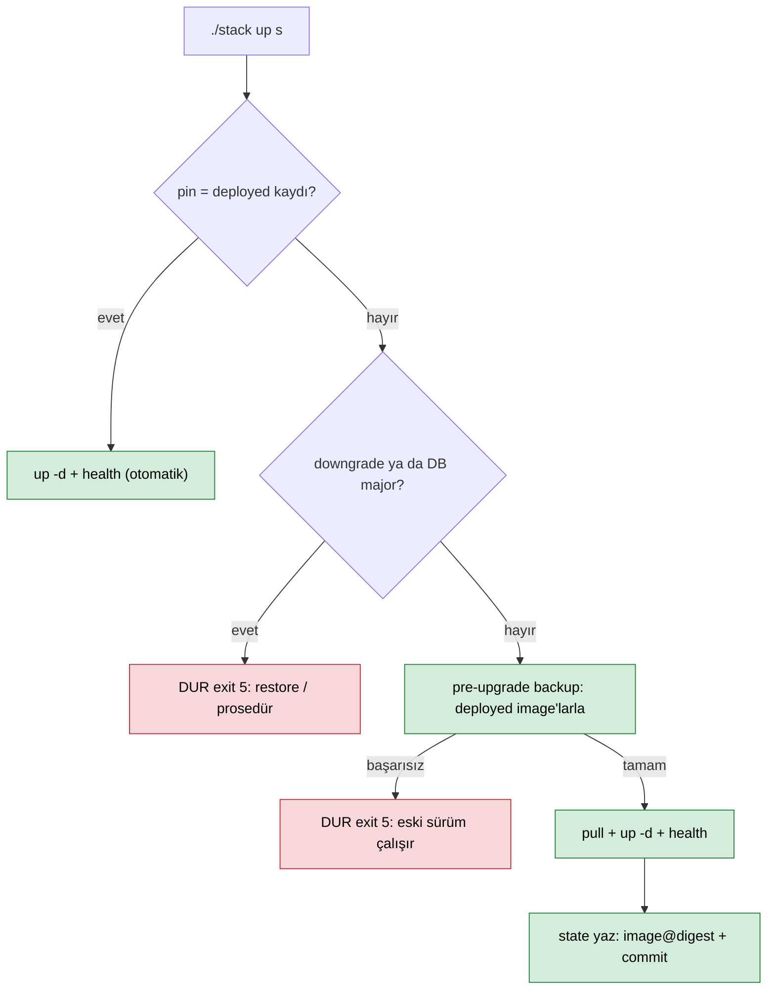

# Architecture opinion: Spec 0001 selfhost-stack | Date: 2026-11-09 | Decision: CONDITIONAL APPROVE

- İncelenen: `/Users/goktugoktay/Desktop/Projects/selfhost-stack/docs/spec.md` (Status: Draft, revizyon 0)
- İnceleyen: architecture-board (tasarımı bu birim yazmadı; yazar BA, ayrı bir architect tasarımı yok)
- Kapsam: katman modeli (upstream/overlay/local), compose merge stratejisi, versiyon pinleme, Plane/Penpot vendoring, yeni bağımlılıklar.
- Kanıt sınırı: bu birimin web erişimi yok. Aşağıda "doğrulanmadı" yazan her upstream bilgisi Haziran 2026'ya kadarki bilgiye dayanıyor ve T-0'da (Scout) doğrulanmalı. Spec'in kendisi de §6.4'te F-1..F-9'u "doğrulanmadı" olarak işaretliyor.
- Yazma yeri notu: çağıran bu görüşü `docs/reviews/architecture-board.md` yoluna istedi. Board'un yazma alanı yalnızca `docs/architecture/`; görüş bu yüzden bu dosyada. Kopyalamak ya da bağlantı vermek çağırana kalır.

## Özet karar

Temel tasarım doğru ve yalın: Compose'un yerel `-f` merge mekanizması, stack başına ayrı project, `setup.sh` çalıştırmamak, platform (Coolify/Portainer) eklememek. Board bunları onaylıyor. Ancak **versiyon ve veri durumu** tarafında rollback'i (AC-13) fiilen kıracak iki boşluk ve pin politikasında CEO kararını ("her makinede aynı versiyon") ölçülemez bırakan bir gevşeklik var. Koşullar (K-1..K-9) spec'e işlenince onay geçerli olur. Yeni bağımlılıklar board onayından bağımsız olarak CEO'ya gösterilecek (bkz. "CEO'ya rota").

## Decisions and assessment

| # | Decision | Rationale present? | Alternative | Risk | Outcome |
|---|---|---|---|---|---|
| D-1 | Katman modeli: upstream (dokunulmaz) → repo overlay → local override | Evet (§6.1, §6.2) | env-only parametre, YAML üretimi, Compose `include` (include aynı servisi merge etmez, uygun değil) | Overlay/upstream servis adı sapması (A-08), project directory (A-09) | CONDITIONAL APPROVE (K-6, K-7) |
| D-2 | Merge: `-f` sırası + `!override`/`!reset`, Compose ≥ 2.24.4 | Evet | (b), (c) | `COMPOSE_*` shell değişkenleri ve `profiles` ile guard atlatma (A-06) | CONDITIONAL APPROVE (K-5) |
| D-3 | Env: `--env-file local` sonra `--env-file versions.env`, versiyon değişkenleri `unset` | Evet | Versiyonu compose YAML'a gömmek | Local override `image:` ile REQ-2'yi deler (A-05) | CONDITIONAL APPROVE (K-4) |
| D-4 | Versiyon pin: sadece tag, digest §13'e ertelendi | Kısmen (iki seçenek, ama "aynı versiyon" şartıyla ilişkisi yok) | tag+digest; tam patch tag kuralı | `postgres:15`, `mariadb:11.4`, `valkey:8` gibi kayan tag'ler AC-7'den geçer (A-04) | CONDITIONAL APPROVE (K-3) |
| D-5 | Upgrade: versiyon farkında otomatik `pre-upgrade` yedek | Evet (REQ-12) | Elle yedek | Yedek hangi versiyonla, manifest'e hangi versiyon yazılır tanımsız; downgrade ve DB major tanımsız (A-01, A-02, A-03) | CONDITIONAL APPROVE (K-1, K-2) |
| D-6 | Plane/Penpot vendoring (release asset / tag'den raw, `SOURCE` + sha256) | Evet (§6.3) | `setup.sh`, elle yazmak | `vendor` komutu REQ-5/AC-8 ile çelişiyor ve AC'si yok (A-12); sha256 TOFU (ilk indirmeye güven), asıl kontrol PR diff'i | APPROVE (D-6 için), `vendor` yeri için K-8 |
| D-7 | CLI dili bash 3.2 | Evet (4 seçenek) | Go binary, Python, Make/Taskfile | JSON işleme ihtiyacı gizli bağımlılık doğuruyor (A-07); bash 3.2 tuzakları (A-13) | CONDITIONAL APPROVE (K-5, K-9) |
| D-8 | BookStack: `lscr.io/linuxserver/bookstack` + resmi `mariadb` | Kısmen (alternatif var; bakım/güvenlik geçmişi/çıkış maliyeti yok) | `solidnerd/bookstack`, kaynaktan build | Resmi image varlığı doğrulanmadı (F-1); linuxserver env adları sürümler arasında değişmiş olabilir (doğrulanmadı) | CONDITIONAL APPROVE (T-0 F-1/F-2 sonucu) |
| D-9 | Plane'in MinIO bağımlılığı (upstream'den gelir) | Hayır (sadece "risk R-3", R-3 spec'te tanımlı değil) | Plane'in önerdiği başka depolama; S3 uyumlu muadiller (SeaweedFS Apache-2.0, Garage AGPL-3.0, RustFS Apache-2.0; hepsi doğrulanmadı) | Güvenlik yaması almayan servis, kullanıcı erişimli yolda (A-11) | ASK CEO (risk kabulü, öneri aşağıda) |
| D-10 | Yedek formatı: dump + tar.gz + `manifest.env` + `SHA256SUMS`, retention `BACKUP_KEEP` | Evet | restic/borg gibi ek araç (eklenmesin: kriter yok) | Yarım yedek, retention'ın pre-upgrade yedeği silmesi, format versiyonu yok (A-10) | CONDITIONAL APPROVE (K-2) |
| D-11 | Docker runtime "herhangi biri" | Kısmen | Tek runtime zorunlu kılmak | 127.0.0.1 bind ve port çakışma tespiti runtime'a göre farklılaşabilir (A-14, doğrulanmadı) | APPROVE, kanıtta runtime adı yazılsın |
| D-12 | Stack başına ayrı project `-p selfhost-<s>` | Evet | Tek project + profiles | Project adı = volume kimliği, sonradan değişirse veri "kaybolmuş" görünür | APPROVE, ADR zorunlu (ADR-0001) |

## Bulgular (önem sırasıyla)

**A-01 [Kritik, veri/rollback] Pre-upgrade yedeğin "verinin versiyonu" ve eski image'a erişim tanımsız.**
`git pull` sonrası `stacks/<s>/versions.env` artık yeni pin'i taşıyor. (a) `manifest.env` "versiyonlar" alanına repo pin'ini yazarsa, AC-13'teki rollback (`git switch --detach <önceki>` + restore) AC-11'in versiyon kontrolüne takılır ve exit 5 verir: rollback çalışmaz. (b) Stack durmuş haldeyken `up` çalışırsa, yedeği almak için DB'yi **eski** image ile başlatmak gerekir, ama eski tag artık hiçbir repo dosyasında yok. `local/state/<s>.deployed` içeriği spec'te tanımlı değil.
Öneri: `local/state/<s>.deployed` çözümlenmiş image ref'lerini (tag + digest), versions.env hash'ini ve git commit'ini saklar. Pre-upgrade yedek bu kayıttaki image'larla alınır ve manifest'e **deployed** versiyonlar yazılır. State dosyası yoksa ama volume'lar doluysa "versiyon değişti" sayılır ve önce yedek alınır.

**A-02 [Kritik, veri] DB major versiyon değişimi tanımsız.**
Yardımcı image bump'ı (ör. Penpot'un postgres 15 → yeni major'a geçmesi) PostgreSQL'de in-place çalışmaz: yeni major eski data dizinini açmaz. MariaDB'de resmi image'ın `MARIADB_AUTO_UPGRADE` seçeneği var (bu birim doğrulamadı). Spec'te `up`'ın bunu nasıl ele aldığı yok.
Öneri: `stack up`, bir DB image'ının major'ı deployed kayda göre değiştiyse exit 5 verir ve yönerge basar. Major yükseltme ayrı bir prosedür (dump → yeni volume → restore) olur, v1'de ayrı bir spec ya da README prosedürü.

**A-03 [Yüksek, veri] Downgrade `up` ile yapılabiliyor.**
`git switch --detach <önceki>` sonrası kullanıcı restore yerine `./stack up` çalıştırırsa eski uygulama yeni şemaya migrate edilmiş DB üzerinde başlar. Bu, veriyi bozabilir.
Öneri: HEAD, deployed commit'in atasıysa ve versiyonlar farklıysa (`git merge-base --is-ancestor HEAD <deployed-commit>`) `up` exit 5 verir: "geri dönüş için `./stack restore <s> <pre-upgrade-id>`". Restore tek downgrade yolu olur.

**A-04 [Yüksek] Pin politikası CEO kararını ölçülemez bırakıyor.**
AC-7 sadece `latest|stable|main` ve tag'sizi yasaklıyor. `postgres:15`, `mariadb:11.4`, `valkey:8`, `rabbitmq:3.13-management` gibi tag'ler geçer, ama zamanla başka patch'e kayar. Bu yüzden iki makine aynı commit'te farklı image çalıştırabilir. Bu, §1'deki "her makinede aynı versiyon" kararına ve REQ-2'ye ters düşüyor. Tag'ler değişebilir, aynı içeriği garanti eden şey digest.
Öneri (tercih): v1'de `name:tag@sha256:<multi-arch index digest>`. Maliyet düşük: Compose bunu destekliyor, tag okunur kalıyor, bump PR'ı digest'i de yazıyor, AC-14'teki "çalışan = pin" karşılaştırması kesinleşiyor. Asgari: AC-7'ye "tam patch tag" kuralı (regex) eklenir ve linuxserver için build'e özgü tag (`-ls<NNN>`) zorunlu olur. Digest §13'ten çıkarılır.

**A-05 [Yüksek] REQ-2 ile AC-14 çelişiyor.**
`local/<s>.override.yaml` içine `image:` yazmak versiyonu değiştirir. REQ-2 "makine ayarları bu versiyonu değiştiremeyecek" diyor, AC-14 ise sadece `DRIFT` uyarısı istiyor.
Öneri: REQ-2 üstün. `stack`, çözümlenmiş image pin'den farklıysa exit 2 verir. CEO makineye özel image override istiyorsa `ALLOW_PUBLIC_BIND` gibi açık bir `ALLOW_IMAGE_OVERRIDE=1` anahtarı olur, REQ-2 buna göre yeniden yazılır. Bu bir davranış kararı, BA bunu CEO'ya tek soru olarak götürmeli.

**A-06 [Yüksek, güvenlik → AppSec] Guard'lar shell ortamı ve profiles üzerinden atlatılabilir.**
(a) Spec sadece versiyon değişkenlerini `unset` ediyor. Shell'deki `COMPOSE_PROFILES`, `COMPOSE_FILE`, `COMPOSE_PROJECT_NAME`, `COMPOSE_ENV_FILES` gibi değişkenler `profiles: [disabled]` servisleri açabilir ya da project/volume kimliğini değiştirebilir. Penpot mailcatcher upstream'de host portu yayınlıyor (F-4 kapsamında, doğrulanmadı). Profile açılırsa bu port REQ-7'ye rağmen dışarı açılır. (b) REQ-7 altyapı servislerinin host'a "hiçbir zaman" açılmamasını istiyor. AC-5 ise sadece loopback olmayan bind'ı kontrol ediyor: local override bir DB'ye `127.0.0.1:5432:5432` eklerse hiçbir AC bunu yakalamıyor.
Öneri: `stack` her çağrıda tüm `COMPOSE_*` değişkenlerini temizler. Disabled servislerde ayrıca `ports: !reset []` uygulanır. Port, infra-port ve image guard'ları local dosyayı grep'lemez, `docker compose config` ile normalleştirilmiş çıktı üzerinde çalışır. AC-4/AC-5'e "infra servise local override ile port eklenirse exit 3" ve "`COMPOSE_PROFILES=disabled` export'lu iken ek container yok" testleri eklenir.

**A-07 [Orta-Yüksek] Gizli bağımlılık: çözümlenmiş config'i okumak.**
A-04/A-05/A-06 guard'ları çözümlenmiş compose'u (port `host_ip`, image, servis listesi) okumayı gerektiriyor. Bash 3.2'de YAML/JSON'u sed/awk ile ayrıştırmak kırılgan. Rationale tablosunda bu bağımlılık yok. Seçenekler:
1. Compose'un kendi alt komutları: `config --services`, `config --images` (servis ve image için yeterli). Port bilgisi için `config --format json` + `jq`. macOS'un yeni sürümlerinde `/usr/bin/jq` hazır geliyor (doğrulanmadı), Linux'ta paket.
2. `jq`'yu pinlenmiş bir container ile çalıştırmak (host bağımlılığı yok, her çağrıda `docker run` maliyeti var).
3. sed/awk ile ayrıştırmak: reddedildi.
Öneri: mümkün olan her yerde (1)'in jq'suz kısmı, port guard için `jq` açık bir ön koşul olur (AC-3: eksikse exit 2). Spec ayrıca host araçları listesini açıkça yazmalı: `curl`, `lsof`/`ss`, `shasum`/`sha256sum`, secret üretimi için `openssl` ya da `/dev/urandom` + `base64` (GNU/BSD bayrak farkları), testler için `python3`.

**A-08 [Orta] Overlay ile upstream servis adı sapması sessiz kalabilir.**
Upstream bir servisi yeniden adlandırırsa (F-4'teki redis → valkey örneği gibi) overlay'deki `image:` pin'li blok yeni ve bağımsız bir servis yaratır, eski pin boşa düşer. Yeni ad tam bir tag taşıyorsa AC-7'den de geçer.
Öneri: `stack` (ve G-1 testi), overlay'deki servis kümesinin upstream kümesinin alt kümesi olduğunu doğrular (`docker compose -f <upstream> config --services`). Değilse exit 2. Aynı kontrol `vendor` PR'ında da koşar.

**A-09 [Orta] Project directory örtük.**
İlk `-f` dosyası `stacks/<s>/upstream/...` olduğu için project directory `upstream/` olur. Overlay'deki relative path'ler ve `env_file:` oradan çözülür. BookStack'te ise `stacks/bookstack/` olur, yani stack'ler arasında tutarsızlık var.
Öneri: her çağrıda `--project-directory stacks/<s>` sabit verilir. Upstream compose'da relative path varsa T-3/T-4'te kontrol edilir.

**A-10 [Orta, veri] Yedek atomikliği, retention ve REQ-15.**
(a) Yarım kalan bir yedek (disk doldu, iptal edildi) listelenebilir ve retention'a sayılabilir. Öneri: `<id>.partial/` altında üretilir, `SHA256SUMS` doğrulanınca rename edilir. `.partial` olan restore edilemez ve sayılmaz. Başlamadan önce boş alan kontrolü yapılır. (b) Retention tek havuzdan sayılırsa 7 manuel yedek, AC-13 için gereken tek `pre-upgrade` yedeğini silebilir. Öneri: retention tip başına uygulanır, deployed versiyona ait son `pre-upgrade` asla silinmez. (c) REQ-15 "veri silen bir komut sunmayacak" diyor, ama retention yedek siliyor, restore da volume boşaltıyor. REQ-15 metni bu iki bilinçli istisnayı adıyla yazmalı (BA). (d) `manifest.env`'e `BACKUP_FORMAT=1` eklenir, böylece gelecekteki `stack` sürümleri eski yedekleri tanır.

**A-11 [Orta, risk → AppSec + CEO] Plane'in MinIO bağımlılığı.**
Haziran 2026'ya kadarki bilgime göre MinIO 2025'te topluluk sürümü için hazır image/binary dağıtımını durdurdu ve topluluk reposunu bakım moduna aldı (bu birim doğrulamadı, F-7). Plane'in proxy'si upload'ları MinIO'ya yönlendiriyorsa (doğrulanmadı) MinIO, loopback üzerinden kullanıcının erişebildiği yolda duruyor. Spec "risk R-3" diyor, ama R-3 hiçbir yerde tanımlı değil.
Öneri: v1'de Plane release'inin kullandığı MinIO image'ı digest ile pinlenir. Bu yalnızca loopback varsayılanıyla kabul edilebilir. Risk ADR-0004 ile kabul edilir ve çıkış tetikleyicisi yazılır: MinIO için yeni bir CVE çıkarsa, Plane depolamayı değiştirirse ya da S-3 (LAN erişimi) açılırsa. T-0'da Scout şunu cevaplar: güncel Plane release'i hangi object storage'ı ve hangi image'ı kullanıyor, S3 uyumlu muadil destekleniyor mu?

**A-12 [Orta, kriter yok] `vendor` komutu runtime CLI'da.**
AC-8 "her `./stack` komutundan sonra `git status` boş" diyor, `vendor` ise tanım gereği repo dosyası yazıyor. Hiçbir AC `vendor`'ı test etmiyor ve komut runtime CLI'ya ağ erişimi getiriyor.
Öneri: `tools/vendor.sh` adında ayrı bir bakımcı script'i olsun (runtime `stack` ağsız kalır, REQ-5 istisnasız olur). Ya da `vendor` için AC eklenir ve AC-8 istisnayı adıyla yazar.

**A-13 [Düşük-Orta] bash 3.2 tuzakları.**
Bash 3.2'de associative array, `mapfile` ve `${x,,}` yok. Bash 4.4'ten önce `set -u` altında boş dizinin `"${arr[@]}"` açılımı "unbound variable" hatası veriyor. shellcheck hedef bash sürümünü ayırt etmiyor.
Öneri: G-1'deki "testler `/bin/bash` 3.2 ile" kapısı zorunlu kalır ve Linux'ta bash 5 ile de koşar. Yeniden değerlendirme tetikleyicisi: guard'lar jq dışında yapısal veri işleme gerektirirse ya da `stack` bakımı zorlaşırsa (ör. tek dosya ~1000 satırı geçerse; bu bir öneri eşiği, ölçüm değil), Go/Python geçişi ADR ile yeniden açılır. Dış sözleşme (§7.1/§7.2) dil değişiminden bağımsız tutulur.

**A-14 [Düşük] Runtime matrisi.**
"Docker Desktop, OrbStack, Colima: herhangi biri" deniyor, ama loopback bind'ın davranışı ve `lsof` ile port tespiti runtime'ın port forwarder'ına bağlı (doğrulanmadı).
Öneri: AC-1/AC-4 kanıtına runtime adı ve versiyonu yazılır. Test edilmeyen runtime README'de "doğrulanmadı" olarak geçer.

**A-15 [Düşük] Local override ile volume türü değişimi.**
Veri olan bir stack'te named volume bind-mount'a çevrilirse uygulama boş dizinle açılır, migrator boş şema kurar ve veri "kaybolmuş" görünür (veri eski named volume'da durur).
Öneri: `up`, override bir veri volume'unun kaynağını değiştiriyorsa ve deployed kayıt farklıysa uyarır ya da onay ister.

**A-16 [Bütünlük] Rationale ve doğrulama boşlukları.**
(a) §6.4'ün tamamı doğrulanmamış. T-0 "imza öncesi önerilir" diye geçiyor, board için **zorunlu**: AC-1'in arm64 şartı (F-9), AC-15 (F-5) ve health yolları buna bağlı. (b) Yeni bağımlılıkların çoğu için rationale tablosunun bakım, son release, güvenlik geçmişi ve çıkış maliyeti boyutları eksik (aşağıdaki boşluk listesi). (c) R-3 tanımsız. (d) Kalite nitelikleri: `HEALTH_TIMEOUT` ölçülebilir. RAM (≥ 8 GB) ve disk (yedek hacmi) için ölçüm yöntemi T-7'ye bırakılmış, ama tavan yok. Öneri: T-7 ölçülen RAM'i ve 3 stack × `BACKUP_KEEP` disk kullanımını rapora yazar.

### Bir `up` versiyon değişikliğini nasıl güvenle ele almalı? (K-1/K-2 sonrası önerilen akış)

Açıklama: versiyon farkı deployed kayda göre ölçülür, geri dönüş ve DB major değişimi `up` ile yapılmaz, yedek verinin kendi versiyonuyla alınır. Kırmızı ve "DUR" etiketli düğümler durma noktaları, yeşiller otomatik adımlar.
Metin karşılığı:
1. `up`, pin'i `local/state/<s>.deployed` ile karşılaştırır. Aynıysa normal `up -d` + health.
2. Farklıysa: HEAD deployed commit'in atasıysa (downgrade) ya da bir DB image'ının major'ı değiştiyse exit 5 ve yönerge.
3. Değilse: deployed image'larla `pre-upgrade` yedek, manifest'e deployed versiyonlar yazılır. Başarısızsa exit 5, eski sürüm çalışmaya devam eder.
4. Başarılıysa: `pull` + `up -d` + health, ardından state'e image@digest ve commit yazılır.

## Found unnecessary (no criterion)

- `vendor` komutunun runtime CLI içinde olması: hiçbir AC'si yok ve REQ-5/AC-8 ile çelişiyor (A-12). Öneri: ayrı bakımcı script'i.
- Bunun dışında gereksiz katman **yok**. Kuyruk, ikinci DB ve cache gibi şeylerin hepsi upstream uygulamaların kendi gereksinimi, bu iş kendi katmanını eklemiyor. Platformları (Coolify/Dokploy/Portainer) ve yedek aracı (restic/borg) eklememek doğru.

## Decisions expensive to reverse → ADR needed: yes

ADR'leri bu board yazıp onaylamaz (yaz-onayla yasağı). Yazar: software-architect (yoksa BA). Board inceler.

| ADR | Konu | Neden pahalı |
|---|---|---|
| ADR-0001 | Katman modeli ve compose birleştirme: `-f` sırası, `--project-directory`, `-p selfhost-<s>`, volume adları, `local/` düzeni | Project adı ve volume adı verinin kimliği. `local/` düzeni sahadaki her makinede yaşıyor, değişirse göç gerekir |
| ADR-0002 | Versiyon pin politikası ve deployed-state kaydı: tag+digest, `local/state/<s>.deployed` şeması, downgrade ve DB major kuralı | Rollback doğruluğu buna bağlı. State şeması makinelerde birikiyor |
| ADR-0003 | Yedek formatı v1: dizin yapısı, `manifest.env` şeması + `BACKUP_FORMAT`, retention kuralı | Eski yedeklerin gelecekteki sürümlerle geri yüklenebilmesi |
| ADR-0004 | Plane object storage (MinIO) risk kabulü ve çıkış tetikleyicisi | Depolama motoru. Değişimi veri göçü demek |
| ADR-0005 (önerilir) | CLI dili bash 3.2 ve yeniden değerlendirme tetikleyicisi | Orta maliyet. Dış sözleşme korunursa ucuzlar |

## Conditions

İmzadan önce spec'e işlenmeli:

- **K-1** (A-01, A-03): `local/state/<s>.deployed` şeması tanımlanır (image@digest, versions hash, commit). Pre-upgrade yedek deployed image'larla alınır ve manifest'e deployed versiyon yazılır. `up` downgrade'i reddeder (exit 5). Yeni AC'ler: "stack durmuşken bump + up → yedek eski image ile alınır" ve "detach + up → exit 5".
- **K-2** (A-02, A-10): DB major değişimi exit 5. Yedekler `.partial` ile atomik, boş alan ön kontrolü var. Retention tip başına uygulanır ve deployed versiyonun son pre-upgrade yedeğini korur. `BACKUP_FORMAT=1` eklenir. REQ-15 istisnalarını adıyla yazar.
- **K-3** (A-04): v1'de tag+digest (tercih). Asgari: AC-7'ye tam patch tag regex'i ve linuxserver build tag'i.
- **K-4** (A-05): REQ-2 ile AC-14 çelişkisi CEO kararıyla çözülür (öneri: image override reddedilir, exit 2).
- **K-5** (A-06, A-07): Tüm `COMPOSE_*` değişkenleri temizlenir. Disabled servislerde `ports: !reset []` uygulanır. Guard'lar normalleştirilmiş config üzerinde çalışır. Infra-port guard'ı ve profile testi AC-4/AC-5'e girer. `jq` (ya da seçilen alternatif) ve host araçları ön koşul listesine, eksikleri AC-3'e (exit 2) girer.
- **K-6** (A-08): Overlay servis kümesi ⊆ upstream servis kümesi kontrolü yapılır.
- **K-7** (A-09): `--project-directory stacks/<s>` sabitlenir.
- **K-8** (A-12): `vendor` ayrı bakımcı script'ine taşınır ya da AC alır ve AC-8 istisnayı yazar.
- **K-9** (A-16): T-0 imza öncesi zorunlu olur. Sonuç olarak F-1..F-9 doğrulanır, R-3 tanımlanır, aşağıdaki rationale boşlukları doldurulur. Bir AC değişirse spec revize edilir ve board ikinci tura bakar.

## Rationale boşluk listesi (BA'ya, birinci tur)

| Bağımlılık | Eksik boyutlar |
|---|---|
| `lscr.io/linuxserver/bookstack` | son release, bakımcı, güvenlik geçmişi (OSV/GHSA), çıkış maliyeti, resmi image var mı (F-1) |
| `mariadb` (resmi) | hangi LTS, EOL tarihi, major upgrade yolu |
| Penpot (frontend/backend/exporter) + `postgres`, `valkey` | upstream'in pinlediği yardımcı versiyonlar, EOL, güvenlik geçmişi |
| Plane CE (~12 container) + `postgres`, `valkey`/`redis`, `rabbitmq`, `minio` | yukarıdakiler + MinIO bakım durumu (A-11), arm64 kapsamı (F-9) |
| `alpine` (yardımcı tar image'ı) | tag/digest, alternatif: busybox ya da DB image'ının kendi `tar`'ı (yeni image eklememek) |
| `jq` (yeni, spec'te yok) | ön koşul mu container mı (A-07) |
| `shellcheck` (geliştirme kapısı) | sürüm, CI'da nasıl çalışacağı |

## Lisans notu (hukuki görüş değildir)

Plane Community AGPL-3.0. Spec'in "dahili kullanım, değişiklik yok, dağıtım yok" çerçevesi geçerli olduğu sürece board ek risk görmüyor. S-3 (LAN/internet erişimi) açılırsa, repo herkese açık yapılırsa ya da upstream kod değiştirilirse AGPL'in ağ maddesinin yorumu **avukat gerektirir**. Board hukuki görüş vermez.

## STACK.md change

`/Users/goktugoktay/Desktop/Projects/selfhost-stack/docs/architecture/STACK.md` oluşturuldu. Bu projenin tüm teknolojileri kayıt dışı olduğu için "assess" olarak girdi. İstisnalar: Docker Compose v2 tercih edilen stack'in parçası (local Docker) olduğu için "adopt". bash CLI ve shellcheck koşullu onay aldığı için "trial". .NET/React bu işte kullanılmıyor, spec başka stack seçiyor ve bu kurala uygun.

## CEO'ya rota

Board'un koşullu onayından bağımsız olarak şu yeni bağımlılıklar CEO'ya gösterilmeli: Penpot (MPL-2.0), Plane CE (AGPL-3.0), BookStack (MIT) için linuxserver image'ı (GPL-3.0 script'ler), MariaDB, PostgreSQL, Valkey, RabbitMQ, **MinIO (risk, ASK CEO: A-11)**, alpine, jq (seçilirse), shellcheck. CEO'ya giden tek davranış sorusu K-4.

## Unanswered questions

1. (CEO, K-4) Makineye özel image override reddedilsin mi (öneri: evet), yoksa açık bir anahtarla mı izin verilsin?
2. (CEO, A-11) MinIO'nun v1'de "yalnız loopback + digest pin + ADR'li risk kabulü" ile kullanılması kabul mü? Öneri: evet, çıkış tetikleyicisiyle.
3. (Scout, T-0) Güncel Plane release'i hangi object storage'ı kullanıyor? Penpot mailcatcher upstream'de host portu yayınlıyor mu? Upstream compose'larda relative path ya da `env_file:` var mı?
4. (AppSec) Secret'ların container'a `environment` ile verilmesi (`docker inspect` ile görünür) tek kullanıcılı makinede kabul mü? Board'un önerisi: v1'de kabul, threat model'e kalan risk olarak yazılsın.

## Dış içerik notu

Spec dışında bir Scout raporu ya da README okunmadı. Spec'te ajana yönelik bir talimat tespit edilmedi.
