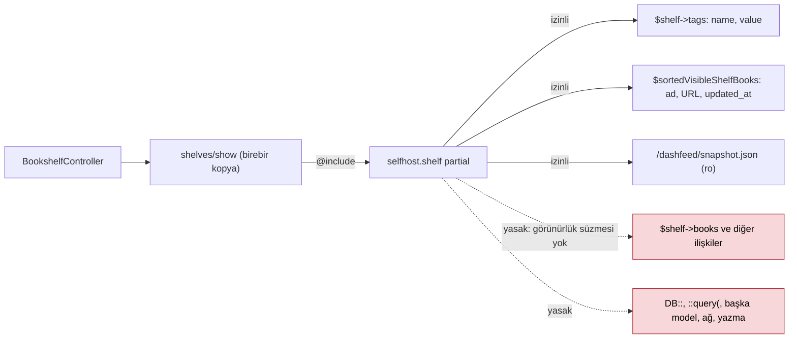

# Architecture opinion (tur 2): Spec 0002 bookstack-dashboard | Date: 2026-11-09 | Decision: CONDITIONAL APPROVE

- İncelenen: `/Users/goktugoktay/Desktop/Projects/selfhost-stack/docs/spec-0002-bookstack-dashboard.md` (Status: Awaiting approval, revizyon 3).
- Tasarım belgeleri (Proposed): `/Users/goktugoktay/Desktop/Projects/selfhost-stack/docs/architecture/tasarim/ADR-0006-selfhost-dashfeed-kopru-agi.md`, `/Users/goktugoktay/Desktop/Projects/selfhost-stack/docs/architecture/tasarim/ADR-0007-bookstack-ozellestirme-yontemi.md`.
- Bağlam: tur 1 görüşü `gorus-0002-bookstack-dashboard-2026-11-09.md` (K-1..K-10, A-01..A-11), `docs/reviews/t0a-upstream-verification-0002.md` (§1, §3, §3b), `docs/spec.md` (0001 revizyon 3, AC-1..AC-15).
- İnceleyen: architecture-board. ADR'leri ve spec'i bu birim yazmadı, yaz-onayla yasağı yok.
- Kanıt sınırı: bu birimin web erişimi ve Bash'i yok. "verified" diye anılan her upstream bilgisi T-0a raporundaki kaynağa dayanır, bu birim kaynağı kendisi okumadı. Kendi genel bilgimden gelen her iddia "doğrulanmadı" diye işaretli.

## Özet karar

| Kapsam | Karar |
|---|---|
| Spec 0002, Faz 1 | **CONDITIONAL APPROVE.** Koşullar: K2-1, K2-2, K2-3 |
| Spec 0002, Faz 2 | **CONDITIONAL APPROVE.** Koşullar: K2-4..K2-8. K2-4 tamamlanmazsa B-3 Faz 2 imzasında kendiliğinden REJECT olur (üçüncü tur yok) |
| Override yöntemi "birebir upstream kopyası + yalnız `@include`" (B-copy) | **APPROVE** (v1 için). Board'un view-enjeksiyonu tercihi geri çekildi, çatışma kalmadı |
| B-3 `python:<3.X.Y>-alpine3.24@sha256` | **CONDITIONAL APPROVE**, Faz 2 imzasına bağlı (K2-4) |
| Partial'ın `$shelf->tags` okuması ve A-08 kuralı | **APPROVE**, kural daraltılarak (K2-1) |
| ADR-0007 | **CONDITIONAL APPROVE**: karar doğru, metin revizyon 2'de kalmış (K2-2) |
| ADR-0006 | **CONDITIONAL APPROVE**: karar doğru, T-0c sonuçları ve 0001 r3 numaraları bekleniyor (K2-8), üye listesi kuralı tüm projelere genişlemeli (K2-5) |

Tur 1'in on koşulundan yedisi spec'te tam karşılandı, üçü kısmen (K-5, K-6, K-9). Ayrıntı aşağıdaki tabloda.

## Tur 1 koşullarının durumu

| Koşul | Bulgu | Spec'teki karşılığı | Durum |
|---|---|---|---|
| K-1 | A-01 volume sahipliği | §6.5 `user: "65534:65534"`, `dashfeed-init` (`network_mode: none`, `cap_add` yok), `/out` 0755, snapshot 0644, okuyan `abc` (dünya-okunur), `specs_skipped`. Kriter CB-15 | Karşılandı |
| K-2 | A-02 ağ listesi, doğrulama, alias | §6.4: yalnız `selfhost-dashfeed`, `Internal`/`Driver`/etiket doğrulaması, exit 2, silme yok, alias `plane-proxy-dashfeed`. CB-13 tek ağ + `mariadb:3306` testi. Ek olarak G-net | Karşılandı (genişletme: K2-5) |
| K-3 | A-03 dizin mount'u | §6.5 her iki tarafta dizin, aynı dizinde `.snapshot.json.tmp` + `rename`, tek dosya bind'ı yasak. CB-15 `Type=volume`, hedef `/dashfeed` | Karşılandı |
| K-4 | A-04 istek bütçesi ve tavan | §6.5 30 istek/dk (`DASHFEED_REQ_PER_MIN` 5-30), proje tavanı 30, proje başına 5 sayfa, etkin aralık formülü, yarım döngü yayımlanmaz. CB-23 | Karşılandı |
| K-5 | B-3 rationale tablosu | §6.3: dört alternatif + "hiçbir şey eklememek", EOL (verified), bakım (verified), lisans (yeniden doğrulanmadı), güvenlik (**eksik**), çıkış maliyeti. Pin biçimi ve EOL yorumu `versions.env`'de | Kısmen: güvenlik kanıtı eksik → K2-4 |
| K-6 | A-05/A-06 hash kontrolü ve D-17 | `UPSTREAM` sha256 + `VIEW_ROOT`, CB-8 pinli image'dan `cat` + tam satır regex diff. D-17 verified: enjeksiyon yalnız logical theme ile (R-b) | Spec'te karşılandı. ADR-0007 R-b'yi henüz kaydetmedi → K2-2 |
| K-7 | A-07 `open_basedir` | D-18 T-0b'de | Karşılandı (ölçüm T-0b'de bekliyor, K2-3) |
| K-8 | B-5 0001 dosya değişikliği | §2.2 C-5/C-6 açık liste, "0001 metni değişmez, dosyası değişir". Ağ garantisi `ENABLED_STACKS`/`SELFHOST_DASHBOARD`'dan bağımsız. CB-27 | Karşılandı |
| K-9 | B-7 sözleşme dosyası | `snapshot.schema.json` §7.1'de, CB-15 doğrular | Kısmen: doğrulayıcının nasıl çalışacağı tanımsız, stdlib'de JSON Schema doğrulayıcısı yok → K2-6 |
| K-10 | A-09/A-11 bakım sahipliği, birim testleri | §13 bakım sahipliği, C-9, T-6 README notu. CB-29 birim testleri pinli image'da `--network none` | Karşılandı |
| A-10 | CB-15 (g) ölçüm ortamı | CB-22 (j): makine, runtime, sürüm + 1 MB ölçümü | Karşılandı |

## Decisions and assessment (tur 2)

| # | Decision | Rationale present? | Alternative | Risk | Outcome |
|---|---|---|---|---|---|
| B-1 | Override yöntemi B-copy: iki view'un birebir kopyası + tam satır `@include('selfhost.*')`, sha256 + diff (CB-8) | Evet (§6.1, ADR-0007, 6 seçenek) | B' logical theme enjeksiyonu (D-17 verified, S-06 ile v1'de yasak), B-part (`common.view-blocks` her sayfayı etkiler), B-free, A, C, D | Upstream view değişince yeniden port (Y-2), view yapısı değişince durma (Y-3, KR-6 ile çözüldü) | **APPROVE** |
| B-3 | Toplayıcı image'ı `python:<3.X.Y>-alpine3.24@sha256` | Evet, boyutların hepsi dolu. Güvenlik boyutu dürüstçe "eksik" yazılmış ve imza kapısına bağlanmış | (0) linuxserver PHP'si, (b) slim, (c) distroless, (d) busybox + jq | CPython ve Alpine paket açıkları taranmadı (D-20) | **CONDITIONAL APPROVE** (K2-4) |
| B-6a | Partial'ın `$shelf->tags`'i kendisi okuması | Evet (D-10: upstream view etiketleri göstermiyor) | Etiketleri hiç okumamak (P1 düşer), P2 `?project=`, P4 `local/` env | Kural "modellerin ilişkileri" diye yazıldığı için yetki süzmesi olmayan ilişkilere de izin veriyor (A-12) | **APPROVE**, kural daraltılarak (K2-1) |
| B-4 | `selfhost-dashfeed` köprüsü (ADR-0006) | Evet (5 seçenek) | N0..N5 | Üye listesi kuralı yalnız BookStack ve Plane projelerini kapsıyor (A-13) | **CONDITIONAL APPROVE** (K2-5, K2-8) |
| B-7 | Snapshot sözleşmesi dosyası | Evet | – | Doğrulayıcı tanımsız: gizli `pip` bağımlılığı riski (A-15) | **CONDITIONAL APPROVE** (K2-6) |
| B-11 | Test için pinli `docker:<tag>-dind` (privileged, sadece test) | Kısmen: ihtiyaç CEO cevabında var (§1 madde 4), rationale satırı yok | Linux VM (CEO istemedi), Linux testini atlamak | Yeni image, privileged | **CONDITIONAL APPROVE** (K2-7) |

## Karar gerekçeleri

### 1. Override yöntemi: "birebir upstream kopyası + yalnız `@include`" (APPROVE)

Tur 1'de board, logical theme'de bir view enjeksiyonu API'si varsa onun seçilmesini istedi (A-05). Appsec S-06 logical theme'i yasakladı. T-0a bu soruyu kaynağıyla cevapladı (D-17, verified): enjeksiyon (`THEME_REGISTER_VIEWS`, `renderBefore`/`renderAfter`) ve kendi view block'umuz (`ViewBlockManager::register`) **yalnız** `functions.php` ile mümkün. Bu ADR-0007 D5'teki R-b sonucudur. Board bu durumda B-copy'yi onaylıyor:

- Tur 1'deki asıl itiraz kopyanın kendisi değildi. İtiraz, sapmanın ölçülmemesiydi (A-06). CB-8 artık pinli image'daki orijinalin sha256'sını karşılaştırıyor ve tam satır kalıbı dışında hiçbir eklemeye izin vermiyor. Sapma mekanik olarak yakalanıyor, upstream değişmediyse bump tek satır.
- Kopyalanan yüzey küçük: `home/default` v26.09'da liste içermiyor (D-4, verified). Override edilen dosyalar iki tane.
- B-part'ın reddi doğru: ana sayfadaki bloklar `common.view-blocks` ile üretiliyor ve onu override etmek bütün sayfaları etkiler (§6.1).
- Board, S-06'nın güvenlik kazancını şöyle okuyor: partial'lar da zaten sunucu tarafında PHP çalıştırıyor (TD-2), bu yüzden fark yetki türünde değil, **etki alanında**. `functions.php` uygulama açılışında ve her istek türünde (API, CLI dahil) çalışır ve olay dinleyicileriyle kimlik doğrulama akışına girebilir (doğrulanmadı, D-2'nin genel okuması). Partial ise yalnız iki sayfanın render'ında çalışır. Bu fark v1'de yasağı haklı kılıyor. Board appsec kararını geçersiz kılmıyor.
- Yeniden açma tetikleyicileri (ADR-0007 #2, #3, #4) yeterli. Ölçüm kaydı (G-5: "orijinal sha256 değişti mi", "yeniden port süresi") board'un tur 1'deki "~15 dk tahmin değil ölçüm" isteğini karşılıyor.

Engellemeyen not (T-5 için): CB-8'in diff'i ham baytlar üzerinde alınmalı. Boşluk ya da satır sonu normalleştirmesi (`diff -w`, `-b`, `--strip-trailing-cr`) kullanılmamalı. Aksi halde "değiştirilmiş satır yok" kuralı gevşer.

### 2. B-3 python alpine image'ı (CONDITIONAL APPROVE, Faz 2 imzasına bağlı)

Tur 1 kuralı şuydu: "ikinci turda boşluk kalırsa B-3 REJECT". Board bu turda REJECT vermiyor. Gerekçe:

- Rationale tablosu artık **boyut olarak tam**: ihtiyaç, "hiçbir şey eklememek" dahil dört alternatif, bakım (EOL ve yeniden build: verified), lisans (yeniden doğrulanmadı diye işaretli), güvenlik (eksik diye işaretli), çıkış maliyeti. Playbook doğrulanamayan bilginin "doğrulanmadı" diye yazılmasını istiyor, spec bunu yapmış. Eksik olan rationale değil, kanıt. Kanıt da araç limiti yüzünden toplanamadı ve bir göreve (T-0a2) bağlandı.
- B-3 yalnız Faz 2'yi ilgilendiriyor. Faz 2 imzası T-0a2'ye zaten bağlı. Bugün verilecek bir REJECT hiçbir işi ek olarak durdurmaz, ama BA'yı aynı tabloyu üçüncü kez yazmaya zorlar.
- Alternatifler daha kötü: (0) s6-overlay ile root başlayan ve BookStack kodunu taşıyan bir image'ı toplayıcı yapmak yüzeyi büyütür ve toplayıcıyı her BookStack bump'ına bağlar. (d) kırılgan.

Bu yüzden karar K2-4'e bağlı CONDITIONAL APPROVE. K2-4 Faz 2 imzasından önce tamamlanmazsa B-3 o anda REJECT olur. Tamamlanır ama sonuç bir koşulu tutmazsa da REJECT olur.

Minor sürüm önerisi: **3.14** (bugfix desteği 2027-10'a, güvenlik desteği yaklaşık 2030-10'a kadar, PEP 745, T-0a §3b). 3.13 artık yalnız güvenlik aşamasında (son bugfix 3.13.16, 2026-10-01, PEP 719, T-0a §3b). Docker Official Image'ın güvenlik aşamasındaki minor'lar için yeniden build sürdürdüğü bu birimce doğrulanmadı. 3.14 bu soruyu ertelediği için tercih ediliyor.

Engellemeyen not: §6.3'teki (c) distroless red gerekçesi zayıf. Healthcheck ve sahiplik adımı exec biçiminde `python` ile de yapılabilir, shell şart değil. Asıl red gerekçesi olabilecek iki şey (CPython minor'ının Debian sürümüne bağlı olması ve patch düzeyinde tag olmaması) bu birimce doğrulanmadı. BA gerekçe metnini düzeltebilir, karar değişmez.

### 3. `$shelf->tags` ve A-08 kuralı (APPROVE, daraltılarak)

D-10 (verified) tur 1'deki varsayımı geçersiz kıldı: upstream `shelves/show` etiketleri kendisi göstermiyor, etiketler kullanıcının kaldırabildiği `ShelvesShowTags` kenar bloğunda. Tur 1'in A-08 kuralı ("upstream view'un kullandığı değişken ve ilişkiler dışında veri erişimi yok") harfiyen uygulanırsa P1 (raf etiketi eşlemesi) çalışmaz. Spec kuralı "controller'ın view'a verdiği modeller ve bu modellerin ilişkileri, salt okunur" diye yeniden yazdı.

Board `$shelf->tags` okumasını onaylıyor: rafı görebilen kullanıcı o rafın etiketlerini de görebilir (kenar bloğu aynı veriyi zaten gösteriyor). Ek maliyet en fazla bir sorgu (D-10). Bu, hiçbir kriterin ölçmediği ve ölçmesi gerekmeyen bir maliyet.

**A-12 [Orta, güvenlik → appsec] Yeniden yazılan kural fazla geniş.** "Bu modellerin ilişkileri" ifadesi `$shelf`'in **bütün** ilişkilerine izin veriyor. BookStack'te görünürlük süzmesi sorgu kapsamında (visible scope) uygulanıyor ve tembel bir Eloquent ilişkisi bu süzmeyi atlar (genel BookStack/Eloquent bilgisi, bu oturumda doğrulanmadı). Örneğin `$shelf->books` kullanıcının görme yetkisi olmayan kitapları da döndürebilir. Controller'ın `$sortedVisibleShelfBooks`'u ayrıca hesaplaması bunu destekleyen bir işaret. Bu, REQ-D4/TD-4'ün raf karşılığını delmenin kolay bir yolu. CB-7'nin yasak listesi (`::query(`, `::where(`, `DB::`) ilişki erişimini yakalamaz.

Öneri ve koşul (K2-1): kural **sayılı bir erişim listesine** çevrilir. Partial'larda izinli nesne erişimleri yalnız şunlardır: `$shelf->tags` (ve her etiket için yalnız `name`, `value`), `$sortedVisibleShelfBooks` öğelerinin gösterim alanları (ad, URL, `updated_at`; kesin liste T-4'te), `userCan(...)`. Liste `PHP_ALLOWLIST` yanında bir `ACCESS_ALLOWLIST` (ya da `PHP_ALLOWLIST` içinde ayrı bölüm) olarak repo'da durur. CB-7 (e)'ye bir statik tarama eklenir: partial'lardaki her `$değişken->üye` zinciri listede olmalı.

### Partial hangi veriye erişebilir? (K2-1 sonrası)

Açıklama: düz çizgi izinli erişim, kesikli ve "yasak" etiketli çizgi yasak erişimdir (kırmızı). Partial yalnız sayılı alanları okur, görünürlük süzmesi taşımayan ilişkiler yasaktır. Metin karşılığı:

| Erişim | Durum | Zorlayan |
|---|---|---|
| `$shelf->tags` (`name`, `value`) | izinli | `ACCESS_ALLOWLIST` + CB-7 (e) |
| `$sortedVisibleShelfBooks` gösterim alanları | izinli | `ACCESS_ALLOWLIST` + CB-7 (e) |
| `/dashfeed/snapshot.json`, (D-7 yanlışsa) `/dashcards/cards.json` | izinli, salt okunur | CB-7 (f) |
| `$shelf->books` ve listede olmayan her ilişki | yasak | `ACCESS_ALLOWLIST` taraması (yeni) |
| `DB::`, `::query(`, `::where(`, ağ, yazma | yasak | CB-7 (e) yasak listesi |

## Yeni bulgular (tur 2)

**A-12 [Orta, güvenlik → appsec]** Yukarıda, §3.

**A-13 [Orta, güvenlik → appsec] G-net yalnız iki projeyi kapsıyor.** C-12 ve CB-13 köprüye bağlı servis kümesini BookStack projesinde `{dashfeed}`, Plane projesinde `{proxy}` olarak sınırlıyor. Penpot projesi (ve gelecekteki her stack) için kural yok. `selfhost-dashfeed` external bir ağ olduğu için bir `local/penpot.override.yaml` herhangi bir Penpot servisini bu ağa bağlayabilir ve o servis Plane proxy'sine ulaşır. ADR-0006 R-7 "üye listesi kapalıdır" diyor, ama zorlayan guard bunu yalnız iki projede yapıyor. Öneri (K2-5): G-net "BookStack'te tam `{dashfeed}`, Plane'de tam `{proxy}`, **diğer her projede boş küme**" olur. CB-13'e bir negatif test eklenir (`local/penpot.override.yaml` bir Penpot servisini bağlar → exit 3). ADR-0006 R-7 ve Measurement tablosu buna göre güncellenir.

**A-14 [Orta, kayıt] `docker:<tag>-dind` test image'ı için rationale satırı yok.** §11 Linux Engine davranışını pinli bir `docker:<tag>-dind` container'ında (privileged) ölçüyor. İhtiyaç CEO cevabında var (§1 madde 4: "Linux testi Docker içinde, VM gerekmez"). Ama bu yeni bir image ve STACK.md'de yok. Pin yeri, lisans (Moby, Apache-2.0 olduğu biliniyor ama bu birimce doğrulanmadı), privileged çalışmanın yalnız test harness'ında olduğu (0001 G-iso stack compose'una uygulanır, test harness'ına değil) ve kalan sınır (Docker Desktop VM çekirdeği, §11'de yazılı) tek satırlık bir rationale olarak yazılmalı. Öneri (K2-7): §6.3 benzeri kısa bir tablo satırı, pin tag + digest ile `tests/` altında bir versions dosyasında (G-img kapsamı dışı olduğu açıkça yazılarak). CEO'ya rota: yeni test image'ı olarak gösterilir.

**A-15 [Orta, gizli bağımlılık] K-9 doğrulayıcısı tanımsız.** CB-15 "snapshot `snapshot.schema.json`'a karşı geçerlidir" diyor. Python standart kütüphanesinde JSON Schema doğrulayıcısı yok. `jsonschema` paketi `pip` ister ve §6.3 "`pip` yok" diyor. Bash tarafında `jq` de şema doğrulamaz. Bu haliyle T-8 ya da T-12a ya kural dışı bir test bağımlılığı ekler ya da kriteri yorumla geçer. Öneri (K2-6): şema dosyası küçük bir alt kümeyle sınırlanır (`type`, `required`, `enum`, `pattern`, `maxLength`, `maxItems`, `properties`, `items`, `additionalProperties: false`) ve `tests/` altında standart kütüphaneyle yazılmış kısa bir doğrulayıcı bu alt kümeyi uygular. Doğrulayıcı alt küme dışındaki bir anahtarı görünce başarısız olur. Alternatif olarak test-only bir `jsonschema` bağımlılığı istenirse ayrı bir rationale satırıyla board'a gelir. Board'un tercihi alt küme + stdlib.

**A-16 [Düşük, ADR tutarlılığı] ADR'ler spec revizyon 3'ün gerisinde.**
- ADR-0007: Status satırı T-0a'yı bekliyor ve "hiçbiri doğrulanmadı" diyor. D-1, D-4, D-5, D-10, D-11, D-17, D-19 artık verified. D5 tablosu R-b sonucunu API adları ve kaynak URL'iyle kaydetmedi. D2 ve K8 tur 1'in eski A-08 cümlesini taşıyor ("upstream view'un zaten kullandığı değişken ve ilişkiler"), bu D-10'dan sonra P1 ile çelişiyor. D4 "başka değer `up` exit 1" diyor, spec ve 0001 r3 exit 2 diyor. B-part satırı "v1'de yok, T-0a gösterirse" diyor, spec kesin red gerekçesini yazdı. AS-1 KR-6 ile cevaplandı, ADR'de kayıt yok. Kaynak satırı spec revizyon 2'yi gösteriyor.
- ADR-0006: 0001 r2 kriter numaralarını kullanıyor. 0001 r3'te loopback AC-3, guard'lar AC-4, silme yok AC-10. "AC-6 c" ve "AC-22 (Host allowlist)" r3'te yok. r3'te Host header yalnız 0001 T-0b ölçümü + belgelenmiş risk (`docs/spec.md` §6 tablosu, satır 100). "Silme yok" ölçüm satırındaki regex PB-5'tekinden farklı (`network +rm` ve `system +prune` eksik). TD-15 artık spec §8'de, G-7 kapandı.

**A-17 [Düşük, engellemeyen] `dashfeed-init` sertleştirmesi.** `cap_add` yasağı yüzünden root'un varsayılan yetenekleri kullanılıyor, bu kabul edilebilir (`chown` için `CAP_CHOWN` gerekir). Ağsız ve read-only olduğu için kalan yüzey küçük. Ek olarak `security_opt: [no-new-privileges:true]` maliyetsiz eklenebilir. Ayrıca her `up`'ta çıkmış init container'ının yeniden başlatılması 0001 AC-1'in "container ID'leri değişmez" kuralıyla çatışmamalı: başlatma yeniden yaratma değildir, ama T-9 bunu CB-9'daki ikinci `up` kontrolüyle birlikte görmelidir.

## Found unnecessary (no criterion)

- **Yok.** Yeni eklenen her parça bir kritere bağlı: `dashfeed-init` (CB-15), G-net (CB-13), `PLANE_COMPAT` (CB-28), `ACCESS_ALLOWLIST` önerisi (CB-7), `DASHFEED_REQ_PER_MIN` (CB-23).
- Board, eklenmemesi doğru olanları yeniden kaydediyor: logical theme, image tarayıcı aracı (OSV sorgusu Scout'un elle işi olarak yeterli, CI aracı için kriter yok), `jsonschema` paketi, cache katmanı, ikinci köprü.

## Decisions expensive to reverse → ADR needed: yes

| ADR | Durum | Board'un görüşü |
|---|---|---|
| ADR-0006 köprü ağı | Proposed | Karar doğru (N2). Ağ adı fiilen kalıcı bir makine sözleşmesi, ADR bunu açıkça yazıyor. Kabul için: K2-5, K2-8 ve T-0c sonuçları (D-15, D-16, D-16b, D-22). Faz 2 imzasından önce |
| ADR-0007 özelleştirme yöntemi | Proposed | Karar doğru (B-copy, R-b). Kabul için: K2-2 (metin güncellemesi). Faz 1 imzasından önce |

Board ADR'leri kabul etmez, decider CEO. Board, koşullar karşılanınca iki ADR'nin "Accepted" olarak CEO'ya sunulmasını önerir. ADR'lerin `docs/adr/`'ye taşınması (T-ADR) board koşulu değildir.

## Conditions (kalan)

**Faz 1 imzasından önce:**
- **K2-1** (A-08, A-12): §6.1 veri erişim kuralı sayılı bir erişim listesine çevrilir (`$shelf->tags` → `name`, `value`; `$sortedVisibleShelfBooks` gösterim alanları; `userCan`). Liste repo'da durur, CB-7 (e) partial'lardaki her `$x->y` zincirini bu listeye karşı tarar. Appsec'e bilgi olarak gider.
- **K2-2** (A-16): ADR-0007 revizyon 3'e getirilir: Status ve kanıt tablosu (verified D-maddeleri), D5'te R-b sonucu API adları ve kaynak URL'iyle, D2/K8 K2-1'in kuralıyla, D4 exit 2, B-part kesin red gerekçesi, AS-1 → KR-6 kaydı, G-4 appsec kararı (çıkınca).
- **K2-3**: T-0b sonuçları (D-1b, D-3 iç içe mount, D-3b `VIEW_ROOT`, D-7, D-9, D-10 etiket sırası, D-18, D-19) spec'e işlenir. Bu spec'in zaten yazdığı ön koşul. Board bir sonucun tasarımı değiştirmesini beklemiyor. D-18'de `open_basedir` kısıtı çıkarsa mount yolu değişimi board'a bilgi olarak gelir, yeni tur gerekmez.

**Faz 2 imzasından önce:**
- **K2-4** (B-3, D-20): T-0a2 tamamlanır ve şunları içerir: (a) seçilen minor (öneri 3.14) ve pinli patch'in CPython advisory listesi, en az `urllib`, `http.client`, `socket`, `json`, `re` modülleri için. (b) CVE-2026-116566'nın düzeltildiği sürüm okunur ve pin o sürüm ya da sonrası olur. (c) Pinli image'daki Alpine paketlerinin listesi (devops-sre, pinli image'da `apk info -v`, yalnız çalıştırma, kurulum yok) ve her paket için OSV/Alpine secdb sorgusu. (d) Lisanslar kaynağından yeniden doğrulanır (PSF-2.0, musl MIT, busybox GPL-2.0), hukuki yorum gerekirse avukata işaretlenir. **Kabul eşiği:** toplayıcının kullandığı bir bileşende düzeltmesi olan ama pinde düzeltilmemiş High/Critical bir açık yok. Düzeltmesi olmayan High/Critical bir açık varsa appsec'e ve CEO'ya gider. T-0a2 tamamlanmazsa B-3 REJECT.
- **K2-5** (A-13): G-net diğer her projede boş küme şartıyla genişler. CB-13'e Penpot negatif testi eklenir. ADR-0006 R-7 güncellenir.
- **K2-6** (A-15): `snapshot.schema.json`'un desteklenen alt kümesi ve stdlib doğrulayıcısı spec'e yazılır (sahibi qa-engineer, `tests/` altında). Yeni bağımlılık yok.
- **K2-7** (A-14): `docker:<tag>-dind` için rationale satırı, tag + digest pini ve pin yeri.
- **K2-8** (A-16): ADR-0006 T-0c sonuçlarıyla (D-15, D-16, D-16b portu, D-22) ve 0001 r3 kriter numaralarıyla güncellenir. Host header atfı 0001 r3'ün ölçüm + belgelenmiş risk modeline çevrilir. Ölçüm tablosundaki regex PB-5'le aynı olur. TD-15'in appsec derecelendirmesi kaydedilir.

**Engellemeyen öneriler:** CB-8 diff'i ham baytlar üzerinde (§1 notu). §6.3 (c) distroless red gerekçesinin düzeltilmesi. `dashfeed-init`'e `no-new-privileges` (A-17).

**ADR-0007 G-4 (appsec'in kararı) hakkında board görüşü:** board öneriyi destekliyor. Diff'i yalnız `UPSTREAM`'deki `BOOKSTACK_IMAGE=` satırı olan ve CB-8'i yeşil geçen bir PR'da, CB-8 upstream view'un bayt düzeyinde değişmediğini zaten kanıtlıyor. Elle bir güvenlik turu bu PR'a bilgi eklemez, ama BookStack'in güvenlik sürümlerini (T-0a §2, KR-6) geciktirir. Karar appsec'te kalır.

**Playbook sınırı (Faz 2'de 18 kriter):** mimari bir konu değil. Board'un bir görüşü yok, spec-critic'e ve CEO'ya kalır.

## STACK.md change

`/Users/goktugoktay/Desktop/Projects/selfhost-stack/docs/architecture/STACK.md` güncellendi:
- BookStack theme system satırı ikiye ayrıldı: visual theme override (B-copy) **trial** (yöntem onaylandı, Faz 1 imzası ve ADR-0007 kabulüyle kullanıma girer). Logical theme **assess** olarak kalır, v1'de kullanılmaz (appsec S-06, D-17 R-b).
- CPython / `python:<3.X.Y>-alpine3.24`: **assess** kalır. Gerekçe güncellendi (3.14 önerisi, K2-4). Trial'a geçiş: T-0a2 temiz + Faz 2 imzası.
- Plane public API v1: **assess** kalır. Gerekçe D-12/D-13/D-13c verified bilgileriyle güncellendi.
- Docker cross-project `internal` ağ: **assess** kalır. AC numarası (AC-9 → AC-10) düzeltildi, K2-5 notu eklendi.
- Yeni: `docker:<tag>-dind` (yalnız test, privileged), **assess** (K2-7).

## CEO'ya rota

Board onayından bağımsız olarak CEO'ya gösterilecek yenilikler (tur 1'deki liste geçerli, eklemeler kalın): yeni runtime image `python:<3.X.Y>-alpine3.24` (PSF-2.0, D-20 taraması bekliyor), Plane public API ve kapsamsız Plane token'ı, BookStack tema sistemiyle sunucu tarafında çalışan kod, stack'ler arası ilk ağ köprüsü (ADR-0006), **test için privileged `docker:<tag>-dind` image'ı**. Board CEO'ya yeni bir soru eklemiyor. Spec'te açık CEO sorusu yok ve board'un koşullarının hiçbiri kullanıcıya görünen davranışı değiştirmiyor.

## Unanswered questions

1. (Scout, T-0a2) D-20'nin tamamı (K2-4). B-3'ün kaderi buna bağlı.
2. (devops-sre, T-0b) D-18 `open_basedir`: kısıt varsa `/dashfeed` ve `/dashcards` yolları değişir.
3. (devops-sre, T-0c) D-16b proxy portu, D-22 ad benzersizliği, D-15 mac + dind davranışı. ADR-0006 bunlarla kesinleşir.
4. (appsec) A-12 ve A-13'ün derecelendirmesi, G-4, TD-15. Board mimari olarak kabul ediyor, güvenlik derecesi appsec'te.

## Dış içerik notu

Spec, iki ADR taslağı, T-0a raporu, 0001 spec'i ve tur 1 görüşü okundu. Hiçbirinde bu birime yönelik bir talimat görülmedi. Spec §15.2'deki "board bunu ikinci turda onaylamalı" ifadesi bir inceleme isteği olarak okundu, onay talimatı olarak değil. T-0a raporu dış kaynaklarda talimat görmediğini yazıyor.
