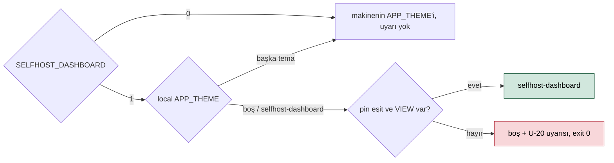

# Architecture opinion (tur 3, yalnız Faz 1): Spec 0002 bookstack-dashboard | Date: 2026-11-09 | Decision: CONDITIONAL APPROVE

- İncelenen: `/Users/goktugoktay/Desktop/Projects/selfhost-stack/docs/spec-0002-bookstack-dashboard.md` (revizyon 4, Status: Awaiting approval (Faz 1)).
- Bağlam: tur 2 görüşü `gorus-0002-bookstack-dashboard-2026-11-09-tur2.md` (K2-1..K2-8, A-12..A-17), `docs/reviews/t0b-measurements-0002.md`, `docs/architecture/tasarim/ADR-0007-bookstack-ozellestirme-yontemi.md` (diskteki metin hâlâ revizyon 2 düzeyinde; software-architect paralel olarak r3'e getiriyor).
- Kapsam: Faz 1 imzası. Faz 2a/2b yalnız istenen iki konu için (python 3.14 pini, üç faz bölünmesi) ve Faz 1'den taşan bulgular için ele alındı. Faz 2a'nın tam incelemesi kendi turunda yapılır.
- İnceleyen: architecture-board. Spec'i ve ADR'yi bu birim yazmadı.
- Kanıt sınırı: web ve Bash yok. Upstream bilgileri T-0a ve T-0b raporlarına dayanır. Kendi genel bilgimden gelen her iddia "doğrulanmadı" diye işaretli.

## Özet karar

| Kapsam | Karar |
|---|---|
| Spec 0002, Faz 1 | **CONDITIONAL APPROVE.** İmzadan önce: K2-2 (ADR-0007 r3), K3-1, K3-2, K3-3. T-5'ten önce: K3-4 |
| K2-1 `ACCESS_ALLOWLIST` | **Karşılandı.** Değişiklik disiplini ADR-0007 D2'ye yazılır (K2-2 içeriği, madde 3) |
| K2-3 T-0b sonuçları | **Karşılandı** |
| K2-2 ADR-0007 r3 (Faz 1 kısmı) | **Açık.** Metin beklenmiyor, gereken içerik aşağıda. Faz 1 imzası ADR'nin bu içerikle r3'e gelmesine bağlı |
| Tema kilidi (C-14, KR-8) | **CONDITIONAL APPROVE** (K3-1: §6.1'deki tanım CB-5 ve REQ-D5 ile çelişiyor) |
| Tema hash etiketinin kaldırılması (D-9) | **CONDITIONAL APPROVE** (K3-2: opcache ayarı bump'ta mekanik izlenir) |
| Python 3.14 pini (Faz 2a) | **APPROVE (minor seçimi)**. Image'ın kendisi K2-4'e bağlı kalır. Faz 2a için K3-5 |
| Üç faz bölünmesi (KR-10) | **APPROVE.** Faz 1'e sızan Faz 2a parçaları ayıklanır (K3-3) |

## Tur 2 koşullarının durumu

| Koşul | Spec r4'teki karşılığı | Durum |
|---|---|---|
| K2-1 (A-08, A-12) | §6.1 numaralı `ACCESS_ALLOWLIST` (A-1..A-5), repo'da `stacks/bookstack/theme/selfhost-dashboard/ACCESS_ALLOWLIST` (§7.1). "Listede olmayan hiçbir `$x->y` zinciri kullanılamaz". `$shelf->books` açıkça yasak. CB-7 (e) her zinciri listeye karşı tarar, her kural için negatif fixture. TD-4 ve TD-2'ye bağlandı | **Karşılandı** |
| K2-2 (A-16), Faz 1 kısmı | T-A7 Faz 1 imza ön koşulu olarak yazılı. Diskteki ADR metni hâlâ r2: Status "T-0a/T-0b bekliyor", kanıt sınırı "hiçbiri doğrulanmadı", D2 eski A-08 cümlesi ve `/dashcards`, D4 "exit 1" ve `com.selfhost.theme-hash` etiketi, D5 R-b kaydı yok, B-part "v1'de yok, T-0a gösterirse", AS-1 açık, G-4 "karar appsec'in" | **Açık** (paralel iş, aşağıdaki içerik listesi) |
| K2-3 | D-1b, D-3 (gürültülü init, CB-7 (a) log metnine bağlı değil), D-3b (`VIEW_ROOT`, iki sha256, yalnız arm64 notu, CB-8 arm64 + amd64), D-7 (`APP_URL` her zaman, C-2, CB-2 (f); `/dashcards` kaldırıldı, CB-7 (f)), D-9 (§6.1 yayılma), D-10 (0 sorgu, `id` sırası, §6.6, A-1), D-18 (dosya modları, `open_basedir` yok), D-19 (CB-7 (h)), D-15 ve D-22 kısmi | **Karşılandı** |
| K2-5 (Faz 2a) | C-12 "diğer her projede boş", CB-13 (d) Penpot negatif testi | Karşılandı (Faz 2a turunda yeniden görülür) |
| K2-6 (Faz 2a) | §7.2 alt küme + `tests/schema_check.py` (stdlib, pinli toplayıcı image'ında) | Karşılandı |
| K2-7 | §6.3 dind tablosu, pin yeri `tests/versions.env`, G-img dışı olduğu yazılı | Rationale karşılandı. Doğrulama zamanlaması yanlış faza bağlı → K3-4 |
| K2-4, K2-8 (Faz 2a) | T-0a2, T-A6 | Açık, Faz 2a ön koşulu olarak doğru yerde |
| Engellemeyen notlar | ham bayt diff (CB-8 (3)), distroless gerekçesi (§6.3 (c)), `no-new-privileges` (§6.5) | İşlendi |

## Decisions and assessment (tur 3)

| # | Decision | Rationale present? | Alternative | Risk | Outcome |
|---|---|---|---|---|---|
| B-6b | `ACCESS_ALLOWLIST` (A-1..A-5) + CB-7 (e) zincir taraması | Evet (§6.1, K2-1) | Serbest "ilişkiler" kuralı (tur 2'de reddedildi) | A-3'ün kesin listesi ve koleksiyon metodları T-4'e kaldı. Listeye ekleme disiplini yazılı değil (A3-4) | **APPROVE** (disiplin ADR D2'ye) |
| B-12 | Tema güvenlik kilidi (C-14, KR-8) | Evet (S2-03, TD-17, CB-30) | Kilit yok, yalnız CB-8 (PR anında); KR-6 süreci (elle `SELFHOST_DASHBOARD=0`) | §6.1'deki "tema etkin değil" tanımı fazla geniş: makinenin kendi temasını da boşaltıyor (A3-1) | **CONDITIONAL APPROVE** (K3-1) |
| B-13 | Tema hash etiketi ve yeniden başlatma yok, opcache yeniden doğrulaması (D-9) | Evet (T-0b ölçümü, karar alternatifiyle T-0b §4 madde 2'de) | Etiketi tutmak (her tema değişikliğinde yeniden yaratma) | Doğruluk pinli image'ın opcache ayarına bağlı. Bump'ta izlenmiyor (A3-2) | **CONDITIONAL APPROVE** (K3-2) |
| B-14 | Üç faz bölünmesi (KR-10) | Evet (KR-10, her faz ayrı güven sınırı) | İki faz (r3), tek teslim | Faz 1'de Faz 2a'ya ait kod ve anahtar var (A3-3) | **APPROVE** (K3-3) |
| B-3m | Toplayıcı minor'ı 3.14 (Faz 2a) | Evet (§6.3, PEP 745 / PEP 719) | 3.13 (yalnız güvenlik aşaması). 3.15 alternatif olarak yazılmamış (A3-5) | Image güvenlik kanıtı hâlâ yok (K2-4) | **APPROVE** (minor), image K2-4'e bağlı |
| B-11 | `docker:<tag>-dind` (yalnız test) | Evet (§6.3) | Linux VM, Linux CI runner, atlamak | Faz 1'de kullanılıyor (CB-9, T-5), doğrulaması Faz 2a'nın T-0a2'sinde (A3-6) | **CONDITIONAL APPROVE** (K3-4) |

## Karar gerekçeleri

### 1. `ACCESS_ALLOWLIST` (K2-1 karşılandı)

Tur 2'deki itiraz "bu modellerin ilişkileri" ifadesinin görünürlük süzmesi taşımayan ilişkilere kapı açmasıydı. Spec bunu numaralı bir listeye çevirdi, `$shelf->books`'u adıyla yasakladı ve taramayı CB-7 (e)'ye bağladı. Liste board'un önerdiğiyle aynı ve repo'da duruyor. Koşul karşılandı.

**A3-4 [Düşük, ADR D2'ye] Liste değişikliği disiplini ve tarayıcı semantiği.** İki şey açık kalıyor. Spec'i değiştirmeleri gerekmiyor, ADR-0007 D2'ye yazılmaları yeterli:
- CB-10'un "en fazla 5 kitap, `updated_at` azalan" kuralı bir sıralama ve kesme ister (ör. `->sortByDesc('updated_at')`, `->take(5)`). Bunlar listede yok, A-3 "kesin liste T-4'te" diyor. Board'un okuması: T-4 yalnız iki tür ekleme yapabilir: (i) A-3 öğelerinin gösterim alanları, (ii) zaten listedeki koleksiyonlar üzerinde, **yalnız sabit dize ya da sayı argümanlı**, bellekte çalışan koleksiyon metodları (`sortBy`, `sortByDesc`, `take`, `first`, `isEmpty`, `count`). İlişki yükleyebilen ya da sorgu çalıştırabilen her metod (`load`, `loadMissing`, `fresh`, `refresh`, `query`, ilişki metodu çağrısı `->books()`) ve callable argüman (closure, `fn`) yasak ekleme sayılır. `ACCESS_ALLOWLIST`'in her diff'i `theme/` altında olduğu için appsec stop-B ister.
- Tarayıcı `@foreach ($shelf->tags as $tag)` gibi döngü değişkenlerini kaynağına bağlamalı: izinli kök değişkenler `$shelf`, `$sortedVisibleShelfBooks` ve bunlardan `@foreach` ile türetilen takma adlardır. Başka bir kökte `->` görülürse tarama başarısız olur. T-5 (qa-engineer) bunu negatif fixture'la gösterir.

### 2. Tema güvenlik kilidi (C-14): onay, bir çelişki düzeltmesiyle

Kilit doğru bir derinlemesine savunma. CB-8 uyumu PR anında zorluyor, kilit aynı şartı çalışma anında, `local/` override'larını da içeren normalize config'e karşı zorluyor. Yeni teknoloji yok, geri alması ucuz (`stack`'te bir koşul), KR-8'in "override dosyalarını sil" yolunu da güvenli yapıyor: `VIEW` satırı kalmayınca tema kendiliğinden kapanıyor ve Faz 2a'da toplayıcı gereksiz yere çalışmıyor. Karşılaştırmanın tam dize olması 0001 G-img'in pin disipliniyle tutarlı.

**A3-1 [Orta, tutarlılık] §6.1'deki tanım makinenin kendi temasını da boşaltıyor.** §6.1: "Tema etkin" = `SELFHOST_DASHBOARD=1` **ve** `APP_THEME` boş ya da `selfhost-dashboard` **ve** pin eşit **ve** `VIEW` var. "Tema etkin değilse `stack` `APP_THEME`'i boş verir ... sebebi uyarı olarak basar". Harfiyen okunursa:
- `APP_THEME=baska` → tema "etkin değil" → `APP_THEME` boş verilir. Bu CB-5'le ("container'da `APP_THEME=baska`"), REQ-D5'le ("makinenin temasını gösterecek") ve ADR-0007 D4/KR-1 "makinenin teması kazanır" ile çelişiyor.
- `SELFHOST_DASHBOARD=0` → bilinçli kapatmada her `up`'ta uyarı basılır. PB-8 ve CB-5 bu uyarıyı beklemiyor.

§2.2 C-14'ün kendi metni dar ve doğru (yalnız pin uyuşmazlığı ve `VIEW` yokluğu). Düzeltme önerisi (K3-1): kilit yalnız dashboard temasının seçileceği durumda uygulanır. Aşağıdaki akış hedef davranışı gösteriyor.

### `./stack up bookstack` container'a hangi `APP_THEME`'i verir? (K3-1 sonrası)

Açıklama: kilit yalnız dashboard teması seçilecekken devreye girer. Makinenin kendi teması ya da bilinçli kapatma kilitten geçmez. Yeşil kutu dashboard'un açık olduğu, kırmızı kutu kilidin kapattığı durumdur; her ikisi de etiketiyle de ayrılır. Metin karşılığı:

| `SELFHOST_DASHBOARD` | `local` `APP_THEME` | Pin eşit ve `VIEW` var | Container `APP_THEME` | Uyarı |
|---|---|---|---|---|
| `0` | herhangi | – | makinenin değeri (boşsa boş) | yok |
| `1` | başka tema | – | başka tema | yok |
| `1` | boş / `selfhost-dashboard` | evet | `selfhost-dashboard` | yok |
| `1` | boş / `selfhost-dashboard` | hayır | boş | U-20, exit 0 |

Engellemeyen notlar: (a) KR-8 durumunda (`VIEW` yok) U-20 metni "doğrulanmadı" diyor, oysa sebep bilinçli bir güvenlik yaması kaldırması. Ayrı bir sebep metni (ör. "Dashboard bu BookStack sürümünde geçici olarak kaldırıldı") kullanıcıyı yanıltmaz. (b) `./stack config bookstack` aynı kararı göstermeli, yoksa `config` ile `up` arasında fark oluşur (0001'in `config` = `up`'ın göreceği config ilkesi).

### 3. Tema hash etiketinin kaldırılması: onay, bir koruma koşuluyla

T-0b ölçümü (D-9): `opcache.validate_timestamps=1`, `revalidate_freq=2`, düzenleme 2-4 s içinde görünür. Etiketi kaldırmanın kazancı gerçek: tema değişikliği container'ı yeniden yaratmaz, 0001 AC-1 kendiliğinden korunur, `stack`'te bir hash hesabı ve etiket mantığı eksilir. Board kaldırmayı onaylıyor.

**A3-2 [Orta, bakım] Doğruluk artık pinli image'ın PHP ayarına bağlı ve bu bağ bump'ta izlenmiyor.** Etiket varken doğruluk `stack`'in kendisindeydi. Kaldırılınca linuxserver image'ının opcache ayarına geçiyor. Bir bump bu ayarı değiştirirse (ör. performans için `validate_timestamps=0`, doğrulanmadı, olasılık bilinmiyor) git'le gelen bir partial düzeltmesi, bir güvenlik düzeltmesi dahil, container yeniden başlatılana kadar devreye girmez ve hiçbir test kırmızı olmaz. CB-9 bunu yakalardı ama full profilde ve §6.1 (c)'deki bump alt kümesinde yok. Koşul (K3-2), iki yoldan biri:
- (tercih) CB-8'e ya da CB-9'a quick profilde statik bir alt madde: pinli image'da (`--network none`) php-fpm'in etkin değerleri `opcache.validate_timestamps=1` ve `opcache.revalidate_freq` ≤ 2 (CB-9'un 10 s sınırının içinde). Değilse test başarısız. Böylece her bump bu ayarı mekanik olarak görür.
- ya da CB-9'u §6.1 (c)'deki bump güvenlik e2e alt kümesine eklemek (daha pahalı).

Hiçbiri kabul edilmezse board'un önerisi etiketi tutmaktır.

### 4. Üç faz bölünmesi (KR-10): onay

Bölünme güven sınırlarını izliyor: Faz 1 yalnız tema ve `stack` (sınır 1 ve 4), Faz 2a yeni container, secret ve stack'ler arası ağ (sınır 2, 3, 5, 6), Faz 2b host dosya sistemi mount'ları (TD-10). Her faz kendi başına geri alınabilir ve Faz 1, Faz 2a'nın revert'ini `--remove-orphans` ile önceden taşıyor. 2b üç kriterle küçük, ama yeni bir güven sınırı açtığı için ayrı imza haklı.

**A3-3 [Düşük, no criterion] Faz 1'de Faz 2a'ya ait parçalar var.**
- T-3 Faz 1'de `selfhost/data.blade.php` partial'ını yazıyor, CB-7 (f) Faz 1'de `'/dashfeed/snapshot.json'` literal'ine izin veriyor, A-5 snapshot anahtarlarını listeliyor. Faz 1'de snapshot da `/dashfeed` mount'u da yok. Hiçbir Faz 1 kriteri bu dosya okumasını istemiyor. Faz 1'de olması, dosya sistemi okuyan kodu ihtiyaç doğmadan sunucuya taşır ve U-1'i "kod yok" yerine bir çalışma anı kontrolüne bağlar. Öneri: `data` partial'ı, A-5 ve `/dashfeed` literal'i T-11'e (Faz 2a) taşınır. Faz 1'de CB-7 (f)'nin izinli kümesi `{'/books'}` olur, U-1 kodun yokluğuyla sağlanır.
- C-13 `TZ` Faz 1'de BookStack container'ına veriliyor. Faz 1'de hiçbir kriter zaman göstermiyor (CB-10 yalnız sıralıyor). `TZ`'nin BookStack'in kendi zaman gösterimini değiştirip değiştirmediği ölçülmedi (bu birimin genel bilgisi: Laravel PHP saat dilimini `APP_TIMEZONE` üzerinden kendisi ayarlar ve linuxserver `TZ`'yi sistem saatine uygular; doğrulanmadı). Öneri: C-13 Faz 2a'ya taşınır. Bu PB-7'nin Faz 1 geri dönüş sırasını da kısaltır. Faz 1'de tutulacaksa bir Faz 1 kriterine bağlanır ve BookStack'in kendi zaman gösteriminin değişmediği PB olarak ölçülür.

Koşul (K3-3): ikisi de ya Faz 2a'ya taşınır ya da bir Faz 1 kriterine bağlanır.

Engellemeyen öneri: C-3 (b) "her `up`" `--remove-orphans`'ı Penpot ve Plane projelerine de uyguluyor. Orphan senaryosu (toplayıcının revert'i) yalnız BookStack projesinde var ve CB-26 (e) yalnız onu ölçüyor. Etki alanını `up bookstack` ile sınırlamak 0001'in diğer stack'lerdeki davranışını değiştirmez. Bütün stack'lerde tutulacaksa PB'ye "orphan yokken Penpot/Plane `up` davranışı değişmez" eklenmeli.

### 5. Python 3.14 pini (Faz 2a): minor seçimi onaylı

§6.3'teki gerekçe board'un tur 2 önerisiyle aynı ve kaynaklı: 3.14 bugfix 2027-10'a, güvenlik ~2030-10'a (PEP 745). 3.13 2026-10-01'den beri yalnız güvenlik aşamasında (PEP 719). Toplayıcının kullandığı modüller (`urllib`, `json`, `socket`, `os`) için 3.14'e özgü bir risk iddiası yok ve T-0c ağ helper'ını 3.14 pin'iyle tekrarlıyor. Pin biçimi (`3.14.<patch>-alpine3.24@sha256`) patch ve digest'i sabitliyor, 0001 AC-13 bump'ı yönetiyor.

**A3-5 [Düşük, rationale eksiği, Faz 2a] 3.15 alternatif olarak yazılmamış.** PEP 790'a göre 3.15.0'ın 2026-10 başında çıkmış olması beklenir (bu birimin genel bilgisi, doğrulanmadı). En uzun destek penceresi onda. Board 3.14'ü tercih etmeye devam ediyor: yaklaşık bir yıllık bugfix sürümüyle olgun, 3.15 ise yeni çıkmış bir `.0`/`.1` serisi. Ama playbook tek seçenekli gerekçeyi eksik sayar. Koşul (K3-5, Faz 2a imzası için): §6.3 minor satırına 3.15 alternatifi ve red gerekçesi eklenir, T-0a2 3.15'in yayın durumunu ve `alpine3.24` varyantını kaydeder, yükseltme tetikleyicisi yazılır (ör. 3.15.2 ya da 3.14 bugfix desteğinin bitişi, hangisi önce). Image'ın kendisi K2-4'e bağlı kalır: T-0a2 tamamlanmazsa B-3 REJECT.

### 6. dind doğrulamasının fazı

**A3-6 [Düşük, sıra] dind Faz 1'de kullanılıyor ama doğrulaması Faz 2a'nın ön koşulunda.** CB-9 "mac'te ve dind'de", T-5 "+ dind". T-0a2'nin "dind lisansı" maddesi ise "İmza öncesi, Faz 2a" bölümünde. Koşul (K3-4): dind'in lisans ve bakım doğrulaması ve `tests/versions.env`'deki tag + digest pini T-5'ten önce yapılır (T-0a2'nin dind kısmı Faz 1 bölümüne alınır). İmzayı durdurmaz, çünkü stack'e girmeyen, yalnız test harness'ında çalışan bir image. dind, Faz 1 imzasında CEO'ya yeni test image'ı olarak gösterilir.

## Faz 2a'ya taşınan bulgu (Faz 1 imzasını etkilemez)

**A3-7 [Orta, Faz 2a tasarımı] Partial `TZ`'yi okuyamıyor.** CB-20 `title` mutlak zamanının `TZ=Europe/Istanbul` ile +03:00 göstermesini istiyor ve §4.5 zamanı "sunucuda" (tema PHP'sinde) hesaplatıyor. S2-02 kuralları `env()`'i yalnız `SELFHOST_PENPOT_URL` ve `SELFHOST_PLANE_URL` için açıyor, `config(` yasak. Laravel'in PHP varsayılan saat dilimini `APP_TIMEZONE`'dan ayarlaması durumunda container `TZ`'si PHP tarih fonksiyonlarına yansımaz (doğrulanmadı). Faz 2a imzasından önce üç yoldan biri seçilmeli: (a) toplayıcı yerel zaman dizesini de snapshot'a yazar (şema alanı), (b) `env('TZ')` S2-02 listesine eklenir (appsec kararı), (c) `APP_TIMEZONE` verilir (BookStack'in kendi gösterimini değiştirir, PB ister). Board'un tercihi (a): tema yeni yetki almaz.

## Found unnecessary (no criterion)

- **Faz 1'de:** `data.blade.php`, A-5 ve `/dashfeed` literal'i; C-13 `TZ` (A3-3, K3-3).
- Yeni teknoloji yok. Faz 1 yeni image, paket ya da servis eklemiyor. PHP taraması pinli BookStack image'ının kendi PHP'siyle yapılıyor.

## Decisions expensive to reverse → ADR needed: yes

| ADR | Durum | Board'un görüşü |
|---|---|---|
| ADR-0007 | Proposed, metin r2 | Karar doğru. Faz 1 imzasından önce aşağıdaki içerikle r3'e gelmeli (K2-2) |
| ADR-0006 | Proposed | Faz 2a'nın işi (K2-8, T-A6). Bu turda incelenmedi |

### ADR-0007 r3'ün içermesi gerekenler (K2-2, board metni beklemiyor)

1. **Status ve kaynak:** "T-0a/T-0b bekliyor" ve "hiçbiri doğrulanmadı" kaldırılır. Kaynak satırı spec r4'e, board tur 2 ve tur 3 görüşlerine, T-0a ve T-0b raporlarına bağlanır.
2. **Kanıt tablosu:** D-1, D-1b, D-3, D-3b, D-4, D-5, D-7, D-9, D-10, D-11, D-17, D-18, D-19 her biri hüküm ve kaynak bölümüyle. Sınırlar açık yazılır: sha256'lar yalnız `v26.09.2-ls295` arm64, D-9 yalnız Docker Desktop, gerçek Linux host yok. D-1b ile "Blade `@include` ebeveyn değişkenlerini geçirir" varsayımı kapanır.
3. **D1 + D2:** dosya kümesine `ACCESS_ALLOWLIST` eklenir. Eski A-08 cümlesi yerine A-1..A-5 ve "listede olmayan zincir yok" kuralı, `$shelf->books` yasağı. Dosya erişimi tek sabit yol `/dashfeed/snapshot.json` (Faz 2a), sınırlı okuma, `/dashcards` kaldırıldı. S2-02 PHP kurallarına atıf. Liste değişikliği disiplini ve tarayıcı semantiği (A3-4).
4. **D3:** `VIEW_ROOT=/app/www/resources/views`, ham bayt diff (normalleştirme yok), arm64 + amd64 kontrolü, `VIEW`'siz `UPSTREAM`'in geçerli olduğu (KR-8). G-4 kararı (S2-04): mekanik inceleme şartları (a)-(d) ve tam stop-B tetikleyicileri. Appsec tur 3 S2-04 metnini (spec §15.3) doğrularsa o metin yazılır, değiştirirse ADR appsec'i izler. Akış diyagramındaki "appsec stop-B" düğümü "mekanik inceleme ya da tam stop-B" olur, Consequences'taki "her bump appsec stop-B" maliyeti güncellenir.
5. **D4:** exit 2 (appsec I-1). `com.selfhost.theme-hash` etiketi ve yeniden yaratma kaldırılır, yerine opcache yayılması (D-9), README `restart` yedeği ve K3-2 koruması. Tema kilidi K3-1'deki dar tanımla ve yukarıdaki tabloyla.
6. **D5:** R-b sonucu kaydedilir: `THEME_REGISTER_VIEWS`, `renderBefore`/`renderAfter`, `ViewBlockManager::register` yalnız `functions.php` ile, T-0a kaynağıyla. R-a ve R-c satırları kapanır.
7. **Alternatifler:** B-part kesin red (bloklar `common.view-blocks` ile üretilir, onu override etmek her sayfayı etkiler). B' satırı R-b'ye göre güncellenir.
8. **AS-1:** KR-6 ile cevaplandı ve KR-8 ile değiştirildi: override dosyalarını silen PR yolu, CB-8 yeşil, kilit.
9. **Yeniden açma tetikleyicileri:** #1 (R-c) kapanır. Eklenir: KR-8 yolu kullanıldı (dashboard bir bump'ta merkezi olarak kaldırıldı) → yeniden port süresi ölçüm kaydına girer ve 2 kez olursa B' yeniden değerlendirilir. Pinli image'ın opcache ayarı değişti (K3-2 kırmızı) → etiket kararı yeniden açılır.
10. **Faz adları:** "Faz 2" atıfları 2a/2b'ye çevrilir (snapshot okuma Faz 2a).

Board ADR'yi kabul etmez, decider CEO. Bu içerikle gelirse board ADR-0007'nin "Accepted" olarak CEO'ya sunulmasını önerir. Yeni bir board turu gerekmez, ancak r3 metni bu listeden bir maddeyi değiştirirse (özellikle 3, 4, 5) board görmek ister.

## Conditions (kalan)

**Faz 1 imzasından önce:**
- **K2-2** ADR-0007 r3, yukarıdaki on maddeyle (software-architect, T-A7).
- **K3-1** (A3-1): §6.1 tema kilidi tanımı daraltılır: kilit yalnız `SELFHOST_DASHBOARD=1` ve `APP_THEME` boş ya da `selfhost-dashboard` iken uygulanır. Başka tema olduğu gibi geçer, `SELFHOST_DASHBOARD=0` uyarı basmaz. CB-30'a bir alt madde: `APP_THEME=baska` + pin uyuşmazlığı → container'da `APP_THEME=baska`, U-20 yok.
- **K3-2** (A3-2): opcache korumasının quick profilde statik kontrolü (tercih) ya da CB-9'un bump alt kümesine eklenmesi. İkisi de olmazsa etiket tutulur.
- **K3-3** (A3-3): `data` partial'ı, A-5, `/dashfeed` literal'i ve C-13 `TZ` Faz 2a'ya taşınır ya da her biri bir Faz 1 kriterine bağlanır.

**Faz 1 uygulamasında, T-5'ten önce:**
- **K3-4** (A3-6): dind lisans ve bakım doğrulaması + tag + digest pini. CEO'ya Faz 1 imzasında yeni test image'ı olarak gösterilir.

**Faz 2a imzasından önce (bu turda değişmeyenler + yeniler):** K2-4 (aynen, tamamlanmazsa B-3 REJECT), K2-8, **K3-5** (3.15 alternatif satırı), **A3-7** çözümü (partial'da `TZ`).

**Engellemeyen:** U-20'nin KR-8 durumu için ayrı sebep metni; `config` ile `up`'ın aynı kilit kararını göstermesi; `--remove-orphans`'ın `up bookstack` ile sınırlanması; tema dosyalarının dünya-okunur olmaması durumunda (Linux, `umask 077`, host uid ≠ `PUID`) `up`'ın bir uyarı basması (T-0b D-18; bugün yalnız CB-1'in kırmızısıyla görülür).

## STACK.md change

`/Users/goktugoktay/Desktop/Projects/selfhost-stack/docs/architecture/STACK.md` güncellendi:
- BookStack visual theme override: **trial** kalır. Gerekçeye `ACCESS_ALLOWLIST` (K2-1 karşılandı), tema kilidi (K3-1) ve etiketsiz opcache yayılması (K3-2) eklendi.
- CPython `python:3.14.<patch>-alpine3.24`: **assess** kalır. Minor 3.14 onaylı, 3.15 alternatif satırı istendi (K3-5).
- `docker:<tag>-dind`: **assess** kalır. Rationale var (spec §6.3), pin yeri `tests/versions.env`. Faz 1'de kullanıldığı ve doğrulamanın T-5'ten önce yapılacağı (K3-4) yazıldı.
- Docker cross-project `internal` ağ: K2-5'in spec'te karşılandığı notu.

## CEO'ya rota

Faz 1 imzasında CEO'ya gösterilecek yenilikler: BookStack tema sistemiyle sunucu tarafında çalışan kod (ADR-0007), tema güvenlik kilidi (KR-8'in uygulaması), **test için privileged `docker:<tag>-dind` image'ı** (Faz 1'de kullanılıyor). Board CEO'ya yeni bir soru eklemiyor. K3-1 kullanıcıya görünen davranışı spec'in kendi kriterlerine (CB-5, REQ-D5) geri hizalıyor, yeni davranış getirmiyor.

## Unanswered questions

1. (appsec, tur 3) S2-04 metninin son cümlesi (spec §15.3). ADR-0007 D3 bunu izler.
2. (devops-sre / Scout) Pinli BookStack image'ında `TZ`'nin PHP ve BookStack zaman gösterimine etkisi (A3-3, A3-7).
3. (Scout, T-0a2) 3.15'in yayın durumu ve `alpine3.24` varyantı (K3-5). D-20'nin tamamı (K2-4).

## Dış içerik notu

Spec r4, tur 2 görüşü, ADR-0007 taslağı, T-0b raporu okundu. Hiçbirinde bu birime yönelik bir talimat görülmedi. Spec'teki "board inceler" ve "üçüncü tur kapılar" ifadeleri inceleme isteği olarak okundu, onay talimatı olarak değil.
