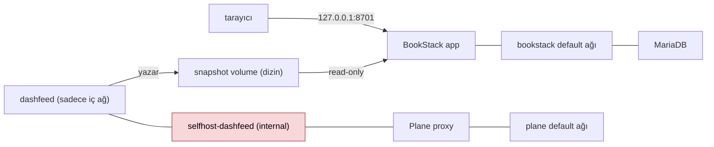

# Architecture opinion: Spec 0002 bookstack-dashboard | Date: 2026-11-09 | Decision: CONDITIONAL APPROVE

- İncelenen: `/Users/goktugoktay/Desktop/Projects/selfhost-stack/docs/spec-0002-bookstack-dashboard.md` (Status: Draft, revizyon 1, 0001'i genişletiyor)
- Bağlam: `docs/spec.md` (0001), `docs/architecture/gorus-0001-selfhost-stack-2026-11-09.md` (K-1..K-9), `docs/reviews/scout-upstream.md` (0001 T-0 Scout raporu, 2026-11-09).
- İnceleyen: architecture-board. Tasarımı bu birim yazmadı (yazar BA, ayrı architect tasarımı yok), bu yüzden yaz-onayla yasağı yok.
- Kanıt sınırı: bu birimin web erişimi yok. Aşağıda "doğrulanmadı" yazan her bilgi Haziran 2026'ya kadarki bilgiye dayanıyor. Spec'in D-1..D-16 listesinin tamamı da doğrulanmamış. Scout raporu 0002'nin D-maddelerini kapsamıyor.
- Yazma yeri notu: çağıran bu görüşü `docs/reviews/architecture-board-0002.md` yoluna istedi. Board'un yazma alanı yalnızca `docs/architecture/`, görüş bu yüzden bu dosyada (0001 görüşündeki uygulamayla aynı). Kopyalamak ya da bağlantı vermek çağırana kalır.

## Özet karar

Tasarımın ana fikri doğru ve yalın: ayrı bir dashboard uygulaması yok, BookStack'e yeni uç nokta ve DB değişikliği yok, tarayıcı JS'i yok. Plane token'ı tek bir sertleştirilmiş sidecar'da duruyor, sayfa açılışında ağ çağrısı yapılmıyor ve snapshot ile Plane'den ayrışıyor. Proje eşlemesi de makinenin kendi verisinde. Board S2 (sidecar), N2 (iç ağ köprüsü) ve P1 (raf etiketi) seçimlerini onaylıyor.

Onay iki gruba koşullu:
1. **Uygulanabilirlik boşlukları.** Bunlar düzeltilmezse kriterler ilk denemede kırmızı çıkar: snapshot volume'unun UID/izin sahipliği, dashfeed'in ağ listesi, tek dosya bind'ı ile atomik rename çakışması, 100 proje tavanının rate limit'i aşması.
2. **Bakım maliyeti.** Upstream BookStack view'larına bağımlılık bu spec'in uzun vadeli asıl maliyeti. CB-8 bu maliyeti ölçmüyor, sadece bir damga kontrol ediyor.

Koşullar K-1..K-10 aşağıda. Yeni bağımlılıklar (python image, Plane public API, BookStack theme sistemi) board onayından bağımsız olarak CEO'ya gösterilecek.

## Decisions and assessment

| # | Decision | Rationale present? | Alternative | Risk | Outcome |
|---|---|---|---|---|---|
| B-1 | Ana sayfa = BookStack visual theme override (`home/default`, `shelves/show`), read-only bind | Evet (§6.1, 4 seçenek) | A (BookStack sayfası), C (Custom HTML Head + JS), D (gethomepage/Homarr/Dashy) | Upstream view sapması (A-05), override yüzeyi tam dosya kopyası | CONDITIONAL APPROVE (K-6, K-7) |
| B-2 | Plane verisi: `dashfeed` sidecar (S2), JSON snapshot | Evet (§6.2, 4 seçenek) | S1, S3, S4. Eksik "add nothing" alternatifi: mevcut pinli image'ı (linuxserver/bookstack PHP'si) yeniden kullanmak | Volume izinleri (A-01), dosya bind'ı ile rename (A-03), rate limit (A-04) | CONDITIONAL APPROVE (K-1, K-3, K-4) |
| B-3 | Sidecar image: `python:<tag>-alpine`, sadece stdlib | Kısmen: need ve alternatif var, bakım/lisans/güvenlik/çıkış boyutları yok | linuxserver/bookstack image'ını yeniden kullanmak, `python:<x>-slim`, distroless python, busybox+jq | CPython ve Alpine paket CVE'leri (genel, OSV ile doğrulanmadı) | CONDITIONAL APPROVE (K-5, rationale boşlukları) |
| B-4 | İç ağ köprüsü `selfhost-dashfeed` (`internal`, `external`, `stack` oluşturur) | Evet (§6.3, 3 seçenek) | N1, N3. Board ek olarak değerlendirdi: dashfeed'i Plane'in `default` ağına bağlamak (reddedilmeli, Plane DB/Redis/RabbitMQ/MinIO'ya erişim açar), dashfeed'i Plane projesine koyup volume'u paylaşmak (eşit bağlılık, kazanç yok) | Dashfeed'in `default` ağa da düşmesi (A-02), aynı adlı ama `internal` olmayan ağ (A-02), servis adı DNS çakışması | CONDITIONAL APPROVE (K-2) |
| B-5 | 0001'in Plane overlay'ine (T-4 dosyası) proxy için ağ ekleme | Kısmen (§6.3 son paragraf) | Ayrı, koşullu bir Plane overlay dosyası (yalnız dashboard açıkken) | "0001 değiştirilmez" ifadesi ile 0001'in teslim ettiği dosyayı değiştirme arasında çelişki. Network external olduğu için Plane `up`'ı artık ağın varlığına bağlı | CONDITIONAL APPROVE (K-8) |
| B-6 | Proje eşlemesi: raf etiketi `plane-project` (P1) | Evet (§6.4, 4 seçenek) | P2 `?project=`, P3 git dosyası, P4 `local/` env | Düşük. Restore eski etiketi getirir (spec §15'te bilinçli). `$shelf->tags` erişimi bir Eloquent sorgusu olabilir, "kendi DB sorgusu yok" kuralıyla ilişkisi yazılmamış (A-08) | APPROVE (A-08 notuyla) |
| B-7 | Snapshot sözleşmesi şema 1 (§7.2) | Evet | Doğrudan API, DB tablosu | Tek üretici ve tek tüketici, ikisi de aynı commit'te. Sözleşme kodda değil, sadece spec'te | APPROVE, K-9 (sözleşme dosyası) |
| B-8 | Plane public API v1 + Personal Access Token (kapsamsız) | Kısmen (D-12/D-13 doğrulanmadı, uç nokta adı `issues` ↔ `work-items` değişmiş) | Plane MCP (bu oturumda görünüyor, host'ta çalışır, sidecar'a uygun değil), Plane DB'sini doğrudan okumak (reddedilmeli: şema sözleşme değil, DB ağına erişim gerekir) | API sözleşmesi Plane sürümleri arasında değişiyor. Token sahibinin rolünü taşıyor (→ AppSec) | CONDITIONAL APPROVE (CB-19 + K-6'nın Plane karşılığı) |
| B-9 | Spec klasörü mount'u ve imza tespiti (§6.5) | Evet | Hiç göstermemek, ayrı bir git hook | Şirket şablon biçimine bağlılık (spec'te varsayım olarak yazılmış) | APPROVE |
| B-10 | Dosya sahipliği ayrımı (§13) | Evet (birim düzeyinde) | `stacks/` tamamen devops-sre'de kalsın | Yükseltme PR'ı artık iki birime bağlı (A-09). Çalışma zamanı dosya sahipliği (UID) hiç tanımlı değil (A-01) | CONDITIONAL APPROVE (K-1, K-10) |

### Bileşenler hangi ağda, kim neye erişebiliyor? (K-2 sonrası önerilen topoloji)

Açıklama: iki compose projesi arasındaki tek bağ `selfhost-dashfeed` iç ağıdır (kırmızı, "internal" etiketli). Bu ağda yalnız dashfeed ve Plane proxy durur. dashfeed başka hiçbir ağa bağlı değildir, BookStack uygulaması da bu ağa bağlı değildir. Metin karşılığı:

| Bileşen | Bağlı olduğu ağlar | Yazabildiği yer |
|---|---|---|
| BookStack app | bookstack `default` | kendi `/config` volume'u (snapshot ve tema read-only) |
| MariaDB | bookstack `default` | kendi volume'u |
| dashfeed | yalnız `selfhost-dashfeed` | yalnız snapshot volume'u |
| Plane proxy | plane `default` + `selfhost-dashfeed` | değişmez |
| Plane DB/Redis/RabbitMQ/MinIO | plane `default` | değişmez, dashfeed'e kapalı |

## Bulgular (önem sırasıyla)

**A-01 [Yüksek, uygulanabilirlik] Snapshot volume'unun çalışma zamanı sahipliği tanımsız.**
Spec dashfeed'i "root olmayan kullanıcı" ve `read_only: true` ile çalıştırıyor. Ancak yeni bir named volume Docker tarafından `root:root` olarak oluşturulur. Image o yolda dizin taşımıyorsa root olmayan bir süreç oraya yazamaz. Böylece CB-11..CB-15'in tamamı ilk çalıştırmada kırmızı çıkar. Okuyan taraf da belirsiz: linuxserver image'ında php-fpm `PUID`/`PGID` kullanıcısıyla çalışır (0001'de varsayılan değer yazılmamış). Snapshot dosyasının modu ve dizinin modu tanımlı değil. Spec klasörü bind'ları Linux'ta host UID'si ile gelir, dashfeed'in UID'si bunları okuyabilmeli.
Öneri: dashfeed sabit bir UID/GID ile çalışır (ör. `user: "${DASHFEED_UID:-65534}:${DASHFEED_GID:-65534}"`; değer T-0b'de seçilir). Volume dizininin sahipliği tek bir yöntemle kurulur: ya `stack` ilk `up`'ta tek seferlik bir init adımıyla (`chown` yapan, aynı pinli image'dan, ağsız, kısa ömürlü bir servis) ya da image'da önceden var olan ve doğru sahipli bir yol kullanılarak. Snapshot `0644` yazılır, dizin `0755`. Yeni kriter: "temiz makinede ilk döngü `status: ok` (sahte Plane) ve BookStack süreci dosyayı okur". Linux'ta spec klasörü `0600` olan bir dosya içerirse dashfeed onu atlar ve bunu durum detayına yazar.

**A-02 [Yüksek, güvenlik → AppSec] dashfeed'in ağ listesi ve köprünün doğrulanması.**
(a) Compose bir servise `networks:` verilmezse onu projenin `default` ağına bağlar. `default` ağı `internal` değildir, yani dışarıya çıkışı vardır. dashfeed hem `default` hem `selfhost-dashfeed` ağına bağlı olursa TD-8'deki "sidecar başka hedefe çıkamaz" iddiası ve CB-11'deki `1.1.1.1:443` testi bozulur. dashfeed ayrıca MariaDB'ye ağ erişimi kazanır. Spec bunu açıkça yazmıyor.
(b) `stack` "yoksa oluşturur" diyor. Ancak aynı adlı ve `internal` olmayan bir ağ (elle oluşturulmuş, eski bir deneme) zaten varsa compose sessizce onu kullanır.
(c) Plane proxy'nin servis adı (`proxy`) genel bir ad. Docker'ın gömülü DNS'i bir container'ın bağlı olduğu tüm ağlarda ad çözer. Bu köprü gelecekte başka bir servisle paylaşılırsa ad çakışması riski doğar.
Öneri: dashfeed `networks: [selfhost-dashfeed]` dışında hiçbir ağa bağlanmaz (`default` açıkça yok). `stack`, ağ varsa `docker network inspect` ile `Internal=true` ve bir yönetim etiketi (ör. `com.selfhost.managed=dashfeed`) olup olmadığını doğrular. Değilse exit 2 verir ve mesaj basar; ağı silmez (AC-9). Plane proxy bu ağda sabit bir alias taşır (ör. `plane-proxy`), dashfeed bu alias'a gider. CB-11'e iki test eklenir: "`docker inspect dashfeed` tek ağ gösterir" ve "dashfeed'den `mariadb:3306` bağlantısı başarısız".

**A-03 [Yüksek, doğruluk] Atomik rename ile tek dosya bind'ı birbiriyle çalışmaz.**
§7.2 "geçici dosya + `rename`" diyor, yol `/dashfeed/snapshot.json`. BookStack tarafında volume bir **dizin** olarak bağlanırsa rename doğru çalışır. Tek bir **dosya** olarak bind edilirse (`.../snapshot.json:/dashfeed/snapshot.json:ro`) container eski inode'u görmeye devam eder ve veri hiç güncellenmez. Bu durumda CB-15 (e) yanlış "veri eski" verir. Spec mount biçimini yazmıyor.
Öneri: snapshot her iki tarafta da dizin olarak bağlanır. Geçici dosya aynı dizinde (aynı dosya sistemi) oluşturulur. Spec §7.1/§7.2'ye bir satır olarak yazılır, CB-7'deki `docker inspect` kontrolü mount'un `Type=volume` ve hedefin bir dizin olduğunu doğrular.

**A-04 [Orta-Yüksek, ölçek tavanı] 100 proje tavanı rate limit'i aşıyor.**
§6.2'deki formül 2 + (proje × 3) + sayfalama. §7.2 `projects[]`'i 100 ile sınırlıyor. 100 projede bir döngü en az 302 istektir. 120 s aralıkla bu yaklaşık 151 istek/dakika eder, D-12'deki 60/dk sınırının (doğrulanmadı) iki katından fazla. 429 davranışı "son veriyi korur" diyor, bu yüzden ~20 projenin üstünde dashboard hiç tazelenmeyebilir. Spec 10 projeyle hesaplamış ama tavanı 100 koymuş.
Öneri: toplayıcı bir istek bütçesiyle çalışır. `DASHBOARD_REFRESH_SECONDS` döngüde gereken istek sayısına göre alt sınırlanır (ör. istek sayısı ≤ 0,5 × sınır × aralık/60), ya da `states`/`labels` gibi nadir değişen veriler her N döngüde bir çekilir. Bu, spec'e ölçek tavanı olarak yazılır: "v1 en fazla X proje" ve bir kriter: "sahte Plane 60/dk sınırı uygular, 100 projelik fixture'da 429 alınmaz ya da `rate_limited` durumu gösterilir ve veri en geç K döngü içinde tamamlanır". X ve K'yı BA belirler.

**A-05 [Orta-Yüksek, bakım] Upstream BookStack view bağımlılığı, bu spec'in asıl uzun vadeli maliyeti.**
Visual theme override tam dosya kopyasıdır (D-1). Doküman sürümler arası kararlılık garantisi vermiyor (D-1, D-5, doğrulanmadı). BookStack sık sürüm çıkarıyor: Scout raporuna göre son sürüm v26.09.2 (2026-10-20), takvim tabanlı sürümleme. Sürüm sıklığını bu birim ölçmedi, ama 0001 tag+digest pin'iyle her bump bir PR'dır ve her PR artık bu override'ları da kapsar. "~15 dk" tahmini ölçüm değil.
Override yüzeyini küçültmenin bilinen bir yolu var (doğrulanmadı): BookStack'in logical theme sisteminde bir view'un önüne/arkasına başka bir view ekleyen bir kayıt fonksiyonu bulunduğunu hatırlıyorum (`Theme::` altında "render before/after" türünde). Bu varsa ana sayfa ve raf için tam dosya kopyası yerine sadece kendi partial'larımızı enjekte etmek mümkün olur. Böylece upstream dosyası hiç kopyalanmaz ve sapma riski büyük ölçüde düşer.
Öneri: T-0a'ya D-17 eklenir: "pinli BookStack sürümünde view enjeksiyonu (before/after) için logical theme API'si var mı, hangi sürümden beri?" Varsa B seçeneğinin uygulaması bu olur. Yoksa en az dosya kuralı geçerli kalır ve K-6 uygulanır. Hangisi seçilirse ADR-0007'ye yazılır.

**A-06 [Orta, ölçülebilirlik] CB-8 bir damgayı ölçüyor, uyumu ölçmüyor.**
CB-8 "`UPSTREAM`'deki sürüm pin'e eşit değilse test kırmızı" diyor. Bu, birinin `UPSTREAM` dosyasını güncellediğini kanıtlar, upstream view'un incelendiğini kanıtlamaz (REQ-D7 "gözden geçirildiği kanıtlanmadan" diyor). Ayrıca upstream dosyası değişmediğinde bile her bump'ta gereksiz bir elle adım doğurur. CB-19'daki `PLANE_COMPAT` için de aynı durum geçerli.
Öneri: `UPSTREAM`, override edilen her upstream dosyasının yolunu ve **sha256'sını** taşır. Test, pinli image'dan orijinal dosyayı okur (`docker run --rm --entrypoint cat <pinli image> /app/www/resources/views/...`, yol D-3'e bağlı) ve hash'i karşılaştırır. Hash değiştiyse test kırmızı olur, değişmediyse bump serbest kalır. Böylece kontrol gerçek değişikliğe bağlanır ve gürültü azalır. Plane tarafında karşılığı CB-19'un sahte Plane fixture'larının, pinli Plane'den bir kez kaydedilmiş gerçek yanıt şekline karşı doğrulanmasıdır (şema anahtar kümesi karşılaştırması).

**A-07 [Orta, doğrulanmamış upstream] Tema PHP'sinin snapshot'ı okuyabilmesi.**
Tema `/dashfeed/snapshot.json`'u PHP ile okuyacak. linuxserver image'ının php-fpm yapılandırmasında `open_basedir` kısıtı varsa (bu birim bilmiyor) `/app/www` dışındaki bir yolu okumak başarısız olur. D-listesinde bu yok.
Öneri: D-18 olarak T-0b'ye eklenir: "pinli linuxserver/bookstack içinde `php -i | grep open_basedir` (fpm havuzu için de) ve snapshot mount yolu okunabiliyor mu". Kısıt varsa mount yolu izinli bir yerin altına (ör. `/config/...`) taşınır.

**A-08 [Düşük, tutarlılık] "Kendi DB sorgusu yazmaz" kuralı ile `$shelf->tags`.**
`$shelf->tags` Eloquent ilişkisi controller'da eager-load edilmediyse view'da ek bir sorgu tetikler. Upstream raf view'u etiketleri zaten gösteriyorsa (D-10, doğrulanmadı) bu ek sorgu değildir. CB-7'nin statik araması (`DB::`, `->query(`) bunu yakalamaz, yakalamasına gerek de yok.
Öneri: kural "upstream view'un kullandığı değişken ve ilişkiler dışında veri erişimi yok" diye yazılır. T-4'te upstream view'un `tags` ilişkisini kullandığı doğrulanır. Ek olarak etiket değeri karşılaştırmadan önce büyük harfe çevrilir (`web` → `WEB`). Bu bir UX kararı, BA'ya bırakıldı, mimari etkisi yok.

**A-09 [Orta, süreç] Yükseltme PR'ı artık iki birime ve iki dile bağlı.**
0001 §6.3'te BookStack/Plane bump PR'ı devops-sre işidir. 0002'den sonra her BookStack bump'ı Blade override incelemesi (polyglot-engineer), her Plane bump'ı da `feed.py` uyumu (polyglot-engineer) gerektirir. §13 dosya sahipliğini teslim için ayırıyor, ama **bakım** sahipliğini yazmıyor.
Öneri: 0001 §6.3'ün yükseltme prosedürüne (README/RUNBOOK) bir satır eklenir: "bump PR'ında K-6 testi kırmızıysa override/compat incelemesi polyglot-engineer'e gider, PR o yeşil olana kadar merge edilmez". Bu iş delivery-manager'ın planına da girer.

**A-10 [Düşük, kalite niteliği] CB-15 (g)'nin ölçüm ortamı yok.**
"Medyan en fazla 50 ms fazla" ölçülebilir, ama hangi makinede, hangi runtime'da, soğuk mu sıcak mı yazılmamış. Ayrıca 1 MB'a kadar JSON'un her istekte ayrıştırılmasının maliyeti ölçülmüyor.
Öneri: CB-15 (g) kanıtına makine, runtime ve sürüm yazılır (0001 A-14 ile aynı kural). Ek bir ölçüm (kriter değil): 1 MB snapshot ile `/` `time_total` medyanı, boş snapshot'a göre. Bu, gelecekte bir cache katmanı isteğine karşı kanıt olur. Şimdi cache eklenmez.

**A-11 [Düşük] Birim testleri host Python'unda koşuyor.**
§11 "`unittest` container dışında" diyor. Host'taki `python3` (macOS'ta Xcode CLT ya da Homebrew, Linux'ta dağıtımın sürümü) pinli image'daki sürümden farklıdır. Bu, 0001 A-07'deki gizli host bağımlılığını büyütür.
Öneri: birim testleri pinli `DASHFEED_PYTHON_IMAGE` içinde, ağsız (`--network none`) ve read-only mount ile koşar. Host'ta `python3` ön koşul olmaz.

## Found unnecessary (no criterion)

- **Yok.** Her yeni parça bir kritere bağlı: sidecar (REQ-D11/D12, CB-11/CB-15), iç ağ (AC-4 korunarak Plane erişimi, CB-11/PB-2), `DASHBOARD_CEO_LABEL` (CB-12), `DASHBOARD_REFRESH_SECONDS` (CB-18), şema sürümü (CB-15 f), spec modu (CB-18).
- Board ayrıca **eklenmemesi doğru** olanları kaydeder: ayrı dashboard uygulaması (D), Docker socket, cache katmanı, kuyruk, Penpot için ikinci köprü, tarayıcı JS'i, `pip` bağımlılığı. Bunlar için kriter yok.

## Decisions expensive to reverse → ADR needed: yes

ADR'leri bu board yazıp onaylamaz (yaz-onayla yasağı). Yazar: software-architect (yoksa BA). Board inceler.

| ADR | Konu | Neden pahalı |
|---|---|---|
| ADR-0006 | Stack'ler arası tek köprü: `selfhost-dashfeed` ağı. Adı, `internal` şartı, yönetim etiketi, kimin oluşturduğu, hiç silinmediği, hangi servislerin bağlanabildiği. 0001 ADR-0001'deki "her stack izole" ilkesine tek istisna olarak yazılır | Ağ adı her makinede yaşar ve AC-9 gereği silinmez. Ad ya da model sonradan değişirse makinelerde artık ağlar kalır. Her yeni köprü talebi (Penpot sağlığı, §14) bu ADR'ye karşı değerlendirilir |
| ADR-0007 | BookStack özelleştirme yöntemi ve yükseltme politikası: visual override mı, logical theme view enjeksiyonu mu (A-05), izinli dosya listesi, hash tabanlı uyum kontrolü (K-6), bakım sahipliği (A-09) | Orta maliyet. Yöntem bir kez seçilince her BookStack bump'ının maliyetini belirler. S-1 cevabı (tema merkezi araç mı) bu ADR'ye kayıt olarak girer |
| (gerekmez) | Snapshot şema 1 | Üretici ve tüketici aynı commit'te, şema sürümü var, veri türetilmiş ve yedek dışı. Değişimi ucuz. K-9 yeterli |
| (gerekmez) | Raf etiketi eşlemesi | Veri kullanıcının BookStack'inde, etiket adı tek bir sabit. Değişimi bir göç script'i değil, README notu gerektirir |

## Conditions

İmzadan önce spec'e işlenmeli (S-3 kabul edilirse K-1..K-5 ve K-8 Faz 2 imzasından önce, K-6, K-7, K-9 ve K-10 Faz 1 imzasından önce):

- **K-1** (A-01): dashfeed'in UID/GID'si, snapshot volume'unun sahiplik kurulumu, dosya ve dizin modları ve BookStack sürecinin okuma kimliği spec'e yazılır. Temiz makinede ilk döngü kriteri eklenir.
- **K-2** (A-02): dashfeed yalnız `selfhost-dashfeed` ağına bağlanır. `stack` mevcut ağın `Internal=true` ve yönetim etiketi taşıdığını doğrular, yoksa exit 2 (silmeden). Plane proxy'nin bu ağda sabit bir alias'ı olur. CB-11'e "tek ağ" ve "MariaDB'ye erişim yok" testleri girer.
- **K-3** (A-03): snapshot her iki tarafta dizin mount'udur. Tek dosya bind'ı yasaktır, CB-7 bunu doğrular.
- **K-4** (A-04): istek bütçesi ve proje tavanı spec'e yazılır. Sahte Plane rate limit uygular ve tavandaki fixture ile bir kriter eklenir.
- **K-5** (B-3): rationale tablosu python image için tamamlanır (aşağıdaki boşluk listesi). Pin 0001 K-3'e göre tam patch tag + digest olur (ör. `python:3.X.Y-alpine3.Z@sha256:...`). Seçilen CPython minor'ının EOL tarihi `versions.env` yorumuna yazılır.
- **K-6** (A-05, A-06): `UPSTREAM` dosyası override edilen her upstream dosyasının sha256'sını taşır. CB-8 pinli image'daki orijinalle hash karşılaştırmasına çevrilir. D-17 (view enjeksiyonu API'si) T-0a'ya eklenir ve sonucu ADR-0007'ye yazılır.
- **K-7** (A-07): D-18 (`open_basedir` ve snapshot yolunun PHP'den okunabilmesi) T-0b'ye eklenir.
- **K-8** (B-5): spec'teki "0001 değiştirilmez" ifadesi düzeltilir: 0001'in **metni** değişmez, ama 0001 T-4'ün **teslim ettiği dosya** değişir. Bu değişiklik ADR-0006'ya bağlanır. `stack up plane`, `ENABLED_STACKS` ve `SELFHOST_DASHBOARD` değerinden bağımsız olarak ağın var olmasını garanti eder (aksi halde external ağ yokken Plane hiç kalkmaz). Bu durum için bir kriter eklenir: "`ENABLED_STACKS=plane` iken temiz makinede `./stack up plane` geçer". 0001 görüşündeki K-6 kontrolü (overlay servis kümesi ⊆ upstream) bu değişiklikten sonra da yeşil kalır, PB-6 Plane health'i ağ eklendikten sonra tekrarlar. Board'un tercihi bu yol: koşullu ayrı overlay dosyası önermiyoruz, çünkü dashboard'u açıp kapatmak Plane proxy'sini yeniden yaratmayı gerektirir ve 0001'in `-f` modeline dördüncü bir katman ekler.
- **K-9** (B-7): §7.2'deki snapshot sözleşmesi repo'da makinenin okuyabileceği bir dosya olarak da durur (ör. `stacks/bookstack/dashfeed/snapshot.schema.json`). Hem `feed.py` birim testi hem tema testi bu dosyaya karşı doğrular. Sahibi polyglot-engineer, testi qa-engineer yazar.
- **K-10** (A-09, A-11): bakım sahipliği (bump PR'ında override/compat incelemesi) 0001 yükseltme prosedürüne eklenir. Birim testleri pinli image içinde ve ağsız koşar.

## Rationale boşluk listesi (BA'ya, birinci tur)

| Bağımlılık | Mevcut | Eksik boyutlar |
|---|---|---|
| `python:<tag>-alpine` (Docker Official Image) | need (S2), "ek paket yok" | Alternatifler: (a) yeni image eklememek, sidecar'ı zaten pinli `lscr.io/linuxserver/bookstack` image'ının PHP'siyle çalıştırmak. Board'un değerlendirmesi: bu image s6-overlay ile root olarak başlıyor, `read_only` ve root olmayan kullanıcıyla çalıştırması zor, sidecar'ı BookStack bump'larına bağlıyor; reddedilebilir ama spec'te yazılmalı. (b) `python:<x>-slim` (Debian, daha büyük, glibc). (c) distroless python (shell yok, saldırı yüzeyi daha küçük, sürüm etiketleri daha kaba). (d) busybox `wget` + `sh` + jq: JSON ayrıştırma ve escape kurallarını kırılgan kılar, reddedilir. Bakım: CPython minor EOL takvimi, image'ın yeniden build sıklığı (doğrulanmadı). Lisans: CPython PSF-2.0, Alpine paketleri karışık (musl MIT, busybox GPL-2.0). Dağıtım yapılmadığı için board ek risk görmüyor (hukuki görüş değildir). Güvenlik geçmişi: CPython `urllib`/`http.client`/`email` CVE'leri ve Alpine paket CVE'leri OSV/GHSA'dan Scout ile çıkarılmalı (doğrulanmadı). Çıkış maliyeti: düşük (yaklaşık 200 satır, sözleşme JSON dosyası) |
| Plane public API v1 (`/api/v1/`, `X-API-Key`) | D-12, D-13 | Sürüm uyumluluk politikası (deprecation, `issues` → `work-items` geçişi hangi sürümde), rate limit'in self-hosted'da yapılandırılabilir olup olmadığı, token kapsamı (D-12). Çıkış maliyeti: düşük-orta (sadece `feed.py`) |
| BookStack visual/logical theme system | D-1, D-2, D-5 | Sürümler arası kararlılık beyanı, view enjeksiyonu API'si (D-17), `open_basedir` (D-18). Çıkış maliyeti: düşük (`SELFHOST_DASHBOARD=0`, veri yok) |
| Docker `internal` + `external` ağ (cross-project) | D-15 | Bakım/lisans boyutu yok (Docker'ın parçası). Eksik: Docker Desktop, OrbStack, Colima ve Linux Engine'de aynı davranışın ölçümü (T-0b, 0001 A-14 runtime matrisiyle birlikte) |

İkinci turda boşluk kalırsa board B-3 için REJECT verir (playbook kuralı).

## STACK.md change

`/Users/goktugoktay/Desktop/Projects/selfhost-stack/docs/architecture/STACK.md` güncellendi. Eklenenler (hepsi kayıt dışı olduğu için "assess"):
- CPython stdlib, `python:<tag>-alpine` (dashfeed sidecar), ADR yok (K-5).
- Plane public API v1 (salt okuma, dashfeed), ADR yok.
- BookStack theme system (visual override / logical theme), ADR-0007 (gerekli).
- Docker cross-project `internal` ağ `selfhost-dashfeed`, ADR-0006 (gerekli).

## CEO'ya rota

Board'un koşullu onayından bağımsız olarak şu yenilikler CEO'ya gösterilmeli: yeni container image `python:<tag>-alpine` (PSF-2.0), Plane public API ve kapsamsız Plane token'ı (yeni secret, AppSec'in TD-5/TD-6 görüşüyle birlikte), BookStack'in tema sistemiyle sunucu tarafında çalışan kod (TD-2), stack'ler arası ilk ağ köprüsü (ADR-0006). Board CEO'ya yeni bir davranış sorusu eklemiyor. Spec'teki S-1, S-2, S-3 yeterli. Board S-3'te (iki imza) spec'in önerisini destekliyor: Faz 1 yeni image, secret ve köprü getirmiyor, mimari riski düşük.

## Unanswered questions

1. (Scout, T-0a, D-17) Pinli BookStack sürümünde logical theme ile bir view'un önüne/arkasına view eklemek mümkün mü, hangi sürümden beri? Cevap ADR-0007'yi ve T-3/T-4 süresini değiştirir.
2. (Scout, T-0a) Plane public API'nin self-hosted rate limit'i yapılandırılabilir mi, ve `work-items` uç noktası pinli v1.4.3'te hangi adla duruyor?
3. (devops-sre, T-0b, D-18 ve A-01) linuxserver/bookstack'te `open_basedir` ve php-fpm UID'si; Plane proxy'nin upstream compose'da açık bir `networks:` listesi taşıyıp taşımadığı (B-5 merge davranışı buna bağlı).
4. (AppSec) Spec klasörü mount'unun başka repolar için `local/` override ile genişletilmesi (TD-10) ve kapsamsız token (TD-6). Board'un görüşü: mimari olarak kabul, son söz AppSec'te.

## Dış içerik notu

Spec, 0001 spec'i, 0001 görüşü, Scout raporu ve talent-capacity raporu okundu. Hiçbirinde bu birime yönelik bir talimat tespit edilmedi. Spec §16'daki "architecture-board: ..." listesi çağıranın kapsam isteğiyle aynı ve bir inceleme kapsamı olarak kullanıldı, talimat olarak değil.
