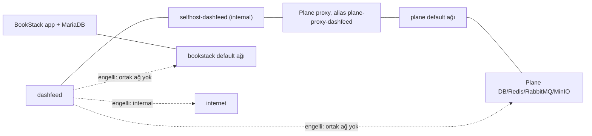

# ADR 0006 — Stack'ler arası tek iç köprü: `selfhost-dashfeed` ağı

- Status: Proposed (Architecture board incelemesi bekliyor. T-0c sonucu bekliyor: D-15, D-16. ADR-0001 henüz yazılmadı)
- Date: 2026-11-09
- Decider: CEO (Architecture board inceler, appsec TD-8/TD-9 için görüş verir)
- Prepared by: software-architect. Bu birim kendi ADR'sini onaylamaz.
- Kaynak: `docs/spec-0002-bookstack-dashboard.md` (revizyon 2) §2.2 C-5/C-6, §5 D-15/D-16, §6.4, §6.8, §8 TD-8/TD-9, CB-13, CB-27, PB-2, PB-5, PB-6, §13 T-A6. `docs/architecture/gorus-0002-bookstack-dashboard-2026-11-09.md` B-4, B-5, A-02, K-2, K-8. `docs/spec.md` (0001) §6.2 madde 5, REQ-7a, AC-4, AC-6, AC-10, AC-22.
- Görev: spec 0002 T-A6. Faz 2 imzasının ön koşulu.
- Yer notu: spec 0001 §12 ADR'ler için `docs/adr/` yolunu adlandırıyor. Bu birimin yazma alanı yalnız `docs/architecture/tasarim/`. Taşıma çağırana kalır.

> **Kanıt sınırı.** Bu birimin ağ erişimi yok ve hiçbir komut çalıştırmadı. Aşağıdaki Docker/Compose davranışları ve Plane proxy bilgileri **doğrulanmadı**. Docker ve Compose'un genel davranışı olarak yazılanlar da (servise `networks:` verilmezse `default` ağa bağlanması, `external: true` ağın compose tarafından oluşturulmaması ve silinmemesi, gömülü DNS'in alias'ları ağ bazında çözmesi) bu oturumda ölçülmedi. Hepsini CB-13, CB-27 ve T-0c ölçer.

## Context

**İzolasyon ilkesi (0001).** Her stack ayrı bir compose projesidir (`-p selfhost-<s>`, `--project-directory stacks/<s>`, 0001 §6.2 madde 5). Her proje kendi `default` ağında yaşar. Stack'ler arasında ağ bağı yoktur. Host'a yalnız giriş servisleri `127.0.0.1`'de açılır (0001 AC-4). Host ağı, ayrıcalıklı mod ve Docker soketi yasaktır (REQ-7a, AC-6 c). Bu ilke board'un 0001 görüşünde ADR-0001'e bağlandı, ama ADR-0001 **henüz yazılmadı**. Bu ADR ilkeyi spec 0001'deki hâliyle referans alır. ADR-0001 yazıldığında bu istisnayı adıyla anmalıdır.

**İhtiyaç (0002 Faz 2).** `dashfeed` toplayıcısı BookStack projesinde çalışır (spec §6.2 S2) ve Plane public API'sini yalnız `GET` ile okur. Kısıtlar:

| # | Kısıt | Kaynak |
|---|---|---|
| N-K1 | Yeni host portu ya da host dinleyicisi yok | 0001 AC-4, PB-2 |
| N-K2 | Token yalnız `dashfeed`'de. BookStack uygulaması ve MariaDB Plane'e ağ yolu bilmez | REQ-D11, TD-3 |
| N-K3 | `dashfeed` başka hiçbir hedefe çıkamaz (internet, MariaDB, Plane iç servisleri) | TD-8, TD-9, CB-13 |
| N-K4 | macOS Docker runtime'ları ve Linux Engine'de aynı davranış | spec §11 Ortam, CB-13 (mac + dind) |
| N-K5 | `stack` hiçbir volume ya da ağı silmez | 0001 AC-10, PB-5 |
| N-K6 | Plane, dashboard kapalıyken ve BookStack etkin değilken de kalkar | board K-8, CB-27 |

**Bu kararın dayandığı bilgiler (hepsi doğrulanmadı):**

| # | Bilgi | Bu ADR'de neye bağlı | Doğrulayan |
|---|---|---|---|
| D-15 | Docker Desktop'ta `host.docker.internal` host loopback'ine ulaşır. Linux Engine'de `host-gateway` bridge IP'sidir ve `127.0.0.1`'e yayınlanmış porta ulaşamaz. `internal: true` dışarı çıkışı keser | N1'in reddi, N-K3'ün sağlanması | T-0c (mac runtime + pinli dind) |
| D-16 | Plane proxy `Host` header'ına göre yönlendirme ya da `ALLOWED_HOSTS` kontrolü yapabilir. Upstream compose proxy için açık `networks:` listesi taşıyor mu | `Host` header kuralı, C-5 overlay birleşmesi | T-0c |
| D-16b (bu ADR ekliyor) | Plane proxy container'ının içeride dinlediği port (spec `:80` varsayıyor) | `PLANE_INTERNAL_URL=http://plane-proxy-dashfeed:80` | T-0c |
| D-22 (bu ADR ekliyor) | Pinli Docker Engine sürümünde aynı adla iki ağ oluşturulabiliyor mu (ad benzersizliği) | ağ garantisi adımı 2 | T-0c (mac + dind) |

## Decision

**Stack izolasyonuna tek bir istisna açılır: `selfhost-dashfeed` adlı, `internal: true` bir Docker bridge ağı. Ağı yalnız `stack` oluşturur ve doğrular, hiç silmez. Ağa yalnız iki servis bağlanır: BookStack projesindeki `dashfeed` (başka hiçbir ağa bağlı değil) ve Plane projesindeki proxy (sabit alias `plane-proxy-dashfeed`, kendi `default` ağı korunarak).**

### Ağa kim bağlı, kim neye ulaşamaz?

Açıklama: düz çizgi ağ üyeliği, kesikli çizgi "engelli" etiketli yoldur. `dashfeed`'in ulaşabildiği tek hedef Plane proxy'sidir. Metin karşılığı:

| Bileşen | Bağlı olduğu ağlar | `selfhost-dashfeed` üzerinden ulaşabildiği |
|---|---|---|
| `dashfeed` | yalnız `selfhost-dashfeed` | Plane proxy (alias), başka hiçbir şey |
| Plane proxy | plane `default` + `selfhost-dashfeed` | `dashfeed` (dinleyen soketi yok, ulaşılacak bir şey yok) |
| BookStack app, MariaDB | bookstack `default` | ağda değiller |
| Plane DB/Redis/RabbitMQ/MinIO ve diğer Plane servisleri | plane `default` | ağda değiller |

### Kurallar

| # | Kural | Zorlayan |
|---|---|---|
| R-1 | **Ad** sabit: `selfhost-dashfeed`. Ayarlanamaz, makineye göre değişmez. `selfhost-` öneki 0001'in proje adı düzeniyle aynı | CB-13 |
| R-2 | **Özellikler:** `driver: bridge`, `internal: true`, etiket `com.selfhost.managed=dashfeed` | CB-13 |
| R-3 | **Oluşturan yalnız `stack`.** İki compose dosyası da ağı `external: true` olarak tanımlar. Compose ağı oluşturmaz, `down` onu kaldırmaz (genel davranış, doğrulanmadı) | C-6, CB-27 |
| R-4 | **Garanti adımı** `./stack up bookstack` ve `./stack up plane` içinde, compose çağrısından önce çalışır. `ENABLED_STACKS` ve `SELFHOST_DASHBOARD` değerinden bağımsızdır (N-K6, K-8) | CB-27 |
| R-5 | **Doğrulama:** ağ varsa `Internal=true`, `Driver=bridge` ve yönetim etiketi kontrol edilir. Biri eksikse exit 2 ve "ağ beklenen ayarlarda değil: `docker network inspect selfhost-dashfeed`" mesajı. `stack` ağı düzeltmez, yeniden yaratmaz | CB-13 |
| R-6 | **Hiç silinmez.** `stack` içinde `network rm` ya da `prune` yok. Revert'ten sonra ağ yerinde ve zararsız kalır. Silmek, CEO onayı isteyen kalıcı bir işlemdir ve elle yapılır | PB-5, 0001 AC-10 |
| R-7 | **Üye listesi kapalıdır:** `bookstack/dashfeed` ve `plane/proxy`. `dashfeed`'in `networks:` listesi yalnız bu ağdır (`default` yok). Proxy'nin listesi `default` + bu ağdır (`default` açıkça yazılır) | CB-13, C-5 |
| R-8 | **Adresleme:** `dashfeed` proxy'ye servis adıyla değil, yalnız bu ağdaki alias'la gider: `http://plane-proxy-dashfeed:80` (`feed.py` içinde sabit, port D-16b'ye bağlı). İstekteki `Host` header'ı `SELFHOST_PLANE_URL`'in host:port kısmıdır ve hostname regex'iyle doğrulanır (spec §6.4) | CB-14 |
| R-9 | **Trafik:** yalnız `dashfeed` → proxy, yalnız HTTP `GET`. `dashfeed` hiçbir portta dinlemez | CB-13, CB-14 |

**Garanti adımı (R-4, R-5) sıralı olarak:**
1. Ağı adla ara.
2. Aynı adla birden fazla ağ görünürse exit 2 (D-22, ad benzersizliği doğrulanmadığı için savunma).
3. Yoksa `--driver bridge --internal --label com.selfhost.managed=dashfeed` ile oluştur, sonra 4'ü uygula.
4. `Internal`, `Driver`, etiket kontrolü. Uymuyorsa exit 2, ağa dokunmadan çık.

### 0001'in teslim ettiği dosyalardaki etkisi (K-8)

- 0001'in **metni** değişmez. 0001 T-4'ün teslim ettiği Plane overlay dosyası değişir: proxy servisine bu ağ ve alias eklenir, `default` açıkça korunur (spec C-5). Upstream compose'un proxy için açık bir `networks:` listesi taşıyıp taşımadığı (D-16) birleşme sonucunu etkiler. T-9, `docker compose config` çıktısında proxy'nin tam olarak iki ağda olduğunu gösterir.
- 0001 görüşündeki overlay kontrolü (overlay servis kümesi ⊆ upstream, 0001 AC-9) yeşil kalır: yeni servis eklenmiyor, var olan servise ağ ekleniyor.
- Faz 2'nin ilk `up`'ı Plane proxy'sini bir kez yeniden yaratır (kısa kesinti). PB-6 Plane health'i bundan sonra tekrarlar.

### Gelecekteki köprü talepleri (spec §14: Penpot sağlığı vb.)

- Yeni bir stack'ler arası ihtiyaç **bu ağa üye eklenerek karşılanmaz**. Bu ağa üyelik, Plane proxy'sine ağ erişimi demektir.
- Varsayılan cevap "köprü yok"dur. Önce köprüsüz yol aranır (ör. veri `stack` tarafından host'ta üretilip read-only bağlanır).
- Köprü gerçekten gerekiyorsa ayrı bir ağ açılır (`selfhost-<amaç>`), R-1..R-9'un aynısıyla (internal, etiket, `stack` oluşturur, hiç silinmez, kapalı üye listesi, alias), bu ADR'ye ek ya da yeni ADR ile, appsec incelemesiyle.
- Bir servis birden fazla köprü ağına yalnız hiçbir portta dinlemiyorsa bağlanabilir. Aksi halde iki stack arasında dolaylı yol açar.

## Consequences

**Kazançlar**
- Yeni host portu ve host dinleyicisi yok (N-K1). Plane proxy'nin host port yayını değişmez (PB-2).
- `dashfeed`'in çıkışı yok, MariaDB'ye ve Plane'in iç servislerine ortak ağı yok (N-K3). Board'un A-02'de işaret ettiği "`default` ağa da düşme" riski R-7 ile kapanır.
- Davranış host loopback'e değil Docker bridge'ine dayanır. Bu yüzden Docker Desktop ve Linux Engine arasında aynı olması beklenir (doğrulanmadı, CB-13 mac + dind ölçer).
- Plane proxy'nin servis adı (`proxy`) genel bir addır. Ayrı alias kullanmak, ileride bu ağda bir ad çakışması olursa yanlış hedefe gitme riskini düşürür (A-02 c).

**Maliyetler ve riskler**
- Ağ, compose yaşam döngüsünün dışında, makine genelinde bir Docker nesnesidir ve kalıcıdır. Adı fiilen kalıcı bir sözleşmedir. Ad ya da model değişirse her makinede artık bir ağ kalır.
- Plane'in `up`'ı artık `stack`'in garanti adımına bağlıdır. `stacks/plane` altında `stack`'siz, doğrudan `docker compose up` çalıştırmak external ağ yok diye başarısız olur. `stack` zaten tek desteklenen giriş noktası (0001), ama bu durum README'de yazılmalı.
- Proxy artık iki ağa bağlı. Proxy ele geçirilirse bu ağda ulaşabileceği tek şey `dashfeed`'dir ve `dashfeed`'in dinleyen soketi yoktur. Ek yüzey küçük, ama sıfır değil (→ appsec).
- Token (`X-API-Key`) bu ağda **şifresiz HTTP** ile gider. Ağ tek host içinde ve `internal`. Bu ağı dinleyebilecek biri zaten Docker erişimine sahiptir ve token'ı `docker inspect` ile de okuyabilir (spec §7.3 not 6). Kabul edilen risk olarak appsec'e iletilir, karar appsec'in.
- `Host` header'ı ve proxy davranışı (D-16) Plane upstream'ine bağlı bir sözleşmedir. 0001 AC-22 (Host allowlist) Plane'de nasıl uygulanırsa uygulansın, `SELFHOST_PLANE_URL`'in host:port'u o listede olmalıdır. Plane bump'ı bunu bozabilir. CB-28 her Plane bump'ında tekrarlanır (C-9).
- Faz 2 dağıtımında bir kez Plane proxy kesintisi.

**Geri dönüş maliyeti.** Özelliği geri almak ucuzdur: Faz 2 commit'inin revert'i + `up --remove-orphans`. Ağ yerinde kalır ve zararsızdır. Ağın kendisini kaldırmak her makinede CEO onaylı, elle bir `docker network rm` ister. Ağın adını ya da modelini değiştirmek pahalıdır: her makinede artık ağ ve bir geçiş adımı. Bu yüzden ad bir kez seçilir.

## Alternatives considered

| # | Seçenek | Pro | Con | Geri dönüş maliyeti | Sonuç |
|---|---|---|---|---|---|
| N0 | Köprü yok, Plane bloğu yok (en basit) | İzolasyon tam | REQ-D8..D10 karşılanmaz, CEO isteğinin çekirdeği düşer | Yok | Red |
| N1 | `host.docker.internal:8703` | Plane tarafında değişiklik yok | Linux Engine'de `127.0.0.1` yayınına ulaşamaz (D-15). `dashfeed`'e çıkışı olan bir ağ gerekir (N-K3 bozulur). AC-22 Host kontrolünden geçmek gerekir | Düşük | Red |
| **N2** | **Paylaşılan iç ağ `selfhost-dashfeed`** | Host portu yok, çıkış yok, iki runtime'da aynı model, tek ve dar bağ | Kalıcı makine nesnesi, Plane `up`'ı garanti adımına bağlı, proxy iki ağda | Özellik için düşük, ad için yüksek | **Seçildi** (board B-4) |
| N3 | Plane'i bridge IP'sine de bind etmek | Compose ağı yok | Yeni host dinleyicisi (0001 REQ-7, AC-4), IP makineye göre değişir | Düşük | Red |
| N4 | `dashfeed`'i Plane'in `default` ağına bağlamak (external referans) | Yeni ağ yok | Plane DB/Redis/RabbitMQ/MinIO'ya ağ erişimi (TD-9). Compose'un ürettiği ağ adına bağımlılık | Düşük | Red (board A-02) |
| N5 | Toplayıcıyı Plane projesine koymak, snapshot'ı external bir volume ile BookStack'e vermek | Stack'ler arası bağ pasif veri olur | Toplayıcı Plane iç ağında ya da yine ayrı bir iç ağda durur (aynı kalıcı nesne sorunu, external volume için). Plane kapalıyken spec modu (§6.5) çalışmaz, spec mount'ları BookStack tarafında üretiliyor. `up plane` dashboard mantığı taşır | Orta | Red (board: eşit bağlılık, kazanç yok) |

## Measurement (kalite niteliği → kriter)

| Nitelik | Ölçüt | Ortam | Kriter |
|---|---|---|---|
| Çıkış yok | `dashfeed` içinden `1.1.1.1:443` ve `mariadb:3306` bağlantısı başarısız, `docker inspect` tek ağ | mac runtime + pinli dind | CB-13 |
| Ağ doğruluğu | `Internal=true`, `Driver=bridge`, etiket. Ön-yaratılmış yanlış ağda iki `up` da exit 2, ağ silinmez | mac + dind | CB-13 |
| Bağımsız Plane | ağ yokken `ENABLED_STACKS="plane"`, `SELFHOST_DASHBOARD=0` ile `./stack up plane` exit 0 | dind (temiz makine) | CB-27 |
| Host portu yok | yayınlanan portlar yalnız `127.0.0.1:8701-8703` | mac | PB-2 |
| Silme yok | `grep -nE 'down -v|volume rm|network rm|prune' stack` boş | statik | PB-5 |
| Plane sağlığı | proxy'ye ağ eklendikten sonra 0001 §9.1 Plane health komutları geçer | mac | PB-6 |

## Reopening triggers

1. T-0c'de D-15 yanlış çıkar: `internal: true` bir runtime'da çıkışı kesmez ya da gömülü DNS iç ağda çalışmaz.
2. T-0c'de D-16 ya da D-16b: proxy alias ve `Host` header'ıyla istek kabul etmez ya da içeride başka bir portta dinler. (R-8 değişir, model değişmez.)
3. Plane upstream proxy servisini kaldırır, yeniden adlandırır ya da ağ yapısını değiştirir.
4. İkinci bir stack'ler arası bağ talebi (spec §14 Penpot sağlığı, Penpot son dosyalar).
5. 0001 S-3 (LAN/uzaktan erişim) açılır ya da makineler çok kullanıcılı olur (şifresiz iç trafik kabulü yeniden değerlendirilir).
6. ADR-0001 yazılırken izolasyon ilkesi farklı tanımlanırsa bu ADR ona göre güncellenir.

## Input for the BA (spec'e girecek, bu ADR spec'i değiştirmez)

- **G-1 (üye listesi guard'ı):** CB-13 `dashfeed`'in tek ağda olduğunu ölçüyor, ama **başka bir servisin** (ör. bir `local/*.override.yaml` ile BookStack uygulamasının ya da MariaDB'nin) bu ağa katılmasını yakalamıyor. Öneri: 0001 §7.10 guard listesine bir guard: normalize config'te `selfhost-dashfeed`'e referans veren servis kümesi BookStack projesinde tam olarak `{dashfeed}`, Plane projesinde tam olarak `{proxy}` olmalı, değilse exit 3 (0001 AC-6'daki izolasyon sınıfı). Bir negatif test kriteri eklenir.
- **G-2 (ad benzersizliği, D-22):** garanti adımında aynı adla birden fazla ağ görünürse exit 2. T-0c'ye "pinli Engine'de aynı adla ikinci ağ oluşturulabiliyor mu" ölçümü eklenir.
- **G-3 (D-16b):** T-0c, Plane proxy'nin container içinde dinlediği portu ölçer. `PLANE_INTERNAL_URL`'deki `:80` buna göre sabitlenir.
- **G-4 (elle bağlanan container, isteğe bağlı):** `./stack status`, `docker network inspect` çıktısındaki bağlı container kümesi `{dashfeed, Plane proxy}` dışında bir şey içeriyorsa uyarı satırı basar (exit değiştirmez). Kriter değil, öneri.
- **G-5 (README):** `stacks/plane` altında `stack`'siz `docker compose up` desteklenmez, external ağ yoksa başarısız olur.
- **G-6 (kriter numarası tutarsızlığı):** spec 0002 §2.1, §6.4, §12 ve PB-5 "silme yok" kuralını 0001 **AC-9** olarak anıyor. 0001 revizyon 2'de (`docs/spec.md` satır 93, 97) AC-9 vendored dosya sha256 kontrolü, "silme yok" kuralı **AC-10**. PB-5'in başlığı ve §2.1 tablosu düzeltilmeli. Benzer kaydırma AC-10/AC-11 (backup) atıflarında da olabilir, BA kontrol etmeli.
- **G-7 (appsec'e):** bu ağda token'ın şifresiz HTTP ile gitmesi kabul edilen risk olarak §8'e yazılsın (şu an TD tablosunda açık bir satır yok).
