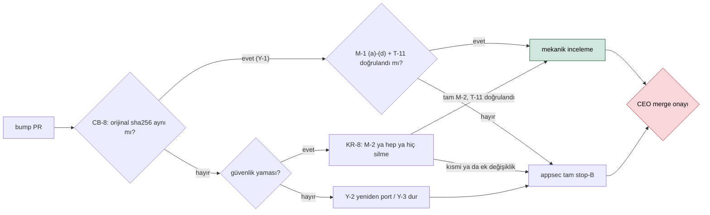
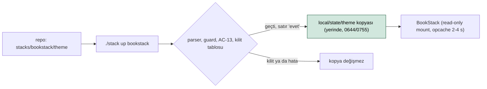

# ADR 0007 — BookStack özelleştirme yöntemi ve yükseltme politikası (`selfhost-dashboard` teması)

- Status: Proposed (revizyon 4, T-A7b). Spec 0002 Faz 1, CEO tarafından chat'te imzalandı (2026-11-09, spec "Signature record"). Bu ADR'nin karar kaydı board'un K3 yeniden kontrolünü bekliyor. ADR kararı CEO'nundur.
- Revision: 4 (2026-11-09). Revizyon 3, spec 0002 revizyon 4'e dayanıyordu. Bu revizyon metni spec 0002 **revizyon 5** ile eşitler: S3-01 (PHP/Blade kuralları), S3-02 (G-4 son metni, M-1/M-2), S3-03 (dağıtım sınırı, C-16), S3-07 ve critic M5 (`UPSTREAM` dilbilgisi, bozuk kayıt), board K3-1 (kilidin daraltılması), K3-2 (opcache koruması), K3-3 (Faz 2a parçalarının Faz 1'den çıkması), A3-4 (`ACCESS_ALLOWLIST` disiplini), critic H6/L4 (`ALLOW`↔`VIEW`, ya hep ya hiç). Değişiklik listesi en altta.
- Date: 2026-11-09
- Decider: CEO (Architecture board inceler, appsec TD-2/S-06/S3-01/S3-02 için görüş verir)
- Prepared by: software-architect. Bu birim kendi ADR'sini onaylamaz.
- Kaynak: `docs/spec-0002-bookstack-dashboard.md` (revizyon 5) §2.2 C-1/C-2/C-9/C-14/C-16, §3 REQ-D5/REQ-D20/REQ-D23, §5, §6.1, §6.6, §6.8, §9.1 CB-5/CB-7/CB-8/CB-9/CB-10/CB-11/CB-30, §12, §15.3, §16 KR-1/KR-8, T-A7b. `docs/reviews/t0a-upstream-verification-0002.md` (§1, §3, §3b). `docs/reviews/t0b-measurements-0002.md`. `docs/architecture/gorus-0002-bookstack-dashboard-2026-11-09-tur2.md` (B-1, A-12, A-16, K2-1, K2-2, G-4 görüşü). `docs/spec.md` (0001 revizyon 3) §1, §6.3, §7.3, §13, AC-1, AC-3, AC-8, AC-11, AC-13, T-11.
- Görev: spec 0002 T-A7 (revizyon 3) ve T-A7b (bu revizyon).
- Yer notu: 0001 ADR'ler için `docs/adr/` yolunu adlandırıyor. Bu birimin yazma alanı yalnız `docs/architecture/tasarim/`. Taşıma (T-ADR) çağırana kalır, board koşulu değildir.
- Öncelik kuralı: bu ADR ile spec 0002 arasında tutarsızlık görülürse spec geçerlidir ve bu ADR düzeltilir.

> **Kanıt sınırı.** Bu birimin ağ erişimi ve Bash'i yok, BookStack kaynağını kendisi okumadı. Aşağıda "verified" ya da "PASS" diye anılan her upstream bilgisi T-0a raporundaki kaynak URL'ye (scout, 2026-11-09) ya da T-0b ölçümüne (devops-sre, 2026-11-09) dayanır. T-0a sayfaları WebFetch ile okudu, bu ham bayt değil model özetidir (T-0a "Method note"). Spec 0002 D-23 genel bilgidir ve doğrulanmamıştır, burada da öyle işaretlidir. Bu ADR o kaynaklarda olmayan hiçbir upstream fonksiyon adını, sürümünü ya da dosya yolunu iddia etmez.

## Context

**Problem.** CEO, BookStack'in ana sayfasını (`/`) ve proje raflarını bir dashboard'a çevirmek istiyor (spec 0002 §1). BookStack upstream'den değiştirilmeden, tag + digest ile pinli `lscr.io/linuxserver/bookstack` image'ıyla çalışıyor (0001 §6.3, §6.4). Özelleştirme yöntemi bir kez seçilince **her BookStack pin bump'ının maliyetini** belirler ve git ile her makineye gider. Bu yüzden geri alması pahalı bir karar (board görüşü 0002 tur 2, ADR tablosu).

**Kısıtlar (spec 0002 revizyon 5'ten):**

| # | Kısıt | Kaynak |
|---|---|---|
| K1 | Yapı ve metin her makinede aynı, elle kurulum adımı yok | REQ-D2 |
| K2 | BookStack'in kendi blokları, her kullanıcının blok düzeni ve yetki süzmesi değişmez | REQ-D4, TD-4, CB-3 |
| K3 | Makine dashboard'u repo'ya dokunmadan kapatabilir, makinenin kendi teması kazanır, ikisi de uyarı üretmez | REQ-D5, KR-1, CB-5 |
| K4 | Harici kaynak yok, tarayıcı JS'i yok, CSP ve içerik filtrelemesi gevşetilmez | REQ-D6, CB-7 |
| K5 | Değiştirilen upstream view pinli sürümde değiştiyse test kırmızı | REQ-D7, CB-8 |
| K6 | Tema yetkili sunucu kodudur, yüzeyi en aza iner | TD-2 |
| K7 | Logical theme (`functions.php`, `Theme::listen`) v1'de yok | appsec S-06, D-17 (R-b) |
| K8 | Partial'lar yalnız repo'daki `ACCESS_ALLOWLIST`'te sayılı nesne erişimlerini ve iki aşamalı PHP/Blade taramasının izin verdiği yapıları kullanır. Listede olmayan her erişim yasak, `$shelf->books` dahil | board K2-1 (A-12), A3-4, appsec S3-01, spec §6.1, CB-7 (e) |
| K9 | Dashboard teması seçilecekken BookStack'in çalışacak sürümü temanın doğrulandığı sürümden farklıysa ya da tema kaydı bozuksa tema o makinede kendiliğinden kapanır ve bunu bildirir. Makinenin kendi temasına dokunulmaz | REQ-D20, KR-8, C-14, board K3-1, CB-30 |
| K10 | Repo'daki tema değişikliği makinede yalnız `./stack up bookstack` ile ve kontroller geçtikten sonra etkili olur | REQ-D23, C-16, appsec S3-03, CB-30 (g) |

**Kanıt tablosu (bu kararın dayandığı upstream bilgileri):**

| # | Bilgi | Hüküm | Bu ADR'de neye bağlı | Kaynak |
|---|---|---|---|---|
| D-1 | Visual theme: `themes/<ad>/`, `resources/views/` ile aynı göreli yol orijinali geçersiz kılar, `APP_THEME=<ad>`. Doküman tema dosyalarının "kararlı sayılmadığını ve her güncellemede değişebileceğini" yazıyor | verified | Seçilen yöntemin kendisi | T-0a §1. https://raw.githubusercontent.com/BookStackApp/BookStack/v26.09.2/dev/docs/visual-theme-system.md |
| D-1b | `@include('selfhost.x')` tema partial'ına çözülür, ebeveyn view değişkenleri partial'a geçer, include ızgaradan önce render edilir | PASS | `@include` tek satır kuralı, ikinci argüman gerekmez | T-0b §2 (D-1b) |
| D-2 | Logical theme: tema klasöründe `functions.php`, `Theme::listen(ThemeEvents::...)` | verified | B' seçeneğinin güvenlik maliyeti | T-0a §1. https://raw.githubusercontent.com/BookStackApp/BookStack/v26.09.2/dev/docs/logical-theme-system.md |
| D-3 | linuxserver image: uygulama `/app/www`, `/app/www/themes -> /config/www/themes` symlink. `/config` volume'u içinde iç içe read-only bind ilk başlatmada çalışır. Her başlatmada init "chown ... Read-only file system" ve "Permissions could not be set" satırlarını basar, uygulama çalışır | verified (T-0a), PASS gürültülü (T-0b) | Mount hedefi. Hiçbir kriter bu log metnine bağlanamaz (CB-7 a) | T-0a §1 (Dockerfile URL). T-0b §2 (D-3) |
| D-3b | `--entrypoint cat` çalışır, `VIEW_ROOT=/app/www/resources/views`. sha256 (`v26.09.2-ls295`, arm64): `home/default.blade.php` = `566ef9ce18437aeea4e50d6a8e670aa2a86da4de9467ddfc17caf49c1db9a33c`, `shelves/show.blade.php` = `c9b32a3fbec368c1f449f4553db73fc1c969bd6f9d7a55b56b05a02386e9ed7a` | PASS, yalnız arm64 | `UPSTREAM`'deki `VIEW_ROOT` ve `VIEW` satırları, CB-8 (2) | T-0b §2 (D-3b) |
| D-4 | `home/default.blade.php` liste içermez: `layouts.simple`, `home.parts.expand-toggle`, `common.dark-mode-toggle`, `#home-default` üç sütun, her sütun `@include('common.view-blocks', [...])`. Listeler kullanıcı başına düzenlenebilir view block'lardır (v26.09) | verified (spec önceden yanlıştı) | Override hedefi, B-part reddi, CB-3 | T-0a §1. https://raw.githubusercontent.com/BookStackApp/BookStack/v26.09.2/resources/views/home/default.blade.php ; .../resources/views/common/view-blocks.blade.php ; .../app/View/ViewBlockDefaults.php |
| D-5 | "Her güncellemeden sonra test et" uyarısı, override güncellemede kendiliğinden yaşamaz | verified | Hash kontrolünün gerekçesi | T-0a §1 (D-1 URL) |
| D-9 | `opcache.validate_timestamps=1`, `revalidate_freq=2`. Mount edilmiş dosyadaki düzenleme yeniden başlatmadan 2-4 s içinde görünür | PASS, yalnız Docker Desktop | Kopyanın yerinde güncellenmesiyle yayılma (D4), CB-8 (7) koruması | T-0b §2 (D-9) |
| D-10 | Controller `shelf`, `sortedVisibleShelfBooks`, `view`, `listOptions` verir, `$activity` yok. View etiketleri göstermez (etiketler kullanıcının kaldırabildiği `ShelvesShowTags` bloğunda). `$shelf->tags` zaten yüklü (0 ek sorgu), `order` sütunu hep 0, sıra pratikte `id` sırası. BookStack etiket adının harfini korur | verified (T-0a, düzeltme), PASS (T-0b) | `ACCESS_ALLOWLIST` A-1..A-3, §6.6 etiket kuralı | T-0a §1. https://raw.githubusercontent.com/BookStackApp/BookStack/v26.09.2/resources/views/shelves/show.blade.php (özet). T-0b §2 (D-10) |
| D-11 | `Permission::SettingsManage = 'settings-manage'`, `userCan('settings-manage')` gerçek bir izin | verified | `ACCESS_ALLOWLIST` A-4 | T-0a §3b. https://raw.githubusercontent.com/BookStackApp/BookStack/v26.09.2/app/Permissions/Permission.php |
| D-17 | View enjeksiyonu ve kendi view block'umuz yalnız logical theme ile (R-b, aşağıda D5) | verified | B' seçeneği, D5 | T-0a §1. URL'ler D5'te |
| D-18 | `open_basedir` yok, php-fpm kullanıcısı `abc` (uid 1000). Tema dosyaları dünya-okunur olmalı | PASS | Kopyanın modları (D4) | T-0b §2 (D-18) |
| D-19 | Tema `public/` klasörü `/theme/<ad>/` altında sunulur. `public/` yokken `/theme/selfhost-dashboard/UPSTREAM` ve partial yolları oturumlu ve oturumsuz 404 | verified (T-0a), PASS (T-0b) | `public/` yasağı, CB-7 (h) | T-0a §1 (D-1 URL). T-0b §2 (D-19) |
| D-23 | Pinli image'da `user()->isGuest()`, `collect()` ve dizi biçimli `sortBy([[alan, yön], ...])` var, PHP 8.5'te `strtoupper` yalnız ASCII dönüştürür | **doğrulanmadı** (spec: genel bilgi) | `ACCESS_ALLOWLIST` A-1, A-3, A-6, §6.6 | Spec 0002 §5 D-23. T-3 pinli image'da doğrular, CB-6/CB-10/CB-11 yakalar. Biri yoksa kural gevşetilmez, appsec'e döner |

**Kalan doğrulanmamış noktalar** (kararı değiştirmez, nerede kapandığı yazılı):
- amd64 manifest'indeki iki view'un sha256'sı ölçülmedi. CB-8 (2) kontrolü `--platform` ile hem arm64 hem amd64'te yapar.
- D-9 yalnız Docker Desktop'ta ölçüldü. CB-9 aynı kontrolü dind'de (Linux Engine) yapar.
- D-23 doğrulanmadı (yukarıda). T-3 kapatır.
- `THEME_REGISTER_VIEWS` olayının hangi sürümden beri var olduğu bulunamadı (T-0a D-17). Yalnız gelecekteki B' seçeneğini ilgilendirir.

## Decision

**v1'de BookStack yalnız visual theme sistemiyle özelleştirilir (B-copy).** `selfhost-dashboard` temasının kaynağı git'te durur (`stacks/bookstack/theme/selfhost-dashboard/`). BookStack container'ına bağlanan dizin repo klasörü değil, `./stack up bookstack`'in kontrollerden sonra eşitlediği **makine kopyasıdır**: `local/state/theme/selfhost-dashboard/` → `/config/www/themes/selfhost-dashboard`, read-only (C-2, C-16, D-3). Override edilen her upstream view, pinli image'daki orijinalin **birebir kopyasıdır**. Tek fark eklenen tam satır `@include('selfhost.<ad>')` satırlarıdır. Uyum, pinli image'dan okunan orijinalin **sha256**'sı ve ham bayt satır diff kuralıyla mekanik olarak zorlanır (CB-8). Logical theme (`functions.php`) kullanılmaz. D-17 sonucu R-b'dir (D5). Board tur 2 bu yöntemi v1 için APPROVE etti (B-1).

### D1. İzinli dosya kümesi

| Dosya | Ne | Kural |
|---|---|---|
| `home/default.blade.php` | upstream kopyası + `@include('selfhost.home')` ızgaranın hemen öncesinde | hash + diff kuralı (D3) |
| `shelves/show.blade.php` | upstream kopyası + `@include('selfhost.shelf')` ana içerik alanının başında | hash + diff kuralı (D3) |
| `selfhost/*.blade.php` | bizim partial'lar (Faz 1: `home`, `shelf`, `cards` gibi. `selfhost/data.blade.php` Faz 1'de **yoktur**, T-11/Faz 2a, K3-3, CB-1 a) | iki aşamalı PHP/Blade taraması ve `ACCESS_ALLOWLIST` (D2) |
| `UPSTREAM` | pin, `VIEW_ROOT`, override edilen dosyaların sha256'ları, izinli dosya listesi | dilbilgisi ve CB-8 (D3) |
| `PHP_ALLOWLIST` | partial'larda izinli PHP fonksiyon adları | CB-7 (e) |
| `ACCESS_ALLOWLIST` | partial'larda izinli nesne erişimleri (numaralı) | D2, CB-7 (e) |
| `README` | tema notu | meta dosya |

- **`ALLOW` kümesi.** Tema klasöründeki dosya kümesi `UPSTREAM`'deki `ALLOW` listesiyle **birebir** aynıdır ve liste meta dosyaları da içerir: `UPSTREAM`, `PHP_ALLOWLIST`, `ACCESS_ALLOWLIST`, `README` (critic L4, CB-7 d, CB-8 4). `functions.php` ve `public/` hiçbir zaman bulunmaz.
- **`ALLOW` ↔ `VIEW` eşlemesi (critic H6, CB-8 6).** `selfhost/` dışındaki ve meta olmayan her `ALLOW` yolunun (yani her override dosyasının) bir `VIEW` satırı vardır ve her `VIEW` satırının bir `ALLOW` satırı vardır. Partial'ların ve meta dosyaların `VIEW` satırı yoktur. (Spec §6.1 düz metninde bu cümle "`selfhost/` altındaki" diye geçiyor, CB-8 (6) "dışındaki" diyor. Bu ADR CB-8 (6)'yı izler, çünkü partial'ların upstream orijinali yoktur. BA'ya not, aşağıda.)
- **Modlar.** Repo'daki modlar belirleyici değildir. Makine kopyasında dosyalar her zaman `0644`, dizinler `0755`'tir, çünkü php-fpm `abc` kullanıcısıyla okur (D-18, C-16, CB-9).
- **Kümenin büyümesi.** Yeni bir upstream view'u override etmek (ör. üçüncü bir sayfa) bu ADR'nin değişikliğidir: spec revizyonu, tam appsec stop-B ve board incelemesi ister.
- **Kümenin küçülmesi (KR-8).** KR-8 durumunda override dosyaları ve satırları silinir (D3, M-2). Silme **ya hep ya hiç**tir: ya bütün override'lar ve onların `VIEW`/`ALLOW` satırları silinir ya da hiçbiri. Kısmi silme CB-8 (6)'yı kırar (CB-30 d). Bu, küme kuralının bir istisnası değil, kümenin küçülmesidir.

### D2. Partial, veri erişimi ve PHP/Blade kuralları (`ACCESS_ALLOWLIST`, board K2-1, A3-4, appsec S3-01)

- Bizim bütün kodumuz `selfhost/` partial'larındadır. Güvenlik kuralları (spec §6.1, CB-7) partial'lara kesin uygulanır. Kopyalanan upstream satırları hash ile doğrulandığı için ayrıca taranmaz.
- **Erişim listesi (Faz 1).** Partial'ların okuyabildiği nesne erişimleri repo'daki numaralı listededir: `stacks/bookstack/theme/selfhost-dashboard/ACCESS_ALLOWLIST`. Spec §6.1'deki liste:

| # | Erişim | Not |
|---|---|---|
| A-1 | `$shelf->tags->sortBy('id')->where('name', 'plane-project')` ve bunun `->first()`, `->count()` | etiketler yüklü (D-10), bellekte |
| A-2 | etiket öğesi `->value` | başka alan yok |
| A-3 | `collect($sortedVisibleShelfBooks)->sortBy([['updated_at', 'desc'], ['id', 'desc']])->take(5)` ve `->isEmpty()`, öğe `->name`, `->getUrl()`, `->updated_at` | gösterim alanları |
| A-4 | `userCan('settings-manage')` | fonksiyon (D-11) |
| A-6 | `user()->isGuest()` | misafir tespiti (critic H3, D-23) |

- **A-5 Faz 1'de yoktur.** Snapshot anahtarları (A-5) ve `selfhost/data.blade.php` Faz 2a'da (T-11) eklenir (K3-3). Numara boşluğu bilerek bırakılmıştır.
- **Liste değişikliği disiplini (board A3-4).** Yalnız (i) A-3 öğelerinin gösterim alanları ve (ii) listedeki koleksiyonlar üzerinde yalnız sabit dize, sayı ya da sabitlerden oluşan dizi argümanlı, bellekte çalışan koleksiyon metodları (`sortBy`, `sortByDesc`, `take`, `first`, `where`, `isEmpty`, `count`) eklenebilir. İlişki yükleyen ya da sorgu çalıştıran her metod (`load`, `loadMissing`, `fresh`, `refresh`, `query`, `->books()` gibi ilişki metodu çağrısı) ve callable argüman yasaktır. Görünürlük süzmesi taşımayan bir ilişki listeye girmez. `ACCESS_ALLOWLIST`'in **her** diff'i tam appsec stop-B ister.
- **Gerekçe.** Tur 1'in kuralı ("upstream view'un zaten kullandığı değişken ve ilişkiler") D-10'dan sonra P1'i (raf etiketi eşlemesi) imkânsız kılıyordu, çünkü upstream `shelves/show` etiketleri kendisi göstermiyor. "Modellerin ilişkileri" ise fazla genişti: görünürlük süzmesi taşımayan ilişkilere de (ör. `$shelf->books`) izin veriyordu (board A-12). Sayılı liste ikisini de çözer: P1 çalışır, yetki süzmesi taşımayan her ilişki yasaktır. Raf kitapları yalnız `$sortedVisibleShelfBooks`'tan gelir (CB-10, S3-06).
- **Etiket kuralının sadeleşmesi (spec §6.6, §15.3).** S3-01 atamayı, closure'ı ve `@php`'yi yasakladığı için etiket kuralı yalnız sabit argümanlı koleksiyon metodlarıyla yazılabilecek hale getirildi: etiketler `id` sırasıyla okunur, yalnız adı **tam** `plane-project` (küçük harf) olanlar aday sayılır, karar **ilk adaya** göre verilir (`trim`, ASCII `strtoupper`, `^[A-Z0-9]{1,12}$`), birden fazla aday U-23 notu verir. A-1 bu kuralın erişimidir. Bu kullanıcıya görünen küçük bir değişikliktir, BA kararıdır, appsec teyidi bekler (spec §15.3).

**İki aşamalı PHP/Blade taraması (S2-02, S3-01, critic H2, S3-05).** Tarama pinli BookStack image'ında `--network none` ile çalışır. Her kural için `tests/` altında bir negatif fixture vardır ve tarayıcı onu yakalamalıdır (CB-7 e).

1. **Blade kaynağı üzerinde:**
   - Değişken allowlist'i: `$shelf`, `$sortedVisibleShelfBooks`, `ACCESS_ALLOWLIST`'te adı geçen `@foreach` takma adları, `$loop`. (Faz 2a: `data` partial'ının snapshot değişkeni.) Yasak: `$app`, `$this`, `$cspNonce`, `$errors`, her `$__*`, bütün süper globaller.
   - Sayılan üye erişimleri: `->`, `?->`, `::`, `[...]`, `{...}`. Hepsi `ACCESS_ALLOWLIST`'e karşı kontrol edilir. Dizi erişimi yalnız snapshot'tan türetilen değişkenlerde (Faz 1'de hiç yok). `::` izinli listesi boştur.
   - `@foreach` kaynakları yalnız allowlist'teki ifadeler. `@foreach` başlıkları dışında atama operatörü yok.
   - Çağrı tespiti `T_STRING`, `T_NAME_FULLY_QUALIFIED`, `T_NAME_QUALIFIED` token'larını kapsar. Her fonksiyon `PHP_ALLOWLIST`'te. Sabit, dizi ya da parantezli ifade üzerinde çağrı, closure (`fn`, `function`) ve `(...)` callable sözdizimi yasak.
   - `env()`/`getenv()` tam bir sabit dize argümanla ve yalnız `'SELFHOST_PENPOT_URL'`, `'SELFHOST_PLANE_URL'`, `'SELFHOST_PENPOT_STATE'`, `'SELFHOST_PLANE_STATE'` için. Argümansız çağrı yasak.
   - `file_get_contents` Faz 1'de yasak. Faz 2a'da yalnız `data` partial'ında ve yalnız `('/dashfeed/snapshot.json', false, null, 0, 1048577)` sabit argüman kümesiyle (sınırlı okuma, önce-kontrol-sonra-oku yok, appsec I-4).
   - Yasak çağrı ve yapıların tam listesi spec §6.1'dedir (`config(`, `@inject`, `@php`, `new `, `app(`, `{!!`, `include`/`require`, `exec` ailesi, `eval`, `DB::`, `Http::`, `file_put_contents`, `unlink` dahil). Kaynakta `<?` yok.
   - Blade direktif allowlist'i: `@if`, `@elseif`, `@else`, `@endif`, `@foreach`, `@endforeach`, `@forelse`, `@empty`, `@endforelse`, `@isset`, `@endisset`, `@include`. Başka her direktif (`@each`, `@includeWhen`, `@includeIf`, `@json`, `@verbatim` dahil) başarısız. Partial'lardaki `@include` da tek argümanlı `selfhost.*` kalıbına uyar.
   - `/` ile başlayan dize sabitleri Faz 1'de yalnız `'/books'` (Faz 2a'da `'/dashfeed/snapshot.json'` eklenir, T-11).
   - Partial HTML'inde statik yasak: `<script`, `on*=` öznitelikleri, `<base`, `<meta http-equiv`, `<form`, `<iframe`, `<object`, `<embed`, `<link`, `javascript:`.
2. **Derlenmiş çıktı üzerinde:** partial'lar Laravel'in Blade derleyicisiyle derlenir. Derleyicinin ürettiği tam ifadeler yalnız spec §6.1'de sayılan derleyici şablonlarıyla birebir eşleştiklerinde çıkarılır. Kalan token'lar 1. aşamanın kurallarından geçer. Şablona uymayan bir `$__env` kullanımı (ör. `$__env->getContainer()`) başarısızdır.

Bu kurallar derinlemesine savunmadır, yetki sınırı değildir (Consequences). Asıl sınır git + PR + appsec + CEO merge'dür.

### D3. `UPSTREAM` kaydı, uyum kontrolü ve yükseltme politikası

**`UPSTREAM` dilbilgisi (spec §6.1, critic M5, S3-07).** İzinli satır türleri:

```
# yorum                                   (sıfır ya da daha fazla; boş satır da izinli)
BOOKSTACK_IMAGE=<ad:tag@sha256:...>       (tam bir tane)
VIEW_ROOT=/app/www/resources/views        (tam bir tane)
VIEW <göreli yol> <64 hex>                (sıfır ya da daha fazla, yol tekil)
ALLOW <göreli yol>                        (bir ya da daha fazla, yol tekil)
```

Başka her satır, tekrar ya da eksik bir zorunlu satır dosyayı **bozuk** yapar. Bozuk ya da eksik `UPSTREAM` → CB-8 başarısız ve `stack`'te kilit kapalı (U-20a, fail closed). `VIEW_ROOT` değeri ve `v26.09.2-ls295` arm64 hash'leri T-0b D-3b'den gelir. Kesin pin 0001 T-1'de belirlenir ve hash'ler o pin'de yeniden alınır.

**CB-8'in mekanik adımları** (`tests/bookstack-dashboard.sh`, quick profil, bump alt kümesinde):
1. `UPSTREAM` dilbilgisine uyar ve `BOOKSTACK_IMAGE`, normalize config'teki BookStack image değeriyle **tam dize olarak** (tag + digest) eşittir.
2. Her `VIEW` satırı için orijinal dosya pinli image'dan okunur (`docker run --rm --network none --entrypoint cat <pin> /app/www/resources/views/<yol>`) ve sha256'sı `UPSTREAM`'dekiyle eşittir, arm64 ve amd64 manifest'inde (`--platform`).
3. Override ile orijinal arasındaki **ham bayt** satır diff'inde (boşluk ya da satır sonu normalleştirmesi yok) silinmiş ya da değiştirilmiş satır yoktur. Her eklenmiş satır tam satır kalıbına uyar: `^\s*@include\('selfhost\.[a-z0-9_.-]{1,64}'\)\s*$`. İkinci argüman yasaktır, böylece partial girdileri ebeveyn view'un değişkenleriyle sınırlı kalır (D-1b).
4. Tema dosya kümesi `ALLOW` listesine eşittir.
5. `VIEW` satırı olmayan `UPSTREAM` (KR-8 durumu) geçerlidir: (2) ve (3) atlanır.
6. `ALLOW` ↔ `VIEW` eşlemesi tutar (D1).
7. **Opcache koruması (board K3-2).** Pinli image'da (`--network none`) etkin `opcache.validate_timestamps` = `1`, `opcache.revalidate_freq` ≤ 2 ve php-fpm havuz dosyalarında bunları ezen `php_admin_value`/`php_value` satırı yoktur.

Fixture'lar (bozuk `UPSTREAM` türleri, `VIEW`'siz `ALLOW` yolu, `validate_timestamps=0` içeren sahte havuz dosyası) her biri testi kırmalıdır. Herhangi bir adım tutmazsa test kırmızıdır ve PR merge edilmez.

**Bump PR'ında appsec incelemesi (G-4 kararı, appsec S3-02 son metni).**

- **M-1, normal BookStack bump.** Mekanik inceleme yalnız şunların **hepsi** sağlanırsa yeterlidir:
  - (a) Merge base'e göre diff tam iki dosyaya dokunur, her birinde bir satır değişir (2 silme + 2 ekleme): `stacks/bookstack/versions.env`'deki BookStack app image satırı ve `UPSTREAM`'deki `BOOKSTACK_IMAGE=` satırı. İki yeni değer bayt düzeyinde aynıdır ve tag + digest biçimindedir. Diff denetleyicisi (`tests/upgrade_diff_check.sh`, sahibi T-5 / qa-engineer) **base dalından** çalıştırılır, PR head'inden asla.
  - (b) CB-8, base dalının test script'leriyle arm64 ve amd64'te geçer.
  - (c) Otomatik güvenlik alt kümesi yeni pin'de geçer: CB-1, CB-3, CB-4, CB-6 (a)-(c), CB-7 (hepsi), CB-10 (S3-06 doğrulaması dahil), CB-11, CB-30, ve Faz 2a'dan CB-21 ile CB-24.
  - (d) PR atlanan her sürümün sürüm notlarına (yalnız revizyon bump'ında, ör. `-ls295` → `-ls296`, linuxserver değişiklik günlüğüne) bağlantı verir ve şu alanların her biri için "dokunuyor: evet/hayır" yazar: tema sistemi; view'lar ve view block'lar; izinler/roller/görünürlük; CSP ve içerik filtreleme; Blade escape'i; entity/raf controller'ları; PHP sürümü; nginx ve php-fpm yapılandırması; güvenlik bildirimleri.
  - (a)-(d)'den biri tutmazsa (diff iki satırdan büyükse dahil) **tam appsec stop-B**. Appsec örnekleme yapabilir ya da M-1'i geri çekebilir.
- **M-2, KR-8 silme PR'ı.** Diff = M-1 (a)'daki iki satır + **bütün** override dosyalarının, bütün `VIEW` satırlarının ve onların `ALLOW` satırlarının silinmesi, başka ekleme yok. CB-8 (5) ve CB-30 geçer. (d) gerekmez, çünkü kilit temayı tamamen kapatır. Kısmi silme ya da ek değişiklik **tam stop-B**.
- **Ön koşul (appsec I-1).** M-1, 0001 T-11'in (branch protection, 2FA) uygulandığı doğrulandıktan sonra kullanılabilir. O zamana kadar her bump tam appsec stop-B ister. (Bu ADR spec'in "her bump" ifadesini M-2'yi de kapsayan biçimde okur. Aşağıda açık nokta olarak kayıtlı.)

Önceki revizyondaki "appsec karar metninin son cümlesi belirsiz" kayıt notu kaldırıldı: S3-02 son metni yukarıdaki M-1/M-2'dir.

**Mekanik taşınamayan güvenlik yaması (KR-8).** Override edilen bir view'u değiştiren BookStack güvenlik yaması bump PR'ı (M-2):
- bütün override dosyalarını `stacks/bookstack/theme/selfhost-dashboard/` altından **siler**, bunların `VIEW` ve `ALLOW` satırlarını `UPSTREAM`'den siler ve `BOOKSTACK_IMAGE`'ı yeni pin'e günceller;
- BookStack yamalı upstream view'u sunar, dashboard **merkezi olarak** kaybolur (U-20b), CB-8 (5) sayesinde test yeşil kalır, makinelerde elle adım yoktur;
- sonraki port PR'ı dosyaları ve satırları geri ekler (Y-2 kuralıyla, tam appsec stop-B).

KR-8 bir güvenlik yamasının tema işine bağlanmamasını sağlar: eski bir kopya yamalı upstream view'unu hiçbir makinede gölgeleyemez.

**Tema kilidi (KR-8, C-14, board K3-1, critic H1, S3-07).** `stack` container'a verilecek `APP_THEME`'i şu tablodan seçer. "Tema kaydı geçerli" = `UPSTREAM` dilbilgisine uyar, `BOOKSTACK_IMAGE` normalize config'teki BookStack image değerine tam dize eşit ve en az bir `VIEW` satırı var.

| `SELFHOST_DASHBOARD` | `local/bookstack.env` `APP_THEME` | Tema kaydı | Container `APP_THEME` | Uyarı | Tema kopyalanır mı (C-16) |
|---|---|---|---|---|---|
| `0` | herhangi (boş dahil) | – | makinenin değeri (boşsa boş) | yok | hayır |
| `1` (ya da anahtar yok) | başka tema | – | makinenin teması, olduğu gibi | yok | hayır |
| `1` | boş / `selfhost-dashboard` | geçerli | `selfhost-dashboard` | yok | evet |
| `1` | boş / `selfhost-dashboard` | pin uyuşmuyor ya da `UPSTREAM` bozuk/eksik | boş | U-20a, exit 0 | hayır |
| `1` | boş / `selfhost-dashboard` | `VIEW` satırı yok (KR-8) | boş | U-20b, exit 0 | hayır |

- **K3-1 daraltması.** Kilit **yalnız dashboard temasını** etkiler. `SELFHOST_DASHBOARD=0` ve makinenin kendi teması kilitten bağımsızdır ve uyarı üretmez. `APP_THEME=baska` + pin uyuşmazlığı → container `APP_THEME=baska`, uyarı yok (CB-30 e). Revizyon 3'teki "pin farklıysa temayı etkin saymaz" metni bu ayrımı yapmıyordu, bu tablo onun yerini alır.
- `SELFHOST_DASHBOARD` için `0`/`1` dışındaki değer **exit 2** ve `local/bookstack.env:<satır>` (spec §7.3, 0001 r3 §7.3 "yapılandırma reddi", CB-5; appsec I-1).
- `./stack config bookstack` aynı tabloya göre aynı `APP_THEME`'i ve aynı uyarıyı gösterir (CB-30 f). `./stack status` iki değeri gösterir: repo'nun bugünkü kararı ve çalışan container'ın `APP_THEME`'i, farklıysa "`./stack up bookstack` gerekli" (C-10, CB-30 h).
- Böylece doğrulanmamış bir BookStack sürümünde ya da bozuk bir kayıtla eski bir override kopyasıyla çalışma durumu hiçbir makinede oluşamaz (TD-17). Normal bump'ta iki değer aynı PR'da güncellendiği için pencere yoktur. T-0b'ye göre boş ya da artık var olmayan bir `APP_THEME` BookStack'i bozmaz (200, standart görünüm).

**Bir BookStack pin bump'ı tema açısından nasıl ilerler?**


Açıklama: upstream view değişmediyse ve M-1'in dört şartı ile 0001 T-11 ön koşulu tutuyorsa bump mekanik incelemeyle CEO'ya gider (yeşil, "mekanik inceleme" etiketli kutu). KR-8 silme PR'ı yalnız tam M-2 biçimindeyse mekanik yoldan gider. Diğer her yol tam appsec stop-B'den geçer. Her yol CEO merge onayında biter (kırmızı, "CEO merge onayı" etiketli eşkenar dörtgen). Metin karşılığı:

| Durum | Ne değişir | Kim | Kapı |
|---|---|---|---|
| Y-1: orijinal sha256 aynı | `versions.env` + `UPSTREAM`'deki `BOOKSTACK_IMAGE` satırı (tam iki satır) | devops-sre (bump) | M-1 (a)-(d) ve T-11 doğrulandı → mekanik inceleme. Değilse tam appsec stop-B. CEO merge |
| Y-2: orijinal sha256 farklı, güvenlik yaması değil | override yeni orijinalden yeniden kopyalanır, `@include` satırları aynı yerlere konur, `UPSTREAM` sha256'ları güncellenir. `ACCESS_ALLOWLIST`'teki erişimlerin yeni sürümde hâlâ var olduğu kontrol edilir | polyglot-engineer (bakım sahibi) | CB-1, CB-3, CB-7, CB-8, CB-10, CB-11, CB-30 yeşil, tam appsec stop-B, CEO merge |
| Y-3: view silindi, yeniden adlandırıldı ya da `@include` noktası artık yok, güvenlik yaması değil | mekanik port mümkün değil | polyglot-engineer → BA | PR durur. Spec revizyonu ya da CEO kararı |
| KR-8: override edilen view'u değiştiren güvenlik yaması (Y-2 ya da Y-3 fark etmez) | bütün override dosyaları ve bütün `VIEW`/`ALLOW` satırları silinir, `BOOKSTACK_IMAGE` yeni pin. Port ayrı PR'da | devops-sre (bump), polyglot-engineer (port PR'ı) | M-2: CB-8 (5), CB-30 (d). Tam M-2 değilse tam appsec stop-B. CEO merge |

Yedek, exit 5 ve `--i-have-a-backup` adımları 0001 §6.3 ve AC-13'teki gibi kalır. Bu ADR onlara dokunmaz.

**Bakım sahipliği (K-10, A-09, C-9):** CB-8 kırmızı olan her BookStack bump PR'ı polyglot-engineer'e gider ve yeşil olana kadar merge edilmez. KR-8'den sonraki port PR'ı da polyglot-engineer'indir. Bu kurallar 0001'in yükseltme prosedürüne README notu olarak girer (spec T-6, M-1/M-2 ve KR-8 dahil). delivery-manager planına alır.

**Bakım maliyetinin ölçümü.** Her BookStack bump PR'ının açıklaması iki değer taşır: "orijinal sha256 değişti mi (evet/hayır, hangi dosya)" ve "yeniden port süresi (dakika)" (C-9). Yeniden açma tetikleyicileri bu kayda dayanır.

### D4. Dağıtım sınırı, makine önceliği ve yayılma

- **Makine önceliği.** Tek kaynak D3'teki kilit tablosudur. "Tema etkin" = tablonun "geçerli" satırı. Tema etkin değilse dashboard ve (Faz 2a) toplayıcı o makinede çalışmaz.
- **Dağıtım sınırı (S3-03, C-16, REQ-D23).** Container'a mount edilen tema `local/state/theme/selfhost-dashboard/` kopyasıdır (gitignored, 0001 AC-11 yedeğe hiç `local/` dosyası almadığı için yedeğe girmez). `./stack up bookstack` parser, guard'lar, AC-13 kontrolü ve tema kilidi geçtikten sonra, **yalnız** tablonun "evet" satırında, repo'daki `stacks/bookstack/theme/selfhost-dashboard/`'ı bu dizine eşitler. `up` 5 ile ya da başka bir hatayla durursa ya da kilit kapalıysa kopya değişmez (CB-30 a, g).
- **Yerinde eşitleme.** Her dosya aynı dizinde geçici dosya + `rename` ile yazılır, repo'da olmayan dosyalar silinir. Dizinin kendisi değiştirilmez, çünkü bind mount dizinin kendisine bağlıdır ve değiştirilen bir dizin container'da görünmez (board K-3). Modlar her zaman `0644`/`0755` (D1).
- **İsteğe bağlı ek kontrol (appsec LOW).** Kopyalamadan önce `VIEW` sha256'ları yerel pinli image'a karşı (`--network none --entrypoint cat`) yeniden doğrulanabilir. Uygulanıp uygulanmayacağına T-2 karar verir, kriter değildir.
- **Yayılma (D-9).** `git pull` artık mount edilmiş kopyaya dokunmaz, sayfa değişmez (CB-30 g, 60 s gözlem). `up bookstack` kopyayı yerinde güncellediği için opcache yeniden doğrulaması devreye girer ve metin 2-4 s içinde görünür. Container yeniden yaratılmaz, container etiketi kullanılmaz (0001 AC-1, CB-9: en geç 10 s, mac ve dind). Etiketsiz yayılma pinli image'ın opcache ayarına bağlı olduğu için CB-8 (7) bu ayarı her bump'ta korur (K3-2). Bir platformda eski görünüm kalırsa çözüm `docker compose -p selfhost-bookstack restart bookstack`'tir ve README'de yazar.

**Faz 1'de tema dosyaları repo'dan BookStack'e ne zaman ulaşıyor?**


Açıklama: tema yalnız `up bookstack` sırasında ve bütün kontroller geçtiğinde kopyalanır, `git pull` tek başına sayfayı değiştirmez (yeşil, "local/state/theme kopyası" etiketli kutu otomatik adımdır). Metin karşılığı:

| Adım | Ne olur | Kriter |
|---|---|---|
| `git pull` | yalnız repo değişir, sayfa değişmez | CB-30 (g) |
| `up bookstack`, kontroller geçer, tablo "evet" | kopya yerinde eşitlenir, 2-4 s içinde görünür, container aynı | CB-9 |
| `up bookstack`, kilit kapalı ya da hata (ör. exit 5) | kopya değişmez | CB-30 (a), (g) |

### D5. D-17 sonucu: R-b (view enjeksiyonu yalnız logical theme ile)

| T-0a sonucu | Durum | Bu ADR'ye etkisi |
|---|---|---|
| R-a: pinli sürümde view enjeksiyonu yok | gerçekleşmedi | – |
| **R-b: enjeksiyon var, ama yalnız logical theme (`functions.php`) ile** | **gerçekleşti (T-0a D-17, verified)** | v1 kararı aynen kalır (K7, S-06). B' "gelecekteki seçenek" olarak kayıtlıdır (aşağıda) |
| R-c: enjeksiyon logical theme olmadan mümkün | gerçekleşmedi | – |

**R-b kaydı (T-0a'nın okuduğu hâliyle, bu birim kaynağı kendisi okumadı):**

| Mekanizma | API (T-0a'daki adlarla) | Davranış | Sürüm | Kaynak URL |
|---|---|---|---|---|
| View'un önüne/arkasına view ekleme | Olay `ThemeEvents::THEME_REGISTER_VIEWS`. Kayıt: `Theme::listen(ThemeEvents::THEME_REGISTER_VIEWS, fn(ThemeViews $v) => $v->renderBefore($target, $local, $priority))`, ayrıca `renderAfter(...)` | Varsayılan öncelik 50, düşük olan önce. Logical theme olayıdır, `functions.php` ister | Hangi sürümden beri olduğu bulunamadı | https://raw.githubusercontent.com/BookStackApp/BookStack/v26.09.2/dev/docs/logical-theme-system.md |
| Kendi view block'umuz | Olay `ThemeEvents::VIEW_BLOCKS_REGISTER`. Kayıt: `ViewBlockManager::register($location, $defaultPosition, $class)`, sınıf `ViewBlockInterface`'i uygular (`BaseViewBlock`'tan türer) | Blok varsayılan konum alır, ama her kullanıcı onu taşıyabilir ya da kaldırabilir ("unused" grubu). Logical theme ister | Block sistemi v26.09 (2026-09-24) | https://raw.githubusercontent.com/BookStackApp/BookStack/v26.09.2/dev/docs/logical-theme-system.md ; https://raw.githubusercontent.com/BookStackApp/BookStack/v26.09.2/app/View/ViewBlockManager.php |

T-0a ayrıca visual theme dokümanının, mümkün olduğunda override yerine view'ları önce/sonra kaydetmeyi önerdiğini not eder (arama özeti, zayıf). D-17'ye göre bu kayıt yine logical theme ister, bu yüzden v1 kararını değiştirmez.

**B' (gelecekte) kullanılmasının koşulları:** appsec'in S-06'yı yazılı olarak yeniden incelemesi, spec revizyonu, `functions.php` içeriğinin hash ile sabitlenmesi ve yalnız kayıt çağrıları içermesi, CB-7/CB-8'in buna göre yeniden yazılması. View block yolu ek olarak "her kullanıcı bloğu kaldırabilir" davranışını kabul etmeyi gerektirir. Bu, bugünkü "bizim blok her zaman ızgaranın üstünde" davranışından (CB-3) farklı, kullanıcıya görünen bir değişikliktir ve CEO kararı ister. (Spec §14 bunu "sonra" listesinde "dashboard'u BookStack bloğu yapmak (logical theme ister)" diye tutar.)

### D6. KR-1 kaydı: 0001 §1 kuralının yorumu

0001 r3 §1 (CEO'nun kararları, aynen): "Projeler/veri (kitaplar, tasarımlar, Plane projeleri = DB + volume'lar) ve tüm özelleştirmeler MAKİNEYE ÖZELDİR: sadece o makinede yaşar, git ile asla senkronlanmaz." 0001 r3 §13 kapsam dışı listesinde "uygulama içi özelleştirme" yer alır.

CEO kararı KR-1 (2026-11-09) bu kuralı şöyle yorumlar ve bu ADR o yorumu kayda geçirir (spec C-1):
- `selfhost-dashboard` teması ve `dashfeed` toplayıcı script'i **merkezi araçtır**: veri ya da secret değil, şablon ve koddur. Git'le gelir. Makineye dağıtım anı `up bookstack`'tir (C-16), makinedeki kopya `local/state/` altında türetilmiş durumdur, makine verisi değildir.
- **Makinede kalanlar:** projeler ve içerik, raf eşlemeleri (`plane-project` etiketleri), BookStack ana sayfa ayarı ve kullanıcı blok düzenleri (DB), Plane token'ı ve `local/dashfeed.env`, makinenin kendi `APP_THEME`'i, `SELFHOST_DASHBOARD` değeri.
- İstisna yalnız bu tema ve bu toplayıcı içindir. Gerekçesi üç özelliğe dayanır: (a) makine verisi ya da secret içermez, (b) her makine repo'ya dokunmadan kapatabilir, (c) makinenin kendi seçimi kazanır. Başka bir uygulama içi özelleştirmeyi merkezi yapmak yeni bir CEO kararı ve bu ADR'nin değişikliğini ister. Üç özellik yeni bir istisna için gerekli koşuldur, yeterli koşul değildir.

## Consequences

**Kazançlar**
- Upstream sapması mekanik olarak yakalanır, iki mimaride (CB-8 2). Upstream view'u değişmeyen bump iki satırlık bir değişikliktir ve M-1'in dört şartı ile T-11 ön koşulu tutarsa elle güvenlik turu beklemez.
- Override yüzeyi iki dosyadır ve küçüktür: `home/default` liste içermez (D-4). Bu dosyalardaki her satır ya upstream'in birebir kopyası ya da tek tip bir `@include` satırıdır. İnceleme yükü partial'larda toplanır.
- BookStack'in blokları, kullanıcı düzenleri ve yetki süzmesi upstream'in kendisidir (K2). Raf verisi yalnız `$sortedVisibleShelfBooks` ve sayılı erişimlerden gelir (K8).
- Logical theme olmadığı için uygulama açılışında ya da olay dinleyicilerinde çalışan tema kodu yoktur (K7).
- Güvenlik yaması tema işine bağlı değildir (KR-8, M-2). Doğrulanmamış bir sürümde ya da bozuk kayıtla eski kopya çalışamaz (C-14, fail closed). Kilit makinenin kendi temasına dokunmaz (K3-1).
- Repo değişikliği yalnız kontroller geçince makineye ulaşır (C-16). Pin farkıyla (exit 5) duran bir `up` tema kopyasını değiştirmez.
- Geri dönüş ucuzdur: `SELFHOST_DASHBOARD=0` ya da tema commit'inin revert'i + `up bookstack`. Veri ve DB değişmez.
- 0001 AC-8'deki vendored dosya sha256 deseniyle aynı fikir: kayıtlı özet + diff incelemesi. Ekipte yeni bir kavram yok.

**Maliyetler ve riskler**
- Upstream view'u değişen her bump'ta yeniden port gerekir (Y-2). Sıklığı bilinmiyor. BookStack düzenli güvenlik sürümü çıkarıyor (T-0a §2: v26.09.2 bir güvenlik sürümü), D3'teki ölçüm sıklığı görünür yapar.
- KR-8 yolunda dashboard, port PR'ı merge edilene kadar **bütün makinelerde** kaybolur. Bedeli bilinçli olarak CEO kabul etti (KR-8). Kullanıcıya U-20b ve standart görünüm gösterilir, veri kaybı yoktur.
- 0001 T-11 doğrulanana kadar her bump tam appsec stop-B ister. Bu, güvenlik sürümünü appsec turu kadar geciktirir. T-11 sonrasında da M-1 şartlarından biri tutmayan her bump aynı gecikmeyi yaşar.
- M-1 (d) sürüm notlarının doğruluğuna dayanır. Notlarda yazılmayan bir view ya da izin değişikliği mekanik yoldan geçebilir. Azaltan: CB-8 (view baytları, opcache), base dalından çalışan diff denetleyicisi, güvenlik e2e alt kümesi ve appsec'in örnekleme ya da M-1'i geri çekme hakkı.
- `@include` partial'ları controller'ın view'a verdiği değişkenlere bağlıdır. Upstream bir değişkeni controller'da değiştirip view hash'i aynı kalırsa CB-8 yakalamaz. M-1 (c) alt kümesindeki CB-1/CB-3/CB-10 e2e testleri yakalar (U-20, BookStack 500).
- Partial'lar Blade içinde PHP çalıştırır. Tema hâlâ yetkili sunucu kodudur (TD-2). İki aşamalı tarama ve `ACCESS_ALLOWLIST` derinlemesine savunmadır, yetki sınırı değildir. Asıl sınır git + PR + appsec incelemesi + CEO merge'dür. Tarama kuralları sıkılaştıkça ifade gücü düşer: etiket kuralı bu yüzden sadeleşti (büyük harfli ad tanınmaz, ilk aday geçersizse sonrakine bakılmaz), bedeli spec §15.2/§15.3'te kayıtlı.
- D-23 doğrulanmadı. A-1, A-3, A-6'nın dayandığı metodlardan biri pinli image'da yoksa kural gevşetilmez, appsec'e döner (T-3).
- Yerinde eşitleme atomik değildir: dosyalar tek tek değişir, bir istek iki dosyanın farklı sürümlerini milisaniyeler boyunca görebilir. Override'lar yalnız bump'ta, partial'lar yalnız tema PR'ında değişir. Risk düşük ve kabul edilmiştir (spec §15.2).
- `git pull` sonrası `up` çalıştırılmazsa repo ile makine farklıdır. `status` bunu "`./stack up bookstack` gerekli" ile gösterir (C-10).
- BookStack init'i her başlatmada read-only mount için "Permissions could not be set" basar (D-3). Zararsız, ama log izleyen biri için gürültü. Hiçbir kriter bu metne bağlanmaz (CB-7 a).
- D-9 yalnız Docker Desktop'ta ölçüldü. Linux'ta yayılma farklıysa README'deki `restart` adımı gerekir. CB-9 dind'de ölçer.

## Alternatives considered

| # | Seçenek | Pro | Con | Geri dönüş maliyeti | Sonuç |
|---|---|---|---|---|---|
| A | BookStack ayarı: ana sayfa = bir BookStack sayfası (en basit) | Kod yok, upstream bağımlılığı yok | İçerik DB'de, git'le gelmez (K1). Plane verisi ve kartları gösteremez | Çok düşük | Red |
| C | "Custom HTML Head" + JS | Tema dosyası yok | DB'de (K1). Tarayıcı JS'i (K4), CSP ve içerik filtrelemesiyle çatışır (D-6) | Düşük | Red |
| D | Ayrı dashboard uygulaması (yeni port) | Upstream view bağımlılığı sıfır | CEO BookStack'in ana sayfasını istedi. Yeni bağımlılık, yeni host portu (0001 AC-3 yalnız üç giriş portuna izin verir) | Orta | Red (v1) |
| B-free | Visual theme, override dosyaları serbest düzenlenir | Esnek, hızlı ilk teslim | Sapma ölçülemez, REQ-D4 her bump'ta elle doğrulanır, inceleme yüzeyi tam dosya | Düşük (dosya silmek), ama her bump'ta gizli maliyet | Red |
| **B-copy** | **Visual theme, birebir kopya + yalnız tam satır `@include` + sha256 ve ham bayt diff, `UPSTREAM` dilbilgisi, C-14 kilidi, C-16 dağıtım sınırı** | Sapma mekanik yakalanır, yüzey küçük, logical theme yok, değişmeyen bump iki satır | Değişen bump'ta yeniden port, KR-8'de dashboard geçici olarak yok, tema değişikliği `up` ister | Düşük (`SELFHOST_DASHBOARD=0` ya da revert, veri yok) | **Seçildi** (board tur 2 APPROVE) |
| B-part | B-copy kuralıyla, ama tam sayfa yerine sayfanın include ettiği en küçük upstream alt view'u override etmek | Kopyalanan satır sayısı ve hash değişme olasılığı düşer | Aşağıdaki gerekçe | Düşük | **Red** |
| B' | Logical theme ile view enjeksiyonu (`THEME_REGISTER_VIEWS`) ya da kendi view block'umuz (`VIEW_BLOCKS_REGISTER`) (D-17, R-b) | Upstream dosyası hiç kopyalanmaz, sapma riski en düşük | `functions.php` gerektirir, S-06 ile v1'de yasak. Board'un okuması: fark yetki türünde değil etki alanında, `functions.php` her istek türünde çalışır, partial yalnız iki sayfanın render'ında (genel okuma, doğrulanmadı). View block yolu kullanıcının bloğu kaldırmasına izin verir | Orta (güvenlik incelemesi + kriter değişikliği) | v1'de red. D5'e göre gelecekteki seçenek |

**Dağıtım yolu için alt karar (C-16, S3-03):**

| Seçenek | Pro | Con | Geri dönüş maliyeti | Sonuç |
|---|---|---|---|---|
| Repo klasörünü doğrudan mount etmek (revizyon 3) | En basit, kopya yok | `git pull` kontrolsüz olarak sayfayı değiştirir, kilit ve AC-13 kontrolünden önce kod çalışır | Düşük | Red (S3-03) |
| **`up bookstack`'te kontrollerden sonra `local/state/` kopyası, yerinde eşitleme** | Kod yalnız kontroller geçince makineye ulaşır, modlar sabit, container yeniden yaratılmaz | Tema değişikliği `up` ister, eşitleme atomik değil | Düşük (mount kaynağını değiştirmek) | **Seçildi** (spec r5) |
| Container etiketiyle yeniden yaratma (revizyon 2) | Opcache'e bağlı değil | 0001 AC-1 ile çatışır, her tema değişikliğinde container yeniden yaratılır | Düşük | Red (K3-2'nin tercihli yolu statik kontrol, CB-8 7) |

**B-part red gerekçesi (kesin).** T-0a'ya göre iki sayfada listeler ve kenar blokları kendi alt view'larında değil, ortak `common.view-blocks` view'unda üretilir (D-4: `home/default` üç sütunu `@include('common.view-blocks', ['location'=>'home-default', ...])` ile kurar. D-10: `shelves/show` kenar çubuklarını da `common.view-blocks` ile kurar). Bizim bloğun konacağı yerde (ızgaranın üstünde, raf içeriğinin başında) sayfaya özgü bir alt view yoktur. Tek aday olan `common.view-blocks`'u override etmek:
1. o view'u kullanan bütün sayfaları ve konumları etkiler (spec §6.1). Yalnız iki sayfada görünmek için kopyaya konum koşulu eklemek gerekir, bu da "yalnız tam satır `@include`" kuralını (CB-8 3) bozar ve upstream kopyasına bizim mantığımızı sokar;
2. bizim bloğu kullanıcı başına düzenlenebilen blok ızgarasının içine taşır, CB-3'ün "bizim blok ızgaranın üstünde, ızgara tema kapalıykenkiyle aynı" şartını riske atar.
Ayrıca B-part'ın asıl kazancı (kopyalanan satır sayısını düşürmek) ortadan kalktı: `home/default` zaten liste içermeyen küçük bir dosyadır (D-4). Board tur 2 bu reddi doğru buldu (§1).

## Reopening triggers

1. Upstream, visual theme içinde (logical theme olmadan) bir view enjeksiyonu mekanizması ekler (R-c'nin gelecekte gerçekleşmesi) → yeniden değerlendirme, öneri o mekanizmaya geçmek. CB-8 değişeceği için spec revizyonu.
2. Appsec S-06'yı gevşetmeye hazır olduğunu yazılı bildirir → B' için ayrı spec (D5 koşulları).
3. D3 ölçüm kaydına göre (öneri eşikleri, ölçüm değil): art arda 3 BookStack bump'ının 2'sinde orijinal sha256 değişirse ya da tek bir yeniden port 60 dakikayı aşarsa → B' yeniden açılır.
4. Bir Y-3 durumu ya da bir KR-8 PR'ı merge edildi (öneri: port PR'ıyla birlikte yöntem yeniden değerlendirilir).
5. Upstream visual theme sistemini kaldırır ya da davranışını değiştirir (D-1, D-5).
6. Yeni bir BookStack görünümünü override etme isteği (ör. üçüncü sayfa) ya da yeni bir merkezi özelleştirme isteği (D6).
7. Bir bump pinli image'ın opcache ayarını değiştirir (CB-8 7 kırmızı) → container etiketi kararı yeniden açılır (K3-2).
8. Appsec M-1'i geri çeker ya da tarama kurallarının (S3-01) bir partial ihtiyacını karşılayamadığı görülür (ör. D-23'te bir metodun yokluğu) → appsec turu, gerekirse spec revizyonu. Kural gevşetilmez.

## Unknowns and assumptions

- amd64 hash'leri ölçülmedi (CB-8 2 kapatır). D-9 yalnız Docker Desktop'ta ölçüldü (CB-9 dind'de kapatır).
- D-23 (`user()->isGuest()`, `collect()`, dizi biçimli `sortBy`, ASCII `strtoupper`) doğrulanmadı. T-3 pinli image'da doğrular.
- `THEME_REGISTER_VIEWS`'un ilk sürümü bilinmiyor. Yalnız B'yi ilgilendirir.
- T-0a kaynakları WebFetch özetiyle okudu. Bayt düzeyindeki gerçek CB-8'in pinli image'dan okumasıdır, T-0a'nın özeti değil.
- BookStack sürüm sıklığı ve view değişme oranı bilinmiyor. D3 ölçümü veriyi toplar.
- 0001 T-11 (branch protection, 2FA) uygulandı mı doğrulanmadı (spec Assumptions). O zamana kadar her bump tam stop-B.
- Etiket kuralının S3-01'e uyduğu appsec'in bir sonraki turunda teyit edilecek (spec §15.3).

## Input for the BA (spec'e girecek, bu ADR spec'i değiştirmez)

Önceki girdilerin durumu:

| Girdi | Durum |
|---|---|
| G-1 tam satır `@include` kalıbı | spec §6.1 ve CB-8 (3)'te. Kapandı |
| G-2 pin eşitliği, `--network none` | CB-8 (1), (2)'de. Kapandı |
| G-3 `cat` ve `VIEW_ROOT` ölçümü | T-0b D-3b ile kapandı, spec §5 ve §7.1'de |
| G-4 bump'ta appsec turu | S3-02 son metniyle kapandı: spec §6.1 M-1/M-2, C-9 |
| G-5 bump ölçüm kaydı | C-9'da. Kapandı |
| G-6 B-part | Red, spec §6.1'de. Kapandı |
| AS-1 güvenlik yaması + Y-3 | KR-8 ile kapandı. Spec §6.1 M-2, §12, C-14, CB-30 |

Bu senkronda görülen, spec'te netleşmesi önerilen üç nokta (bu ADR spec'i değiştirmez, karar BA'nın):

| # | Nokta | Öneri |
|---|---|---|
| N-1 | Spec §6.1 "`ALLOW` ve `VIEW` eşlemesi" paragrafı "`selfhost/` **altındaki** ve meta olmayan her `ALLOW` yolunun bir `VIEW` satırı vardır" diyor, CB-8 (6) "`selfhost/` **dışındaki**" diyor. Partial'ların upstream orijinali olmadığı için §6.1 metni CB-8 (6)'yla çelişiyor | §6.1'de "altındaki" → "dışındaki". Bu ADR CB-8 (6)'yı izler |
| N-2 | §6.1 "M-1 ancak 0001 T-11 doğrulandıktan sonra ... O zamana kadar her bump tam stop-B" cümlesi M-2'yi açıkça anmıyor | M-2'nin de T-11'e bağlı olduğu açık yazılsın (bu ADR öyle okur) ya da tersi appsec'le kararlaştırılsın |
| N-3 | M-2 metni M-1 (d)'nin gerekmediğini söylüyor, M-1 (b) (base dalından arm64 + amd64 CB-8) ve (c) (güvenlik alt kümesi) için bir şey söylemiyor | M-2 için (b) ve (c)'nin geçerli olup olmadığı appsec'le tek cümleyle yazılsın |

## Revizyon 4 değişiklik listesi (T-A7b)

- Status ve kaynak satırı: spec revizyon 5, Faz 1 imzası (chat, 2026-11-09), board K3 yeniden kontrolü bekleniyor. Öncelik kuralı: tutarsızlıkta spec geçerli.
- Kısıtlar: K3 (uyarı yok), K8 (S3-01, A3-4), K9 (K3-1 daraltması, bozuk kayıt), yeni K10 (REQ-D23, C-16). Kanıt tablosuna D-23 (doğrulanmadı) eklendi, D-10'a etiket adı harfi eklendi.
- Decision: mount kaynağı repo klasöründen `local/state/theme/selfhost-dashboard/` kopyasına (C-2, C-16).
- D1: `README` ve meta dosyalar `ALLOW`'da, `ALLOW`↔`VIEW` eşlemesi (CB-8 6), KR-8 ya hep ya hiç, `data` partial'ı Faz 1'den çıktı (K3-3), modlar kopyada.
- D2: `ACCESS_ALLOWLIST` A-1..A-4, A-6 spec r5 metniyle, A-5 Faz 2a'ya taşındı, A3-4 değişiklik disiplini ve "her diff tam stop-B". S3-01 iki aşamalı tarama, değişken ve direktif allowlist'leri, `env()` kuralı, Faz 1'de `file_get_contents` yasağı. Etiket kuralının sadeleşmesi (§6.6). Revizyon 3'teki Faz 2a dosya okuma maddesi Faz 2a'ya işaretlendi.
- D3: `UPSTREAM` dilbilgisi ve fail closed, CB-8 (6) ve (7). G-4 yerine S3-02 son metni M-1 (a)-(d) ve M-2, T-11 ön koşulu. Belirsiz cümle kayıt notu kaldırıldı. KR-8 PR'ı artık tam M-2 biçimindeyse mekanik yoldan geçer. Kilit için K3-1 girdi-çıktı tablosu, U-20a/U-20b, `config` = `up`, `status`. Bump diyagramı ve tablosu güncellendi.
- D4: makine önceliği kilit tablosuna bağlandı, dağıtım sınırı (C-16), yerinde eşitleme, `git pull`'un sayfayı değiştirmemesi, opcache koruması (K3-2). Yeni diyagram.
- Alternatives: dağıtım yolu alt kararı eklendi.
- Reopening triggers: 7 (S2-04 metni) kaldırıldı, yerine opcache (7) ve M-1 geri çekme / S3-01 yetersizliği (8).
- Input for the BA: N-1..N-3 eklendi.
