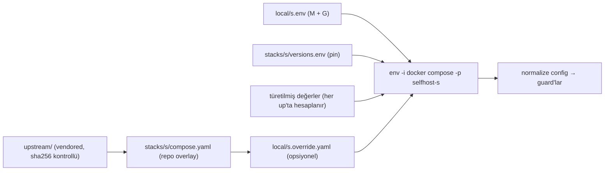
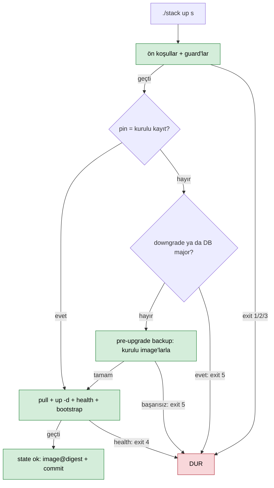
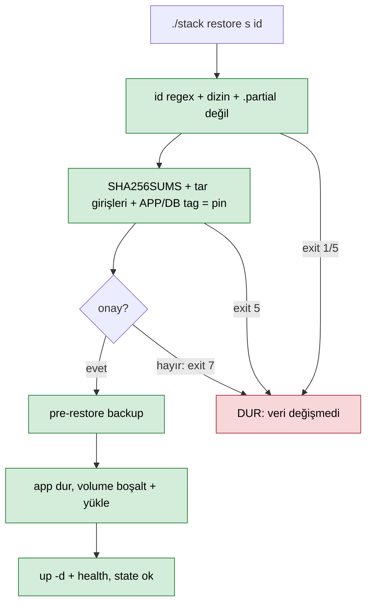
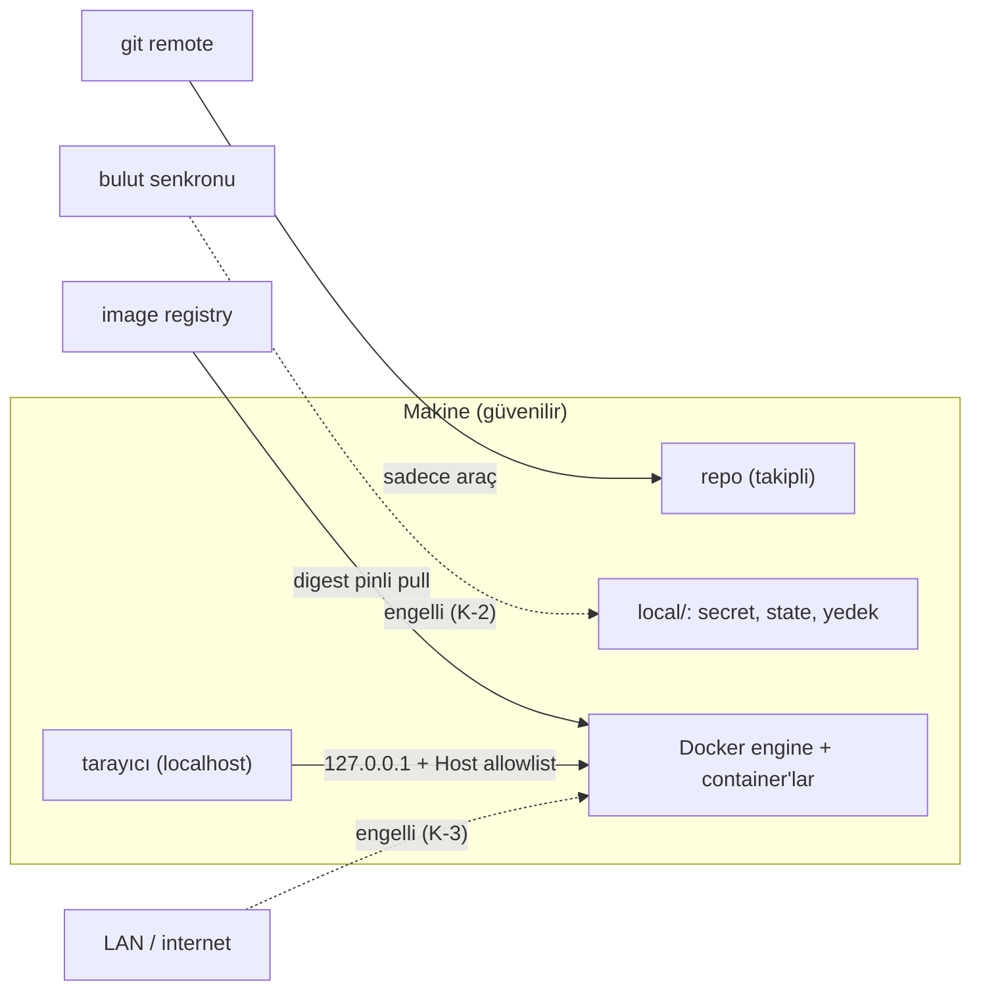
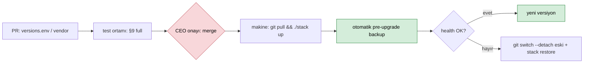

# Spec 0001: selfhost-stack (BookStack + Penpot + Plane, her makinede aynı kurulum)

- Status: Awaiting approval
- Tier: full (yeni altyapı, 3 uygulama ve ~10 yeni dış bağımlılık, secret yönetimi, kimlik bilgileri)
- Revision: 2 (round 2: spec-critic, appsec, architecture-board, scout T-0 ve talent-capacity bulguları işlendi)
- Previous spec: yok
- Self-critique: pending (BA kendi düşman okumasını yaptı. Round-2 incelemesi bekleniyor: spec-critic, appsec, architecture-board)
- Budget ceiling: **provizyonel (K-9)**: toplam 12 saat ajan süresi, görev bazında dağılım §12.1'de. Token tavanı: `<TOKEN_CEILING>` (CEO doldurur). Para tavanı: `<MONEY_CEILING>` (öneri: 0, ücretli servis yok). Ara kontrol T-6 sonunda (§12.1). Tavan aşılırsa iş durur ve CEO'ya dönülür.
- CEO decisions: K-1..K-10 açık. Önerilen varsayılanlar **provizyonel** olarak uygulandı (§15). İmza, CEO aksini yazmadıkça bu varsayılanları kabul etmek demektir.

> T-0 (upstream doğrulama) imzadan önce yapıldı: `docs/reviews/scout-upstream.md` (2026-11-09). Sonuçlar §6.4'e işlendi. Hâlâ ölçülmemiş kalan maddeler (Penpot backend health yolu, Plane admin CLI ve signup ayarı, BookStack admin CLI, Host header mekanizması, marker tablo adları, `--env-file` sırası) **T-0b** ölçümüne bırakıldı. Bu maddeler AC'leri değil, yalnızca mekanizmayı etkileyecek şekilde yazıldı. T-0b bir AC'yi değiştirmeyi gerektirirse iş T-5'ten önce durur ve spec revize edilir.

## 1. Intent

**CEO'nun kararları (aynen):**
- Araçlar (compose dosyaları, pinlenmiş image versiyonları, CLI script) git'te MERKEZİ yönetilir; her makine bunları `git pull && ./stack up` ile alır.
- Projeler/veri (kitaplar, tasarımlar, Plane projeleri = DB + volume'lar) ve tüm özelleştirmeler MAKİNEYE ÖZELDİR: sadece o makinede yaşar, git ile asla senkronlanmaz. Makine bazlı override'lar (port, domain, volume path) ve secret'lar gitignored `local/` klasöründe durur; repo sadece `local.example/` şablonlarını taşır.
- Makineye özel bir özelleştirme diğer makineleri asla etkilemez.

**Yorumum:** CEO'nun macOS geliştirme makinelerinde (ve ileride Linux sunucularda) BookStack, Penpot ve Plane, Docker Compose ile ve tek komutla, her makinede **bit düzeyinde aynı image'larla** (tag + digest) ayağa kalkar. Git "araç kutusu"nu taşır, asla veri ya da secret taşımaz. Başarı şu demek: temiz bir makinede `git clone` → `./stack init` → `./stack up` sonrası üç uygulama da sağlıklı çalışır, varsayılan admin ya da açık kayıt yoktur; bir makinede yapılan port/path/secret değişikliği `git status`'a hiç yansımaz; bir yükseltme her zaman verinin kendi versiyonuyla alınmış bir yedekle geri alınabilir.

**Bilerek yapılmayanlar:** TLS/reverse proxy, LAN/uzaktan erişim (K-3), makineler arası veri taşıma/senkron, mevcut kurulumlardan veri göçü (K-1), SSO, SMTP, izleme/alarm, makine dışına otomatik yedek (K-5), DB major versiyon yükseltme prosedürü (ayrı spec).

## 2. Market summary

Product birimi notu yok, kısa değerlendirme: alternatifler SaaS sürümleri (Plane Cloud, Penpot cloud, BookStack'in SaaS'ı yok) ve self-host platformları (Coolify, Dokploy, Portainer stacks, CasaOS). Karar: **yap**. Gerekçe: "veri sadece o makinede" şartı SaaS'ı eliyor. Platformlar ise ek bir sunucu bileşeni ve kendi state'ini getiriyor, `git pull && ./stack up` sadeliğini bozuyor. Risk: upstream compose değişikliklerini takip etme yükü (§6.3 vendoring ve bütünlük kontrolü ile yönetilir).

## 3. Requirements (EARS)

- REQ-1: Sistem, desteklenen bir makinede tek bir init komutu ve tek bir up komutuyla üç uygulamayı da çalışır hale getirecek.
- REQ-2: Sistem, her uygulamanın ve yardımcı servisin image'ını repo'da hem versiyon etiketiyle hem içerik kimliğiyle sabit tutacak. Makine ayarları da kullanıcının shell ortamı da çalışan image'ı değiştiremeyecek (K-4, provizyonel).
- REQ-3: İlk init'te sistem her secret'ı o makineye özel ve rastgele üretecek. Daha önce üretilmiş bir secret'ı asla yeniden üretmeyecek ya da değiştirmeyecek.
- REQ-3a: Bir uygulamanın verisi makinede mevcutken o uygulamanın secret dosyası yoksa, sistem yeni secret üretmeyi reddedecek.
- REQ-4: Sistem, secret'ları, makine ayarlarını, veriyi, çalışma durumunu ve yedekleri git tarafından takip edilmeyen bir yerde tutacak.
- REQ-4a: Repo, makine ayarları dizini ya da yedek dizini bir bulut senkron klasörünün içindeyse, sistem açık bir makine-ayarı onayı olmadan çalışmayı reddedecek (K-2).
- REQ-5: Hiçbir `stack` komutu repo'da takip edilen bir dosyayı değiştirmeyecek.
- REQ-6: Takip edilmemesi gereken bir dosya git'e eklenmişse, sistem çalışmayı reddedecek.
- REQ-6a: Repo'daki vendored upstream dosyalarından biri kayıtlı içerik özetinden farklıysa, sistem çalışmayı reddedecek.
- REQ-7: Sistem, uygulamaları varsayılan olarak sadece aynı makineden erişilebilir yapacak. Uygulamanın giriş servisi dışındaki hiçbir servis (DB, cache, queue, object storage, mail) host'a açılmayacak.
- REQ-7a: Sistem, host'un izolasyonunu kaldıran bir container ayarını (ayrıcalıklı mod, Docker soketi, host ağı ya da host süreç alanı) reddedecek.
- REQ-8: Makine ayarı bir uygulamayı makine dışına açmak isterse, sistem açık bir makine-ayarı onayı ve o uygulamanın admin kurulumunun tamamlandığı doğrulanmadan başlatmayı reddedecek.
- REQ-9: İstenen bir port başka bir süreç tarafından kullanılıyorsa, sistem o uygulamayı başlatmayacak, dolu portu ve değiştirilecek ayarı bildirecek. Portu aynı uygulamanın kendi container'ı tutuyorsa bu çakışma sayılmayacak.
- REQ-10: Sistem, makineye özel override'ları merkezi tanımın üstüne, sadece o makinede uygulayacak.
- REQ-11: Sistem, makine bazında hangi uygulamaların çalışacağının seçilmesine izin verecek.
- REQ-12: Bir uygulamanın repo'daki image'ları o makinede en son kurulan image'lardan farklıysa, sistem yeni image'ları başlatmadan önce, verinin ait olduğu versiyonla otomatik bir yedek alacak. Yedek başarısız olursa yükseltmeyi yapmayacak.
- REQ-12a: Repo'daki versiyon, makinede en son kurulan versiyonun gerisindeyse ya da bir DB'nin ana versiyonu değişiyorsa, sistem up komutuyla başlatmayı reddedecek ve kullanıcıyı geri yükleme yoluna yönlendirecek.
- REQ-12b: Makine ayarı bir veri volume'unun kaynağını en son kurulan duruma göre değiştirirse, sistem up komutuyla başlatmayı reddedecek.
- REQ-13: Sistem, her uygulamanın DB'sini ve dosya verisini, geri yüklenebilir ve bütünlüğü doğrulanabilir biçimde yerel olarak yedekleyecek. Yarım kalmış bir yedek geçerli yedek sayılmayacak.
- REQ-14: Sistem bir yedeği geri yüklerken önce yedeğin bütünlüğünü doğrulayacak, açık onay isteyecek, sonra mevcut durumun yedeğini alacak. Yedeğin uygulama ya da DB versiyonu şu anki pinlenmiş versiyondan farklıysa reddedecek.
- REQ-15: Durdurma komutu hiçbir veriyi silmeyecek. Sistem uygulama verisini ya da yedekleri silen bir komut sunmayacak. Bilinçli iki istisna vardır ve başka istisna yoktur: (a) saklama kuralı, sayı sınırını aşan en eski **manuel** yedekleri silecek; yükseltme öncesi ve geri yükleme öncesi otomatik yedekleri asla silmeyecek (K-6). (b) Geri yükleme, bütünlük doğrulaması, açık onay ve otomatik ön yedekten sonra hedef uygulamanın mevcut verisini yedekteki veriyle değiştirecek.
- REQ-16: Sistem, her uygulama için çalışma durumunu, sağlık durumunu, erişim adresini, admin kurulum durumunu ve pinlenmiş ile kurulu/çalışan image arasındaki farkı gösterecek.
- REQ-17: Sistem, uygulamaların upstream varsayılan kimlik bilgileriyle ya da herkese açık kayıtla çalışmasını önleyecek. Admin hesabını ilk kurulumda kendisi oluşturacak; otomatik oluşturulamayan durumda makine dışına açılmayı engelleyecek ve kullanıcıya yapılacak adımı söyleyecek.
- REQ-17a: Uygulama, yapılandırılmış erişim adreslerinin dışındaki bir host adıyla gelen isteklere uygulama içeriği döndürmeyecek.
- REQ-17b: Sistem, uygulamaların üçüncü taraflara telemetri göndermesini, upstream bunu kapatmaya izin veriyorsa kapatacak.
- REQ-18: Her hata durumunda sistem sıfırdan farklı, belgelenmiş bir çıkış kodu ve neyin düzeltileceğini söyleyen bir mesaj verecek. Hiçbir çıktıda secret değeri görünmeyecek.
- REQ-19: Aynı makinede aynı anda iki değiştirici komut çalışırsa, sistem ikincisini reddedecek.
- REQ-20: Sistem, makine ayar dosyalarını içlerindeki hiçbir ifadeyi çalıştırmadan okuyacak ve beklenmeyen bir satırda çalışmayı reddedecek.
- REQ-21: Sistem, her değiştirici komutun zamanını, kullanıcısını, commit'ini ve sonucunu yerel bir kayda ekleyecek.
- REQ-22: Birden çok uygulama için verilen bir komutta sistem her uygulamayı deneyecek ve ilk başarısız uygulamanın çıkış kodunu döndürecek. Ortak bir ön koşul başarısızsa hiçbir uygulamayı denemeyecek.

## 4. User experience

UI yok. Arayüz bir CLI (`./stack`). Uygulama UI'ları upstream'e ait ve kapsam dışı. CLI durumları:

| Durum | Davranış | AC |
|---|---|---|
| Boş (init yapılmamış) | `up/pull/backup/restore/status/config` exit 2: `local/ yok: önce ./stack init` | AC-25 |
| Yükleniyor | `pull`/`up` ilerleme çıktısı. Health beklerken her 5 s'de bir `bekleniyor <s>: <geçmeyen kontroller> (<geçen>/<HEALTH_TIMEOUT> s)` | AC-1 |
| Hata | §7.3'teki exit code + düzeltme mesajı (stderr, Türkçe) | AC-25 |
| Başarı | Her stack için `OK <s> <url>` ve admin bilgisinin dosya yolu (ilk kurulumda) | AC-1, AC-21 |
| Yetkisiz | Docker daemon yok ya da erişim reddi: exit 2 `docker erişilemiyor: <docker hata mesajı>` | AC-25 |
| Meşgul | Başka bir değiştirici komut çalışıyor: exit 6 | AC-26 |
| İptal | Restore onayı verilmedi: exit 7, hiçbir şey değişmez | AC-16 |

## 5. Acceptance criteria

`<s>` ∈ {bookstack, penpot, plane}. Varsayılan portlar: BookStack 8701, Penpot 8702, Plane 8703. "Normalize config" = `stack`'in kendi çağrı biçimiyle (§6.2) üretilen `docker compose config --format json` çıktısı. "Değiştirici komut" = `init`, `up`, `down`, `pull`, `backup`, `restore`.

**Kurulum ve secret'lar**
- [ ] AC-1: §7.6'daki ön koşulları karşılayan temiz bir makinede `git clone`, `./stack init`, `./stack up` exit 0 verir ve §9.1'deki health tanımı her üç stack için `HEALTH_TIMEOUT` (varsayılan 600 s) içinde geçer. Apple Silicon'da hiçbir container `linux/amd64` emülasyonuyla çalışmaz. Kanıt, Docker runtime adını ve versiyonunu içerir.
- [ ] AC-2: `./stack init`, `local/` (700), `local/state/` (700), `local/machine.env` ve her `<s>` için `local/<s>.env` (600) oluşturur. Oluşturulan her dosya ve dizin, umask'tan bağımsız olarak bu modlardadır. §7.4'teki her secret boş değil, tablodaki formatta, birbirinden farklı ve §7.4'teki upstream varsayılan listesinin hiçbir değerine eşit değil. İkinci `./stack init`'ten sonra `local/*.env` sha256 değerleri aynı kalır. Bir secret anahtarı dosyadan silinip `init` tekrar çalışınca sadece o anahtar eklenir, diğer satırlar byte düzeyinde aynı kalır.
- [ ] AC-3: `selfhost-<s>` projesine ait en az bir volume varken `local/<s>.env` yoksa `./stack init` exit 2 verir, o stack için dosya oluşturmaz ve mesajda "secret dosyasını yedekten geri koyun" yönergesini verir. Diğer stack'lerin dosyaları normal oluşur.

**Ağ ve izolasyon**
- [ ] AC-4: Varsayılan kurulumda 8701/8702/8703 sadece `127.0.0.1`'de dinlenir. Makinenin LAN IP'sinden `curl` başarısız olur. Normalize config'te `ports` taşıyan servisler sadece giriş servisleridir (`bookstack`, `penpot-frontend`, Plane `proxy`) ve her birinin tek bir yayınlanmış portu vardır. 8025, 9000, 9001, 3306, 5432, 5672, 6379, 15672, 80, 443 host'ta dinlenmez.
- [ ] AC-5: Bir stack'in portunu başka bir süreç tutuyorsa `./stack up <s>` exit 3 verir. Mesaj portu, değişkeni ve dosyasını (ör. `BOOKSTACK_PORT`, `local/bookstack.env`) içerir, o stack'ten container başlamaz. Stack zaten çalışırken ikinci `./stack up <s>` exit 0 verir ve container ID'leri değişmez (idempotent).
- [ ] AC-6: Guard'lar normalize config üzerinde çalışır ve local override ile şu durumların her biri exit 3 verir, hiçbir container başlamaz: (a) `host_ip` loopback değil (`127.0.0.1`, `::1` dışında, boş dahil) ve `ALLOW_PUBLIC_BIND≠1`; (b) giriş servisi dışındaki bir servise port eklenmiş (`127.0.0.1` dahil); (c) herhangi bir serviste `privileged: true`, `docker.sock` mount'u, `network_mode: host` ya da `pid: host`; (d) `ALLOW_PUBLIC_BIND=1` iken `local/state/<s>.deployed` içinde `BOOTSTRAP=done` yok (yani bootstrap daha önce loopback'te tamamlanmamış); bu durumda hiçbir container başlamaz. `BOOTSTRAP=done` varsa stack başlar, health sonrası bootstrap kontrolü (§7.7) yeniden koşar; geçmezse stack durdurulur (volume'suz) ve exit 3. Kontrol geçiyorsa stack çalışır kalır ve her `up`/`status` çıktısı `UYARI: <s> makine dışına açık (<host_ip>:<port>)` satırını basar.
- [ ] AC-22: Her stack için `curl -H 'Host: evil.example' http://127.0.0.1:<port>/` uygulama içeriği döndürmez (4xx yanıt ya da bağlantı reddi; yanıt gövdesinde uygulamanın giriş sayfası işaretleri yok). `Host: localhost:<port>` ve `Host: 127.0.0.1:<port>` normal yanıt alır.

**Versiyon, pin ve bütünlük**
- [ ] AC-7: Normalize config'teki her image `ad:tag@sha256:<64 hex>` biçimindedir, tag `latest`, `stable`, `main`, `develop`, `preview` değildir ve değer `stacks/<s>/versions.env` ile birebir aynıdır. Şunların hiçbiri çözümlenen image'ları ya da servis kümesini değiştirmez: shell'de bir versiyon değişkenini `export` etmek; `COMPOSE_PROFILES`, `COMPOSE_FILE`, `COMPOSE_PROJECT_NAME`, `COMPOSE_ENV_FILES` export etmek. `local/<s>.env` içinde `versions.env`'deki bir anahtar varsa ya da local override bir servise `image:` yazıyorsa komut exit 2 verir (K-4).
- [ ] AC-8: Her `./stack` komutundan sonra `git status --porcelain` boş kalır. `git ls-files` içinde `local/` ya da `.env.example` dışında `.env` yoktur. `local/` altında bir dosya git'e eklenirse her komut exit 2 verir. İki makine senaryosu: A makinesinde portu değiştirilmiş override varken bir araç değişikliği commit/push edilir, B makinesi `git pull && ./stack up` yapar. B'nin portu, secret'ları ve verisi değişmez.
- [ ] AC-9: `stacks/<s>/upstream/` altındaki bir dosyada tek bir byte değişince her `stack` komutu (`status` ve `config` dahil) exit 2 verir ve mesajda dosyanın adını ve beklenen/bulunan sha256'yı gösterir. `stacks/<s>/upstream/SOURCE` şu alanları taşır: upstream repo, tag, tag'in çözüldüğü 40 hex commit SHA, her dosya için URL ve sha256, vendoring tarihi. Overlay'de upstream servis kümesinde olmayan bir servis adı varsa her komut exit 2 verir.
- [ ] AC-32: `tools/vendor.sh <penpot|plane> <tag>` sadece `stacks/<s>/upstream/` altına yazar, `SOURCE`'u AC-9'daki alanlarla üretir ve önceki vendored dosyayla diff'i basar. `stack` ve `lib/` içinde ağ çağrısı yoktur: `docker compose pull` dışında hiçbir komut `127.0.0.1` dışına bağlanmaz (kod incelemesi + `grep -nE 'curl|wget|nc ' stack lib/*.sh` sonucunda sadece `127.0.0.1` hedefli satırlar).

**Veri kalıcılığı ve override**
- [ ] AC-10: Marker veri oluşturulur (§9.2). `./stack down` + `./stack up` sonrası marker sayıları aynıdır. `stack` ve `lib/` hiçbir yerde `down -v`, `volume rm`, `volume prune`, `system prune` çalıştırmaz (kod incelemesi + `grep -nE 'down +-v|volume +(rm|prune)|system +prune' stack lib/*.sh` boş).
- [ ] AC-11: `local/<s>.override.yaml` varsa merge edilir (ör. bir environment değeri değişince `./stack config <s>` bunu gösterir). Dosya yoksa sadece repo tanımı kullanılır. `local/machine.env` içindeki `ENABLED_STACKS="bookstack"` ile argümansız `./stack up` sadece BookStack'i başlatır. Veri olan bir stack'te override bir veri volume'unun kaynağını `local/state/<s>.deployed` kaydına göre değiştirirse (ör. named volume → bind mount) `up` exit 5 verir ve "önce backup, sonra override, sonra restore" yönergesini basar.

**Yedekleme**
- [ ] AC-12: `./stack backup <s>`, `$BACKUP_DIR/<s>/<YYYYMMDDTHHMMSSZ>-manual/` altında DB dump'ını, dosya volume tar'larını, `manifest.env`'i (§7.5) ve `SHA256SUMS`'u üretir. `shasum -a 256 -c SHA256SUMS` geçer. Dizin `700`, dosyalar `600`, sahibi komutu çalıştıran kullanıcıdır (Linux'ta `stat -c %U`). Yedek sürerken sadece `<id>.partial/` vardır, başarıyla bitince adı `<id>/` olur. İşlem ortada öldürülürse `.partial` kalır, `status` bunu uyarı olarak gösterir, retention ve restore onu saymaz. `BACKUP_DIR`'deki boş alan, yedeklenecek volume'ların toplam boyutundan azsa komut hiçbir şey yazmadan exit 5 verir. Yedek sonrası stack önceki durumuna (çalışıyor/durmuş) döner.
- [ ] AC-13: `BACKUP_KEEP=3` iken 4 manuel, 1 `pre-upgrade` ve 1 `pre-restore` yedeği olan bir stack'te yeni bir manuel yedek sonrası 3 manuel (en yeniler), 1 `pre-upgrade` ve 1 `pre-restore` yedeği kalır. `.partial` dizinlere dokunulmaz. Otomatik yedekler hiçbir koşulda otomatik silinmez.
- [ ] AC-14: `BACKUP_DIR` göreli bir yolsa exit 2. Varsayılan dışında bir değer verilmiş ve dizin yoksa exit 2 (otomatik oluşturulmaz). Dizin grup ya da başkaları tarafından yazılabilirse exit 2. Dizin §7.8'deki senkron kuralına takılırsa ve `ALLOW_SYNCED_PATH≠1` ise exit 2. Varsayılan `local/backups` yoksa `700` ile oluşturulur. `BACKUP_INCLUDE_ENV=0` (varsayılan) iken yedekte `<s>.env` yoktur. `=1` iken `<s>.env` kopyası `600` ile vardır ve `SHA256SUMS`'a girer.

**Geri yükleme**
- [ ] AC-15: `./stack restore <s> <backup-id>` önce bütünlüğü doğrular, sonra onay ister (stack adını yazdırır ya da `--yes`). Onaydan sonra `pre-restore` yedeği alır, uygulama servislerini durdurur, veriyi geri yükler, stack'i başlatır ve health'i bekler. Backup sonrası silinen marker veri geri gelir. Restore sonrası `local/state/<s>.deployed` şu anki pin'i ve HEAD commit'ini taşır.
- [ ] AC-16: Şu durumların her birinde restore volume içeriğine dokunmaz (marker sayıları aynı) ve `pre-restore` yedeği oluşturmaz: backup-id §7.5 regex'ine uymuyor (ör. `../x`) → exit 1; yedek yok ya da `.partial` → exit 5; `SHA256SUMS` doğrulaması başarısız → exit 5; bir tar arşivinde mutlak yol ya da `..` içeren bir giriş var → exit 5; manifest'teki `APP_TAG` ya da `DB_TAG` şu anki pin'in tag'inden farklı → exit 5; onay verilmedi → exit 7; `restore all` → exit 1. Sadece yardımcı image'ların (cache, queue, object storage, helper) tag'i farklıysa restore devam eder.

**Yükseltme ve geri alma**
- [ ] AC-17: `stacks/<s>/versions.env` değişip `./stack up <s>` çalışınca, yeni image'lardan herhangi biri çekilmeden ve başlatılmadan önce `pre-upgrade` yedeği alınır. Bu yedeğin manifest'i **kurulu** (eski) image'ları ve eski commit'i taşır. Stack durmuşken yapılan bump + `up` de yedeği eski image'larla alır. Yedek başarısız olursa (ör. `BACKUP_DIR` yazılamaz) exit 5 verir, eski versiyon önceki durumunda (çalışıyor/durmuş) kalır ve `local/state/<s>.deployed` değişmez.
- [ ] AC-18: `up` şu durumlarda exit 5 verir ve hiçbir container'ı değiştirmez: (a) `git switch --detach <önceki-commit>` sonrası pin'ler kurulu kayıttan farklı ve kurulu commit HEAD'in atası değil (downgrade) → mesaj `./stack restore <s> <pre-upgrade-id>` yönergesini içerir; (b) bir DB image'ının ana versiyonu kurulu kayda göre değişmiş; (c) `local/state/<s>.deployed` yok ama `selfhost-<s>` volume'ları var.
- [ ] AC-19: Rollback: bump + `up` → `git switch --detach <önceki-commit>` → `./stack restore <s> <pre-upgrade-id>` sonrası eski versiyon sağlıklı çalışır ve marker sayıları yükseltme öncesi haliyle aynıdır. Ardından `git switch main` + `./stack up <s>` yeni bir `pre-upgrade` yedeği alıp yükseltmeyi yeniden yapar.

**Durum, log, maskeleme, kayıt**
- [ ] AC-20: `./stack status`, her etkin stack için şunları gösterir: servis durumu, health, URL, bootstrap durumu (`done`/`pending`), pin ile kurulu versiyon (farklıysa `UPGRADE PENDING`), çalışan container'ın image digest'i pin'den farklıysa `DRIFT`, yedek sayısı/toplam boyutu ve varsa `.partial` uyarısı. `./stack logs <s> [service]` log akıtır.
- [ ] AC-28: `local/*.env` ve `local/*.admin` içindeki her secret değeri için `grep -F` şu çıktılarda 0 eşleşme verir: `./stack config all`, `./stack status`, AC-25'teki her negatif testin stdout+stderr'i, `local/state/audit.log`. Maskeleme değere göredir: secret, türetilmiş bir değerin içinde geçse de (ör. `DATABASE_URL`) `***` olarak görünür.
- [ ] AC-31: Her değiştirici komut `local/state/audit.log` dosyasına tek satır ekler: UTC zaman, kullanıcı, komut, stack, HEAD commit, exit code ve varsa backup-id. Dosya `600`'dür ve secret içermez (AC-28).
- [ ] AC-30: Türetilmiş değerler (§7.4 "T") `local/` altındaki hiçbir dosyada yazılı değildir (`grep -r` boş). `PLANE_PORT` değiştirilip `./stack up plane` çalışınca `WEB_URL` ve `CORS_ALLOWED_ORIGINS` başka bir dosya düzenlenmeden yeni portu gösterir.

**Admin ve uygulama sertleştirme**
- [ ] AC-21: İlk başarılı `up` sonrası her stack için bootstrap kontrolü (§7.7) geçer ve admin bilgisi `local/<s>.admin` (600) dosyasındadır. BookStack: `admin@admin.com` kullanıcısı yoktur ve `admin@admin.com` / `password` ile giriş başarısız olur. Penpot: UI'da kayıt bağlantısı yoktur ve kayıt RPC'si hata döner. Plane: kimliği olmayan bir kayıt (sign-up) isteği başarısız olur ve bir instance admin vardır. Plane admin'i T-0b'de bulunan bir CLI ile oluşturulamıyorsa: `up` exit 0 verir, `status` `bootstrap pending` ve `/god-mode` yönergesini gösterir, AC-6(d) public bind'ı engeller. Normalize config'te §7.4'teki upstream varsayılan secret değerlerinin hiçbiri geçmez.
- [ ] AC-23: Penpot normalize config'inde `penpot-mailpit` ve `penpot-mcp` aktif servis değildir, `PENPOT_FLAGS` içinde `enable-smtp`, `enable-mcp`, `enable-telemetries`, `enable-registration` yoktur ve `PENPOT_TELEMETRY_ENABLED=false`'tur. Plane'de upstream varsayılanı `TRUSTED_PROXIES=0.0.0.0/0` normalize config'te geçmez.

**Senkron yolu, ön koşullar, exit code'lar, kilit, parser**
- [ ] AC-24: §7.8 kuralı: sahte bir `HOME` ve PATH'te Finder ayarı için sahte bir `defaults` ile (gerçek iCloud'a hiçbir şey yazılmaz) repo `$HOME/Desktop/x` altında ve Desktop senkronu açıkken her komut exit 2 verir. Aynısı `$HOME/Documents/x` + Documents senkronu, `$HOME/Library/Mobile Documents/x` ve `$HOME/Library/CloudStorage/x` için geçerlidir. `ALLOW_SYNCED_PATH=1` ile komut çalışır ve her çıktıda uyarı basar. Senkron kapalıyken `$HOME/Desktop/x` engellenmez.
- [ ] AC-25: §7.3'teki her exit code'un tabloda yazılı negatif testi beklenen kodu verir ve o testlerin hiçbirinde istenmeyen container başlamaz. `./stack up all` sırasında bir stack exit 3 ile düşerse diğer stack'ler yine denenir, her stack için bir özet satırı basılır ve genel exit code `ENABLED_STACKS` sırasındaki ilk başarısız stack'in kodudur. Ortak bir ön koşul (ör. Docker yok) başarısızsa hiçbir stack denenmez.
- [ ] AC-26: Bir değiştirici komut çalışırken başlatılan ikinci bir değiştirici komut exit 6 verir ve mesajda kilidi tutan PID'yi ve kilit yolunu gösterir. `status`, `logs`, `config` kilitliyken de çalışır. Kilit normal çıkışta, hata ile çıkışta ve `Ctrl-C` (SIGINT) sonrası serbest kalır.
- [ ] AC-27: `local/*.env` ya da `local/machine.env` içinde şu satırların her biri exit 2 ve `<dosya>:<satır>` mesajı verir: `export X=1`, `=` içermeyen satır, küçük harfli anahtar, dosyaya ait olmayan anahtar. `X=$(touch <tmp>/pwn)` ve backtick içeren değerler hiçbir zaman çalıştırılmaz (`<tmp>/pwn` oluşmaz); bu değerler literal metin olarak okunur ya da izin verilmeyen anahtar olduğu için exit 2 verir.
- [ ] AC-29: §7.6'daki her host aracı PATH'ten çıkarıldığında (sahte PATH) değiştirici komutlar exit 2 verir ve eksik aracın adını yazar. `!override` probu başarısız olan sahte bir `docker compose` ile exit 2.

## 6. Architecture and technology decision

### 6.1 Kararlar ve alternatifler

| Konu | Seçenekler | Seçim ve gerekçe |
|---|---|---|
| CLI dili | (a) bash 3.2 uyumlu script, (b) Python, (c) Go binary, (d) Makefile/Taskfile | **(a)**. macOS'ta `/bin/bash` 3.2 hazır geliyor, Linux'ta da var, ek runtime yok. Python sürüm farkları, Go build/dağıtım yükü, Make ise argüman/hata yönetiminde zayıf. Maliyet: bash'te hata yönetimi disiplin ister (`set -euo pipefail`, shellcheck + bash 3.2 test kapısı). Yeniden değerlendirme tetikleyicisi ADR-0005'te: `stack` + `lib/` toplamı 1500 satırı geçerse ya da jq dışında yapısal veri işleme gerekirse. |
| CLI dosya düzeni | (a) tek `stack` dosyası, (b) `stack` + `lib/*.sh` | **(b)**. Okunabilirlik ve inceleme kolaylığı. `lib/` dosyaları sadece `stack` tarafından yüklenir. Env dosyaları ise **asla** `source` edilmez (§7.9). |
| Normalize config okuma | (a) host'ta `jq`, (b) pinlenmiş bir container'da `jq`, (c) sed/awk | **(a)**, `jq ≥ 1.6` ön koşul (§7.6). (b) her guard çağrısına `docker run` maliyeti ekliyor, (c) YAML/JSON için kırılgan, reddedildi. |
| Plane kurulumu | (a) release asset'leri (`docker-compose.yml` + `variables.env`, v1.4.3) vendor + overlay, (b) `setup.sh` ile üretilen `plane-app/` dosyaları, (c) compose'u elle yazmak | **(a)**. Release asset'i tag'e bağlı ve sabit. (b) interaktif, `latest`'ten indiriyor, dosya adları farklı (`plane.env`). (c) upstream'den kopuyor. `variables.env` yalnızca referans; `stack` onu `--env-file` olarak kullanmaz. |
| Penpot kurulumu | (a) upstream `docker/images/docker-compose.yaml`'ı release tag'inden vendor + overlay, (b) elle yazmak | **(a)**, aynı gerekçe. Tag `2.18.6`. |
| BookStack image | (a) `lscr.io/linuxserver/bookstack`, (b) `solidnerd/bookstack`, (c) kaynaktan build | **(a)**. Resmi image yok (F-1 doğrulandı). Dokümanların gösterdiği topluluk image'ı, multi-arch, aktif changelog. Compose'u biz yazıyoruz. Tag: linuxserver build tag'i (`v26.09.2-ls<N>`) + digest. |
| BookStack DB | (a) resmi `mariadb` 11.4 LTS, (b) `lscr.io/linuxserver/mariadb` | **(a)**. Hazır `healthcheck.sh` ve `mariadb-dump`, Docker Official Image. |
| Override merge | (a) `-f upstream -f overlay -f local` + `!override`/`!reset`, (b) env-only parametre, (c) YAML'ı script'le üretmek | **(a)**. Compose'un yerel mekanizması. Upstream `ports` listesini değiştirmek için `!override` gerekli, normal merge `ports`'u ekler. Compose için sabit bir minimum versiyon yazılmıyor (2.24.4 resmi kaynakta doğrulanmadı); bunun yerine her değiştirici komut `!override` probunu çalıştırır (§7.6). |
| Versiyon pin | (a) sadece tag, (b) tag + digest | **(b)**, v1'de zorunlu. Tag okunur kalır, digest içeriği sabitler, "her makinede aynı versiyon" kararı ölçülebilir olur (AC-7, AC-20). Multi-arch index digest'i pinlenir. |
| Ortam izolasyonu | (a) sadece versiyon değişkenlerini `unset`, (b) `env -i` + izin listesi | **(b)**. Tüm `COMPOSE_*`, versiyon ve secret değişkenleri shell'den gelemez. İzin listesi §7.6'da. |
| Host header koruması | (a) uygulamanın kendi ayarı, (b) stack başına pinlenmiş küçük bir reverse proxy sidecar'ı, (c) risk kabulü | **(a), yoksa (b)**. T-0b her uygulama için yerel bir mekanizma olup olmadığını ölçer (Plane'in kendi proxy'si, Penpot frontend nginx'i, BookStack'in Laravel/nginx katmanı). Yerel mekanizması olmayan stack için T-2/T-3/T-4 overlay'e digest pinli bir sidecar ekler. AC-22 mekanizmadan bağımsızdır. (c) reddedildi: loopback servisleri DNS rebinding ile tarayıcıdan erişilebilir. |
| Yedek tar yardımcısı | (a) pinlenmiş `alpine`, (b) DB image'larının kendi `tar`'ı, (c) `busybox` | **(a)**, tek bir yardımcı ve digest pin. (b) stack'ler arasında farklı tar sürümleri (GNU/busybox) davranış farkı getiriyor. Mutlak yol ve `..` koruması tar bayrağına bırakılmaz: arşiv açılmadan önce giriş listesi doğrulanır (AC-16). |
| `stack` sahibi | (a) polyglot-engineer, (b) devops-sre | **(a)**. Uygulama yazan birimler dotnet/react/polyglot; bash varsayılan stack dışı. devops-sre zaten T-1..T-4'ü taşıyor, ikisini birleştirmek kritik yolu tek birime yığar. Koşul: polyglot-engineer bash 3.2 tuzaklarını (ADR-0005) ve G-1 kapısını uygular. |
| Docker runtime (mac) | Docker Desktop, OrbStack, Colima | Herhangi biri. Kanıtta runtime adı ve versiyonu yazılır. Test edilmeyen runtime README'de "doğrulanmadı" olarak geçer. |

### 6.2 Katmanlar nasıl birleşiyor?

Açıklama: compose dosyaları soldan sağa merge edilir. Versiyon anahtarları sadece `versions.env`'de bulunabilir (local env'de görülürse exit 2), bu yüzden `--env-file` sırasına bağımlılık yok. Guard'lar dosyaları değil, birleşik sonucu inceler. Metin karşılığı:
1. `-f stacks/<s>/upstream/<dosya>` (sadece penpot, plane). Çağrıdan önce `SOURCE`'taki sha256 doğrulanır (AC-9).
2. `-f stacks/<s>/compose.yaml`: repo overlay (127.0.0.1 port `!override`, image pin, gereksiz servisler `profiles: [disabled]` + `ports: !reset []`, eksik healthcheck'ler).
3. `-f local/<s>.override.yaml` (varsa). Bind-mount path'leri mutlak olmalı.
4. `--env-file local/<s>.env --env-file stacks/<s>/versions.env`. Türetilmiş değerler (§7.4 "T") çağrı ortamına verilir, dosyaya yazılmaz.
5. Sabitler: `-p selfhost-<s>`, `--project-directory stacks/<s>`. Hiç `--profile` verilmez. Volume isimleri bu yüzden her makinede stabil (ADR-0001).
6. Çağrı `env -i` + izin listesi (§7.6) ile yapılır.
7. Her değiştirici komut önce normalize config'i üretir, guard'ları (§7.10) çalıştırır, sonra işlem yapar.

### 6.3 Vendoring ve versiyon pinleme

- `stacks/plane/upstream/` = `https://github.com/makeplane/plane/releases/download/v1.4.3/` altındaki `docker-compose.yml` ve `variables.env` asset'leri **değiştirilmeden**, artı `SOURCE`. `setup.sh` çalıştırılmaz; vendoring sırasında sadece okunur (beklediği env değişkenleri, upgrade/backup adımları), işlevleri `stack` içinde yeniden uygulanır.
- `stacks/penpot/upstream/docker-compose.yaml` = `https://raw.githubusercontent.com/penpot/penpot/2.18.6/docker/images/docker-compose.yaml` (`main`/`develop` değil, tag).
- `SOURCE` alanları: `REPO`, `TAG`, `COMMIT` (tag'in çözüldüğü 40 hex SHA), her dosya için `URL` ve `SHA256`, `VENDORED_AT` (UTC). Her `stack` komutu dosyaları bu sha256'lara karşı doğrular (AC-9). Bu bir TOFU (ilk indirmeye güven) kontrolüdür; asıl inceleme vendor PR'ının diff'idir.
- Bakımcı aracı: `tools/vendor.sh <penpot|plane> <tag>` (ağ gerektirir, sadece `stacks/<s>/upstream/` altına yazar, diff basar). Runtime `stack`'in parçası değildir, bu yüzden REQ-5 istisnasızdır (AC-32).
- Overlay, upstream'deki her image'ı `versions.env`'deki `tag@digest` değeriyle ezer. Upstream'deki `${PENPOT_VERSION:-2.18}`, `APP_RELEASE=stable` gibi kayan varsayılanlar bu yüzden etkisizdir. Vendored compose'da tanımsız kalan her `${...}` değişkeni T-3/T-4'te listelenir ve ya §7.4'e girer ya da overlay'de sabitlenir.
- Versiyon yükseltme bir PR'dır: `versions.env` (tag + digest) + gerekirse yeniden vendor + overlay uyumu + test ortamında §9 (full profil) geçer. main'e merge CEO onayıyla olur.

### 6.4 Upstream gerçekleri (T-0 sonucu, kaynak: `docs/reviews/scout-upstream.md`, 2026-11-09)

| # | Bilgi | Durum | Spec'e etkisi |
|---|---|---|---|
| F-1 | BookStack resmi image yayınlamıyor, topluluk image'ları | doğrulandı | §6.1 BookStack image |
| F-2 | linuxserver/bookstack: `APP_URL`, `APP_KEY`, `DB_*`, port 80, `/config`, amd64+arm64, `PUID/PGID/TZ`. `APP_KEY` formatı sayfada yazmıyor | doğrulandı, format ölçülecek | `APP_KEY` formatı T-0b (§7.4) |
| F-3 | Varsayılan giriş `admin@admin.com` / `password`. `/status` JSON `database/cache/session`, hepsi geçerse 200, değilse 500 | doğrulandı | AC-21, §9.1 |
| F-4 | Penpot compose 8 servis: frontend, backend, admin-console (yeni), mcp (yeni), exporter, postgres (`postgres:15`), valkey (`valkey/valkey:8.1`), mailpit (`axllent/mailpit:v1`, host'a 8025) | doğrulandı (eski bilgi kısmen yanlıştı) | AC-4, AC-23 |
| F-4b | Frontend `9001:8080` | doğrulandı | overlay `!override` |
| F-4c | Image tag varsayılanı `${PENPOT_VERSION:-2.18}` | doğrulandı (eski bilgi yanlıştı) | pin `2.18.6@sha256` |
| F-5 | `PENPOT_PUBLIC_URI`, `PENPOT_SECRET_KEY`, kayıt/doğrulama bayrakları. Compose varsayılanı `enable-smtp enable-prepl-server enable-mcp` da içeriyor | doğrulandı | AC-23, §7.4 |
| F-5c | `python3 manage.py create-profile` (`enable-prepl-server` gerekli) | doğrulandı | bootstrap (§7.7), `docker compose exec` ile |
| F-5d | Backend readiness yolu (`/readyz`) ve portu | **bilinmiyor** | T-0b ölçer, §9.1 aday + yedek tanım |
| F-5e | Telemetri: compose `PENPOT_TELEMETRY_ENABLED: "true"`, opt-out resmi olarak belgelenmemiş | kısmen | AC-23, değer T-0b'de denenir |
| F-6 | Plane release v1.4.3 asset'leri: `docker-compose.yml`, `variables.env`, `setup.sh`, ... | doğrulandı | §6.3 |
| F-6b | `variables.env` değişkenleri ve varsayılan secret'lar (`change-this-key-on-deployment`, `plane`, `access-key`, `secret-key`), `APP_RELEASE=stable`, `TRUSTED_PROXIES=0.0.0.0/0` | doğrulandı | §7.4 varsayılan listesi, AC-23 |
| F-6c | `DOCKERHUB_USER`, `PULL_POLICY`, `CUSTOM_BUILD` | **çürütüldü** (release asset'inde yok) | spec'ten çıkarıldı |
| F-6d | `setup.sh` yolu `plane.env` adını kullanıyor, release asset `variables.env` | kısmen | release asset yolu seçildi |
| F-6f | Instance admin `/god-mode`'da kuruluyor; admin CLI'ı belirsiz | kısmen | T-0b, AC-21 yedek yolu |
| F-7 | MinIO topluluk image dağıtımı durdu. Plane v1 compose `pgsty/silo:RELEASE.2026-09-16T00-00-00Z` (MinIO fork'u) kullanıyor, amd64+arm64 | doğrulandı (zayıf kaynaklar var) | ADR-0004, K-7 |
| F-8 | `!reset`/`!override` var. Minimum Compose versiyonu resmi kaynakta yok | kısmen | §7.6 prob |
| F-8b | `ports` benzersiz anahtarla birleşip eklenir | doğrulandı | `!override` gerekli |
| F-8c | Çoklu `--env-file` sırası belgelenmemiş | bilinmiyor | tasarım buna dayanmıyor (§6.2) |
| F-9 | arm64: penpotapp/frontend 2.18.6, makeplane/plane-backend/plane-frontend v1.4.3, pgsty/silo var. Diğer image'lar tek tek kontrol edilmedi | kısmen | AC-1 ölçer |
| F-10 | Plane compose'da healthcheck yok. Penpot'ta sadece postgres ve valkey'de var | doğrulandı | overlay healthcheck'leri (§9.1) |

### 6.5 Yeni bağımlılıklar

Güvenlik geçmişi (OSV/GHSA) bu turda taranmadı: T-9'da appsec tarar.

| Bağımlılık | Pin (T-1'de digest ile) | Lisans | Bakım kanıtı | Çıkış maliyeti |
|---|---|---|---|---|
| `lscr.io/linuxserver/bookstack` | `v26.09.2-ls<N>` (BookStack v26.09.2, 2026-10-20) | MIT (app), GPL-3.0 (image script'leri) | changelog son girdi 28.10.26 | düşük: veri `/config` + DB, başka image'a taşınabilir |
| `mariadb` | `11.4.<patch>` (LTS; EOL tarihi doğrulanmadı) | GPL-2.0 | Docker Official Image | major geçiş ayrı spec |
| `penpotapp/frontend, backend, exporter` (+ admin-console T-0b'ye göre) | `2.18.6` (2026-11-04) | MPL-2.0 | aktif | yüksek (uygulamanın kendisi) |
| `postgres` (Penpot) / `postgres` (Plane) | `15.<patch>` / `15.7-alpine` | PostgreSQL | Docker Official Image; PG 15 EOL tarihi doğrulanmadı | major geçiş ayrı spec |
| `valkey/valkey` | `8.1.<patch>` (Penpot), `7.2.11-alpine` (Plane) | BSD-3 | aktif | düşük (geçici veri) |
| `rabbitmq` | `3.13.6-management-alpine` | MPL-2.0 | upstream Plane pin'i; 3.13 topluluk desteği durumu doğrulanmadı | düşük (yedek dışı) |
| `makeplane/*` (web, space, admin, live, backend, proxy) | `v1.4.3` (2026-10-28) | AGPL-3.0 | aktif | yüksek |
| `pgsty/silo` | `RELEASE.2026-09-16T00-00-00Z` | AGPL-3.0 varsayımı (MinIO fork'u, doğrulanmadı) | üçüncü taraf fork, değerlendirilmedi | orta: S3 uyumlu muadile göç (ADR-0004) |
| `alpine` (yedek yardımcısı) | `3.<minor>.<patch>` | MIT ve diğerleri | Docker Official Image | düşük |
| reverse proxy sidecar (sadece T-0b gerektirirse) | T-0b'ye göre | T-0b | T-0b | düşük |
| `jq` (host) | `≥ 1.6` | MIT | aktif | düşük |
| `shellcheck` (geliştirme kapısı) | T-5'te sürüm yazılır | GPL-3.0 | aktif | düşük |

### 6.6 ADR listesi

ADR'leri bu spec yazmaz. Yazar software-architect (yoksa business-analyst), inceleyen architecture-board. Görev T-10.

| ADR | Konu | Neden pahalı |
|---|---|---|
| ADR-0001 | Katman modeli ve compose birleştirme: `-f` sırası, `--project-directory`, `-p selfhost-<s>`, volume adları, `local/` düzeni | Project ve volume adı verinin kimliği |
| ADR-0002 | Pin politikası (tag+digest) ve kurulu durum kaydı (`local/state/<s>.deployed` şeması), downgrade ve DB major kuralı | Rollback doğruluğu buna bağlı |
| ADR-0003 | Yedek formatı v1: dizin yapısı, `manifest.env` + `BACKUP_FORMAT=1`, retention kuralı, yardımcı image | Eski yedeklerin gelecekte geri yüklenebilmesi |
| ADR-0004 | Plane object storage (`pgsty/silo`) risk kabulü ve çıkış tetikleyicileri (§8 TH-15) | Depolama değişimi veri göçü demek |
| ADR-0005 | CLI dili bash 3.2, bash tuzakları listesi ve yeniden değerlendirme tetikleyicisi | Orta maliyet |

## 7. Data and API contract

ER diyagramı yok: uygulama verisi upstream şemalarında ve bu iş şema tanımlamıyor. Sözleşme dosyalar, CLI, env değişkenleri ve state dosyalarından oluşuyor.

### 7.1 Dosya sözleşmesi

| Yol | Git | Sahibi/içerik |
|---|---|---|
| `stack` | evet | CLI giriş noktası (bash 3.2 uyumlu) |
| `lib/*.sh` | evet | CLI modülleri (`stack` yükler) |
| `tools/vendor.sh` | evet | bakımcı aracı, runtime dışı |
| `stacks/_probe/*.yaml` | evet | `!override` probu için iki küçük compose dosyası |
| `stacks/<s>/compose.yaml` | evet | BookStack: tam tanım. Penpot/Plane: overlay |
| `stacks/<s>/upstream/*` | evet | vendored upstream + `SOURCE` (penpot, plane) |
| `stacks/<s>/versions.env` | evet | tek image kaynağı: `ad:tag@sha256:...` (uygulama + yardımcılar) |
| `stacks/<s>/.env.example` | evet | M ve G değişkenleri. Secret'lar `__GENERATE__` placeholder |
| `local.example/` | evet | `machine.env.example`, `<s>.override.yaml.example` |
| `local/` | **hayır** (`.gitignore`) | `machine.env`, `<s>.env` (600), `<s>.admin` (600), `<s>.override.yaml`, `state/` (700), varsayılan `backups/` (700) |
| `local/state/<s>.deployed` | hayır | kurulu durum kaydı (§7.5) |
| `local/state/audit.log` | hayır | değiştirici komut kaydı (AC-31) |
| `local/state/lock/` | hayır | kilit dizini (§7.3) |
| `tests/` | evet | quick ve full test script'leri (QA) |
| `README.md` | evet | ön koşullar, kurulum, ilk giriş, upgrade/rollback, restore, senkron uyarısı, DB major notu |

`local/machine.env` anahtarları:

| Anahtar | Varsayılan | Geçerli değerler |
|---|---|---|
| `ENABLED_STACKS` | `bookstack penpot plane` | bu üç adın boşlukla ayrılmış alt kümesi |
| `BACKUP_DIR` | `<repo>/local/backups` | mutlak yol (AC-14) |
| `BACKUP_KEEP` | `7` | 1..100, sadece manuel yedekler |
| `BACKUP_INCLUDE_ENV` | `0` | `0`/`1` |
| `HEALTH_TIMEOUT` | `600` | 60..3600 saniye |
| `ALLOW_PUBLIC_BIND` | `0` | `0`/`1` (K-3) |
| `ALLOW_SYNCED_PATH` | `0` | `0`/`1` (K-2) |
| `ADMIN_EMAIL` | `admin@example.com` | e-posta biçimi; bootstrap'ta kullanılır |

Geçerli değer dışındaki her değer exit 2.

### 7.2 CLI sözleşmesi

`./stack <komut> [bookstack|penpot|plane|all]`. Argüman yoksa `ENABLED_STACKS`. Birden çok stack verildiğinde REQ-22 / AC-25 geçerlidir.

| Komut | Kilit | Davranış |
|---|---|---|
| `init` | evet | `local/` + env dosyalarını oluşturur, eksik anahtarları doldurur, mevcut değerlere dokunmaz. AC-3 kuralı. Senkron yolu kontrolü (§7.8). |
| `up` | evet | ön koşullar → normalize config + guard'lar → kurulu kayıtla karşılaştırma (§7.5) → gerekirse `pre-upgrade` backup → `pull` → state `pending` → `up -d` → health (§9.1) → bootstrap (§7.7) → state `ok` → `OK <s> <url>` |
| `down` | evet | `docker compose stop` (volume'suz). Container'ları kaldırmak gerekirse `down` **`-v` olmadan** |
| `pull` | evet | pinlenmiş image'ları çeker |
| `status` | hayır | AC-20 |
| `logs <s> [service]` | hayır | `-f` log. `all` kabul edilmez (exit 1) |
| `backup [s\|all]` | evet | AC-12..14 |
| `restore <s> <id> [--yes]` | evet | AC-15, AC-16. Tek stack |
| `config <s\|all>` | hayır | normalize config, secret'lar değere göre maskeli (AC-28) |

### 7.3 Exit code'lar (her biri bir negatif testle)

Mesajlar stderr'e, Türkçe, düzeltme adımıyla. Mesajların sahibi `stack` (polyglot-engineer).

| Kod | Anlam | Negatif test (AC-25 bunları koşar) |
|---|---|---|
| 0 | başarı | AC-1 |
| 1 | kullanım hatası: bilinmeyen komut/stack, eksik argüman, `logs all`, `restore all`, backup-id regex'e uymuyor | `./stack foo`; `./stack up nope`; `./stack logs all`; `./stack restore bookstack ../x` |
| 2 | ön koşul ya da yapılandırma reddi: `local/` yok, Docker erişilemiyor, host aracı eksik, `!override` probu başarısız, `local/` dosyası git'te takipli, senkron yolu, vendored sha256 uyuşmuyor, overlay servisi upstream'de yok, image override (K-4), local env'de versiyon anahtarı, env parser hatası, geçersiz `machine.env` değeri, `BACKUP_DIR` kuralları, AC-3 | `mv local local.bak; ./stack up`; Docker durdurulmuş; PATH'ten `jq` çıkarılmış; sahte compose; `git add -f local/machine.env`; AC-24; upstream dosyasında 1 byte değişiklik; override'da `image:`; `BACKUP_DIR=rel/path`; AC-27 satırları |
| 3 | ağ/izolasyon guard'ı ya da port çakışması | port başka süreçte (AC-5); AC-6 (a)..(d) |
| 4 | health timeout | `HEALTH_TIMEOUT=60` + override ile uygulamanın DB host'u bozulmuş → 4, mesajda geçmeyen kontrol ve `./stack logs <s> <service>` |
| 5 | veri güvenliği: backup/restore hatası, yetersiz disk, downgrade, DB major değişimi, kurulu kayıt yok ama veri var, veri volume kaynağı değişti, manifest/bütünlük/tar giriş reddi | `BACKUP_DIR` read-only; AC-11 volume değişimi; AC-16; AC-17 yedek hatası; AC-18 (a)..(c) |
| 6 | kilit meşgul | `mkdir local/state/lock` (içine PID dosyası) sonra `./stack up` |
| 7 | kullanıcı onayı verilmedi | `echo hayir \| ./stack restore bookstack <id>` |

Kilit: `local/state/lock/` dizini `mkdir` ile atomik alınır, içine PID ve başlangıç zamanı yazılır, çıkışta (normal, hata, SIGINT, SIGTERM) kaldırılır. Kilidi tutan süreç yaşamıyorsa `stack` kilidi kendisi silmez; mesaj PID'nin yaşamadığını ve `rmdir`/`rm -r local/state/lock` komutunu gösterir (exit 6).

### 7.4 Env değişkenleri ve secret'lar

Türler: **G** = `init` üretir, **D/M** = varsayılanı var, makine değiştirebilir, **T** = `stack` her `up`/`config`'te hesaplar, hiçbir dosyaya yazmaz, **P** = sadece `versions.env`.

| Stack | Değişken | Tür |
|---|---|---|
| bookstack | `BOOKSTACK_PORT`=8701, `BOOKSTACK_PUBLIC_URL` (boş = `http://localhost:<port>`) | D/M |
| bookstack | `APP_URL` (← `BOOKSTACK_PUBLIC_URL`) | T |
| penpot | `PENPOT_PORT`=8702, `PENPOT_PUBLIC_URL` (boş = türetilir), `PENPOT_FLAGS` (varsayılan `disable-registration disable-email-verification enable-login-with-password disable-secure-session-cookies enable-prepl-server`) | D/M |
| penpot | `PENPOT_PUBLIC_URI`, `PENPOT_TELEMETRY_ENABLED=false` | T |
| plane | `PLANE_PORT`=8703, `PLANE_PUBLIC_URL` (boş = türetilir) | D/M |
| plane | `WEB_URL`, `APP_DOMAIN`, `CORS_ALLOWED_ORIGINS`, `DATABASE_URL`, `AMQP_URL`, `REDIS_URL` (upstream compose bunları kullanıyorsa), `TRUSTED_PROXIES` (loopback, değeri T-0b) | T |
| tümü | her image ref (`*_IMAGE`) | P |

**Secret tablosu** (her secret tek bir kaynaktan gelir, aşağıdaki tüm tüketicilere aynı değer verilir; tam tüketici listesi T-2/T-3/T-4'te vendored dosyadan çıkarılır ve bu tabloya PR ile işlenir):

| Secret (local/<s>.env anahtarı) | Üretim | Tüketen değişkenler |
|---|---|---|
| `BOOKSTACK_APP_KEY` | `base64:` + 32 rastgele byte'ın base64'ü (`openssl rand -base64 32`). Format T-0b'de image ile doğrulanır | bookstack `APP_KEY` |
| `BOOKSTACK_DB_PASSWORD` | `openssl rand -hex 32` | bookstack `DB_PASSWORD`; mariadb `MARIADB_PASSWORD` |
| `BOOKSTACK_DB_ROOT_PASSWORD` | `openssl rand -hex 32` | mariadb `MARIADB_ROOT_PASSWORD`; yedek dump'ı |
| `PENPOT_SECRET_KEY` | `openssl rand -hex 32` | penpot-backend (ve upstream'de varsa exporter) `PENPOT_SECRET_KEY` |
| `PENPOT_DB_PASSWORD` | `openssl rand -hex 32` | penpot-postgres `POSTGRES_PASSWORD`; penpot-backend `PENPOT_DATABASE_PASSWORD` |
| `PLANE_SECRET_KEY` | `openssl rand -hex 32` | api, worker, beat-worker, migrator `SECRET_KEY` |
| `PLANE_LIVE_SERVER_SECRET_KEY` | `openssl rand -hex 32` | live, api `LIVE_SERVER_SECRET_KEY` |
| `PLANE_DB_PASSWORD` | `openssl rand -hex 32` | plane-db `POSTGRES_PASSWORD`; T `DATABASE_URL` |
| `PLANE_RABBITMQ_PASSWORD` | `openssl rand -hex 32` | plane-mq `RABBITMQ_PASSWORD`/`RABBITMQ_DEFAULT_PASS`; T `AMQP_URL` |
| `PLANE_S3_ACCESS_KEY` | `openssl rand -hex 10` (20 karakter, S3 uyumlu uzunluk) | plane-minio root kullanıcı; api `AWS_ACCESS_KEY_ID` |
| `PLANE_S3_SECRET_KEY` | `openssl rand -hex 32` | plane-minio root parola; api `AWS_SECRET_ACCESS_KEY` |
| admin parolaları (`local/<s>.admin`) | `openssl rand -hex 16` | bootstrap (§7.7) |

Hex seçimi bilinçli: URL içinde (`DATABASE_URL`, `AMQP_URL`) kaçış gerektirmez. Tüm dosyalar `umask 077` altında oluşturulur.

**Upstream varsayılan listesi** (AC-2, AC-21 buna karşı kontrol eder): `change-this-key-on-deployment`, `change-this-insecure-key`, `plane`, `penpot`, `access-key`, `secret-key`, `password`, `admin@admin.com`. T-2..T-4 vendored dosyalarda bulunan diğer varsayılanları listeye ekler.

### 7.5 Kurulu durum kaydı ve yedek formatı

**`local/state/<s>.deployed`** (strict parser ile okunur, atomik yazılır: geçici dosya + `mv`):

| Anahtar | Açıklama |
|---|---|
| `STATE_FORMAT` | `1`. Bilinmeyen değer → exit 5 |
| `STATE` | `pending` (`up -d` öncesi yazılır) / `ok` (health ve bootstrap sonrası) |
| `COMMIT` | o `up`'taki HEAD, 40 hex |
| `VERSIONS_SHA256` | `stacks/<s>/versions.env` sha256'sı |
| `APP_IMAGE`, `DB_IMAGE` | `ad:tag@sha256:...` |
| `IMAGE_<SERVİS>` | diğer her servisin image ref'i |
| `VOLUME_<AD>` | her veri volume'unun kaynağı (named volume adı ya da mutlak bind path) |
| `BOOTSTRAP` | `done` / `pending`: son bootstrap kontrolünün sonucu (§7.7) |
| `UPDATED_AT` | UTC |

**`up` karşılaştırma kuralı (ADR-0002):**
1. Kayıt yok ve `selfhost-<s>` volume'u yok → ilk kurulum.
2. Kayıt yok ama volume var → exit 5 (AC-18c), README'deki elle kurtarma adımı.
3. Tüm image ref'leri pin ile aynı → normal `up`.
4. Farklı ve `git merge-base --is-ancestor <COMMIT> HEAD` başarısız (HEAD geride, ayrık dal ya da commit bulunamıyor) → downgrade, exit 5 (AC-18a). Tek geri dönüş yolu `restore`.
5. Farklı ve `DB_IMAGE` tag'inin ana versiyonu (ilk `.` ya da `-` öncesindeki sayı) değişmiş → exit 5 (AC-18b).
6. Farklı ve ileri → kayıttaki image'larla `pre-upgrade` yedek, sonra yükseltme.
7. `VOLUME_*` kaynağı override yüzünden değişmiş → exit 5 (AC-11).

**Yedek dizini:** `$BACKUP_DIR/<s>/<id>/`, `<id>` regex'i `^[0-9]{8}T[0-9]{6}Z-(manual|pre-upgrade|pre-restore)$`. Yazım `<id>.partial/` altında yapılır, `SHA256SUMS` doğrulanınca rename edilir. Dosya ve dizinlerin sahibi komutu çalıştıran kullanıcıdır.

**`manifest.env`:** `BACKUP_FORMAT=1`, `STACK`, `BACKUP_ID`, `REASON`, `CREATED_AT`, `CLI_COMMIT` (yedek anındaki HEAD), `DATA_COMMIT` (kayıttaki `COMMIT`), `APP_IMAGE`, `DB_IMAGE`, `APP_TAG`, `DB_TAG`, tüm `IMAGE_*` (kayıttan), `INCLUDES_ENV` (`0`/`1`), `FILES` (arşiv dosya adları). Restore sadece `APP_TAG` ve `DB_TAG`'i şu anki pin tag'leriyle karşılaştırır (digest ve yardımcı image'lar karşılaştırılmaz).

| Stack | DB (mantıksal dump, gzip) | Dosya volume'ları (tar.gz) | Hariç (geçici veri) |
|---|---|---|---|
| bookstack | `mariadb-dump --single-transaction` | `/config` | – |
| penpot | `pg_dump` | assets | valkey |
| plane | `pg_dump` | object storage (silo) verisi | valkey, rabbitmq, log volume'ları |

Tutarlılık: dump ve tar sırasında yazan uygulama servisleri durdurulur, DB çalışır (stack durmuşsa DB kayıttaki image ile tek başına başlatılır). Kısa kesinti kabul (tek kullanıcı). Tar, pinlenmiş `alpine` yardımcısıyla read-only mount üzerinden, göreli yollarla yapılır.

**Restore:** id regex → dizin var ve `.partial` değil → `SHA256SUMS` → her tar'ın giriş listesi (mutlak yol ya da `..` yok) → manifest `BACKUP_FORMAT=1`, `STACK` eşleşmesi, `APP_TAG`/`DB_TAG` = pin → onay → kilit → `pre-restore` yedek → uygulama servisleri durur → DB volume boşaltılır, DB pinli image ile boş başlatılır, dump yüklenir → dosya volume'ları boşaltılıp açılır → `up -d` + health → state `ok` (pin + HEAD). Volume boşaltıldıktan sonra bir adım başarısız olursa exit 5 ve mesaj `pre-restore` yedeğinin id'sini verir. Restore `local/<s>.env`'i asla yedekten ezmez.

### 7.6 Host ön koşulları ve ortam izolasyonu

Ön koşullar (eksik olan her biri exit 2, adıyla; AC-29): `bash` ≥ 3.2, `docker` (daemon erişilebilir), `docker compose` v2 ve `stacks/_probe/` üzerinde `!override` probu geçiyor, `jq` ≥ 1.6, `curl`, `openssl`, `git`, `shasum` (macOS) ya da `sha256sum` (Linux), `lsof` (macOS) ya da `ss` (Linux), `df`, `du`, `defaults` (sadece macOS, §7.8). Testler için ayrıca `python3`.

`env -i` izin listesi (docker/compose çağrılarına sadece bunlar geçer): `PATH`, `HOME`, `USER`, `LOGNAME`, `LANG`, `LC_ALL`, `TMPDIR`, `TERM`, `DOCKER_HOST`, `DOCKER_CONTEXT`, `DOCKER_CONFIG`, `DOCKER_CERT_PATH`, `DOCKER_TLS_VERIFY`. Bunların dışındaki her değişken (tüm `COMPOSE_*`, versiyon ve secret adları dahil) düşer. `local/` env dosyalarındaki değerler ve türetilmiş değerler bu temiz ortama `stack` tarafından eklenir.

### 7.7 Admin bootstrap ve bootstrap kontrolü

`up`, health geçtikten sonra her seferinde bootstrap kontrolünü çalıştırır. Kontrol geçmiyorsa ve admin yoksa admin'i oluşturur. Bilgiler `local/<s>.admin` (600, `ADMIN_EMAIL` + üretilmiş parola) dosyasına yazılır; terminale sadece dosya yolu basılır. Mekanizma T-0b'de ölçülür, kontrol davranışı ölçümden bağımsızdır.

| Stack | Admin oluşturma | Bootstrap kontrolü (hepsi geçmeli) |
|---|---|---|
| bookstack | BookStack'in admin oluşturma CLI'ı (`php artisan bookstack:create-admin`, T-0b doğrular), ardından `admin@admin.com` kullanıcısı silinir | DB'de `admin@admin.com` yok; `ADMIN_EMAIL` admin rolünde var; kayıt ayarı kapalı |
| penpot | `docker compose exec penpot-backend python3 manage.py create-profile` (`--skip-tutorial --skip-walkthrough`) | `PENPOT_FLAGS` `disable-registration` içeriyor ve `enable-registration` içermiyor; DB'de `ADMIN_EMAIL` profili var |
| plane | T-0b bir instance admin CLI'ı bulursa onunla. Bulamazsa `stack` oluşturmaz, `status` `/god-mode` yönergesini gösterir | DB'de en az bir instance admin var; instance signup ayarı kapalı (mekanizma T-0b) |

Sonuç `local/state/<s>.deployed` içine `BOOTSTRAP=done|pending` olarak yazılır. Public bind iki aşamalıdır, böylece uygulama bootstrap'tan önce hiçbir zaman makine dışına açılmaz: (1) container başlamadan önce kayıtta `BOOTSTRAP=done` yoksa `ALLOW_PUBLIC_BIND=1` exit 3 verir; (2) başladıktan sonra kontrol yeniden koşar, geçmezse stack durdurulur ve exit 3 (AC-6d). Kullanıcı akışı: önce `ALLOW_PUBLIC_BIND=0` ile `up` (bootstrap loopback'te tamamlanır), sonra `ALLOW_PUBLIC_BIND=1` ile `up`.

### 7.8 Senkron klasörü algılama (macOS)

Yol, sembolik bağlantılar çözülerek (`pwd -P`) değerlendirilir. Şunlardan biri doğruysa yol "senkron" sayılır:
1. Yol `$HOME/Desktop` altında ve `defaults read com.apple.finder FXICloudDriveDesktop` = `1`.
2. Yol `$HOME/Documents` altında ve `defaults read com.apple.finder FXICloudDriveDocuments` = `1`.
3. Yol `$HOME/Library/Mobile Documents/` ya da `$HOME/Library/CloudStorage/` altında.

Anahtar adları T-5'te gerçek bir Mac'te ölçülür. Okunamayan anahtar "senkron değil" değil **"bilinmiyor"** sayılır ve uyarı basılır; reddetme sadece `1` değerinde olur. Kural repo yoluna (her komut) ve `BACKUP_DIR`'e (yedek ve restore) uygulanır. `ALLOW_SYNCED_PATH=1` reddi kaldırır, uyarıyı kaldırmaz. Linux'ta kural 3'ün karşılığı yok, kontrol atlanır.

### 7.9 Env dosyası parser'ı

`local/*.env`, `local/machine.env`, `local/state/*.deployed`, `manifest.env` ve `versions.env` aynı strict parser ile okunur, asla `source`/`eval` edilmez. Geçerli satırlar: boş, `#` ile başlayan, `ANAHTAR=değer` (anahtar `^[A-Z][A-Z0-9_]*$`). Değer literal okunur: tırnak, `$`, backtick, `\` genişletilmez. Her dosyanın izinli anahtar kümesi vardır (§7.1, §7.4, §7.5). Diğer her satır → exit 2, `<dosya>:<satır>` (AC-27). Uygulamaya özel ek environment değerleri `local/<s>.override.yaml` üzerinden verilir.

### 7.10 Guard listesi (normalize config üzerinde, sıra ile)

| Guard | Kural | Exit |
|---|---|---|
| G-src | vendored sha256 = `SOURCE` | 2 |
| G-svc | overlay servis kümesi ⊆ upstream servis kümesi | 2 |
| G-img | her image `ad:tag@sha256:<64hex>`, kayan tag yok, `versions.env` ile birebir (K-4) | 2 |
| G-iso | `privileged`, `docker.sock` mount'u, `network_mode: host`, `pid: host` yok | 3 |
| G-port | sadece giriş servisinde port, `host_ip` loopback ya da `ALLOW_PUBLIC_BIND=1` | 3 |
| G-boot | `ALLOW_PUBLIC_BIND=1` ise başlatmadan önce kayıtta `BOOTSTRAP=done`, health sonrası bootstrap kontrolü geçiyor (§7.7) | 3 |
| G-free | portu başka süreç tutmuyor (stack'in kendi container'ı hariç) | 3 |
| G-vol | veri volume kaynakları kurulu kayıtla aynı | 5 |

### 7.11 Bir `up` versiyon değişikliğini nasıl ele alır?

Açıklama: versiyon farkı kurulu kayda göre ölçülür; geri dönüş ve DB major değişimi `up` ile yapılmaz; yedek verinin kendi versiyonuyla alınır. Yeşil düğümler otomatik adımlar, kırmızı ve "DUR" etiketli düğüm durma noktası; exit code'lar kenar etiketlerinde. Metin karşılığı:

| Adım | Koşul | Sonuç |
|---|---|---|
| 1 | ön koşul ya da guard başarısız | exit 1/2/3, hiçbir şey değişmez |
| 2 | pin = kurulu kayıt | pull + up -d + health + bootstrap |
| 3 | downgrade ya da DB major | exit 5, "önce restore" |
| 4 | ileri yükseltme | kurulu image'larla pre-upgrade yedek; hata → exit 5, eski sürüm kalır |
| 5 | health geçmez | exit 4, state `pending` kalır |
| 6 | health + bootstrap geçer | state `ok` |

### 7.12 Restore hangi sırayla çalışır?

Açıklama: veriyi değiştiren ilk adım (F) yalnızca bütünlük, versiyon ve onay kontrolleri ve ön yedek geçtikten sonra çalışır. Yeşil otomatik, kırmızı ve "DUR" etiketli düğüm durma noktası. Metin karşılığı:

| Adım | Kontrol | Başarısızsa |
|---|---|---|
| 1 | id regex, dizin var, `.partial` değil | exit 1 / exit 5, veri değişmez |
| 2 | `SHA256SUMS`, tar girişleri, `APP_TAG`/`DB_TAG` = pin | exit 5, veri değişmez |
| 3 | onay (stack adı ya da `--yes`) | exit 7, veri değişmez |
| 4 | `pre-restore` yedek | exit 5, veri değişmez |
| 5 | volume boşalt + yükle | exit 5, mesajda `pre-restore` id'si |
| 6 | `up -d` + health, state `ok` | exit 4 |

## 8. Threat model and security

Sensitive area: kimlik bilgileri (uygulama secret'ları, DB/object storage/RabbitMQ parolaları, admin hesapları) ve uygulamalardaki kullanıcı içeriği (kişisel veri: e-posta, isim).

### 8.1 Güven sınırları nerede?

Açıklama: makine içi bileşenler güvenilir sayılır; git remote ve registry'den sadece doğrulanmış içerik gelir; LAN ve bulut senkronu varsayılan olarak engelli (kesikli çizgi = engelli yol, etiketli). Metin karşılığı:

| Sınır | Ne geçer | Ne geçemez | Koruma |
|---|---|---|---|
| git remote ↔ repo | compose, pin, script | secret, veri, state | `.gitignore`, AC-8, branch protection (T-11) |
| registry ↔ Docker | digest'i pinli image | kayan tag | G-img, AC-7 |
| tarayıcı ↔ uygulama | `127.0.0.1` + izinli Host | başka Host (DNS rebinding) | AC-22 |
| LAN ↔ uygulama | hiçbir şey (varsayılan) | her bağlantı | G-port, AC-4, AC-6 |
| `local/` ↔ bulut | hiçbir şey | secret, yedek | §7.8, AC-24 |
| container ↔ host | sadece tanımlı volume'lar | Docker soketi, host ağı/PID | G-iso |

### 8.2 Tehditler

| # | Tehdit | Önlem | AC |
|---|---|---|---|
| TH-1 | Secret'ın git'e sızması | `local/` gitignored, takipli `local/` dosyası → exit 2, `.env.example` sadece placeholder | AC-8 |
| TH-2 | Upstream varsayılan secret'larla çalışma | `init` hepsini üretir; varsayılan listesi normalize config'e karşı kontrol | AC-2, AC-21 |
| TH-3 | Portun LAN'a açılması (upstream 0.0.0.0 bind, Penpot mailpit 8025, Plane 80/443) | overlay `!override`, G-port normalize config üzerinde | AC-4, AC-6 |
| TH-4 (appsec S-01, HIGH) | Varsayılan admin, açık kayıt, ilk ziyaretçinin admin'i ele geçirmesi; public bind ile birleşince uzaktan ele geçirme | bootstrap admin'i CLI ile oluşturur, BookStack varsayılan admin silinir, Penpot/Plane kayıt kapalı, bootstrap kontrolü geçmeden public bind exit 3 | AC-6d, AC-21 |
| TH-5 | Yedeklerin ifşası (dump'larda parola hash'leri/token'lar) | `700/600`, sahibi kullanıcı, `BACKUP_DIR` mutlak + izin kontrolü + senkron kontrolü, env kopyası varsayılan kapalı. Şifreleme yok (§13) | AC-12, AC-14 |
| TH-6 | Bulut senkronu (`~/Desktop` iCloud) `local/`'ı buluta taşır | §7.8 kuralı, exit 2; K-2 repo'yu senkron dışı yola taşır | AC-24 |
| TH-7 | Tedarik zinciri: kayan tag ya da vendored dosyanın değişmesi | tag+digest, her komutta vendored sha256, `SOURCE`'ta commit SHA, PR diff incelemesi | AC-7, AC-9 |
| TH-8 | Yükseltmede geri dönülmez migration, downgrade ile veri bozulması | kurulu image'larla pre-upgrade yedek, downgrade ve DB major reddi, tek geri dönüş yolu restore | AC-17, AC-18, AC-19 |
| TH-9 | Çıktıda secret görünmesi | değere göre maskeleme, grep testi | AC-28 |
| TH-10 | Kazara veri silme | `-v`/`rm`/`prune` yok, retention sadece manuel yedek, restore öncesi yedek | AC-10, AC-13, AC-15 |
| TH-11 | DNS rebinding ile tarayıcıdan loopback servisine erişim | Host header allowlist | AC-22 |
| TH-12 | Shell ortamı ya da env dosyası ile guard atlatma / komut enjeksiyonu (`COMPOSE_PROFILES`, `$(...)`) | `env -i` izin listesi, strict parser, `source` yok | AC-7, AC-27 |
| TH-13 | Yedek arşivi ile path traversal (`/etc/...`, `../`) | `SHA256SUMS`, tar giriş listesi doğrulaması, yardımcıda sadece hedef volume mount'lu | AC-16 |
| TH-14 | Eşzamanlı komutlar (yedek sırasında up) ile tutarsız veri | `mkdir` kilidi | AC-26 |
| TH-15 | Plane object storage (`pgsty/silo`, üçüncü taraf MinIO fork'u) güvenlik yaması almaz | digest pin, sadece loopback, ADR-0004 risk kabulü (K-7). Çıkış tetikleyicileri: (1) silo/MinIO'yu etkileyen bir CVE için 30 gün içinde yamalı silo release'i yok, (2) Plane depolamayı değiştirir, (3) K-3 LAN/uzaktan erişimi açar, (4) silo deposunda 6 ay release yok. Tetikleyici olunca ayrı spec ile S3 uyumlu muadile göç (SeaweedFS, Garage, RustFS: Plane uyumu doğrulanmadı) | AC-7 (pin), ADR-0004 |
| TH-16 | Git remote ya da hesabın ele geçirilmesi ile kötü niyetli araç değişikliği | main branch protection (PR zorunlu, force push yok), hesapta 2FA, remote audit log (T-11); `stack` kendi kendine `git pull` yapmaz | T-11 kanıtı |
| TH-17 | Penpot `enable-mcp`, `enable-smtp`, telemetri varsayılanları | bayraklar kaldırılır, mcp/mailpit servisleri devre dışı, telemetri kapalı | AC-23 |

**Kabul edilen kalan riskler (v1, appsec round-2 onayına):**
- Secret'lar container'a `environment` ile gider ve `docker inspect` ile görünür. Tek kullanıcılı makinede kabul (board sorusu 4).
- Penpot `enable-prepl-server` admin oluşturma için açık; prepl sadece container ağında, host'a açılmaz.
- Bootstrap tamamlanana kadar (ilk `up`'tan sonraki saniyeler, Plane'de CLI yoksa kullanıcı `/god-mode`'u tamamlayana kadar) aynı makinedeki başka bir yerel kullanıcı/süreç admin'i alabilir. Loopback + tek kullanıcı varsayımıyla düşük.
- Yedekler şifresiz.

Kişisel veri: uygulama hesaplarındaki e-posta/isimler sadece yerelde. Üçüncü tarafa veri akışı yok: SMTP kapsam dışı, Penpot telemetrisi kapalı (AC-23), Plane'de telemetri değişkeni bulunamadı (T-0b ölçer, bulunursa kapatılır).

## 9. Test and evidence plan

### 9.1 Health tanımı (AC-1, `up`, `status`)

Ortak kural: her 5 s'de bir tur; her HTTP probu `curl --max-time 5`; bir turda stack'in tüm kontrolleri geçerse stack sağlıklıdır; `HEALTH_TIMEOUT` (60..3600 s, varsayılan 600) dolarsa exit 4 ve geçmeyen kontrollerin listesi. Tek seferlik servisler (Plane migrator) `exited (0)` ise geçer, başka bir çıkış kodu ise health hemen başarısız olur (exit 4).

| Stack | Kontroller |
|---|---|
| bookstack | `GET http://127.0.0.1:8701/status` → 200 ve JSON'da `database`, `cache`, `session` hepsi `true`; mariadb container'ı `healthy` (`healthcheck.sh --connect --innodb_initialized`) |
| penpot | `GET http://127.0.0.1:8702/` → 200; backend probu: T-0b'nin ölçtüğü yol (aday: frontend üzerinden anonim `get-profile` RPC'si ya da `/readyz`), ölçülene kadar backend container'ı `running` ve 0 restart; penpot-postgres ve penpot-valkey `healthy` |
| plane | `GET http://127.0.0.1:8703/` → 200; `GET http://127.0.0.1:8703/api/instances/` → 200 JSON (yol T-0b'de doğrulanır); overlay'in eklediği healthcheck'ler (db `pg_isready`, redis `valkey-cli ping`, mq `rabbitmq-diagnostics ping`, minio health yolu T-0b) `healthy`; migrator `exited (0)`; hiçbir servis `unhealthy`/`restarting` değil |

Arch kontrolü (macOS Apple Silicon): `docker image inspect --format '{{.Architecture}}'` her çözümlenmiş image için `arm64`.

### 9.2 Marker veri (AC-10, 15, 16, 19)

Otomatik sayım, DB container'ında `docker compose exec` ile: BookStack `SELECT COUNT(*) FROM pages`, Penpot `SELECT COUNT(*) FROM file`, Plane `SELECT COUNT(*) FROM issues`. Tablo adları T-0b'de doğrulanır (scout bu maddeyi kapsamadı). Elle: bir BookStack sayfası + görsel, bir Penpot dosyası + görsel, ekli bir Plane issue. Dosya volume'u için görselin URL'i 200 döner.

### 9.3 Kriter ↔ test

Profil: **quick** = T-7a (stack başına kısa ömürlü, çoğu tek stack ya da sahte araçlarla, test makinesinde ~dakikalar); **full** = T-7b (üç stack, temiz makine/VM, iki makine senaryosu).

| Criterion | Test | Layer | Profile |
|---|---|---|---|
| AC-1 | temiz macOS + Linux VM: clone → init → up → §9.1 + arch kontrolü; runtime adı/versiyonu kanıtta | e2e | full |
| AC-2 | `init` ×2, `shasum -a 256 local/*.env` eşit; `stat` modları; format regex'leri; varsayılan listesine `grep -F` boş; bir anahtarı silip `init` → diff sadece o satır | integration | quick |
| AC-3 | volume oluştur (`docker volume create --label com.docker.compose.project=selfhost-bookstack ...`), `local/bookstack.env` sil → `init`=2, dosya yok | integration | quick |
| AC-4 | `lsof -nP -iTCP -sTCP:LISTEN` / `ss -ltn` → sadece 3 port, `127.0.0.1`; LAN IP'den `curl --max-time 3` başarısız; normalize config'te `ports` taşıyan servis listesi | integration | full |
| AC-5 | `python3 -m http.server 8701 --bind 127.0.0.1 &` → `up bookstack`=3, mesajda `BOOKSTACK_PORT`; `up` ×2 → 0 ve `docker ps -q` aynı | integration | quick |
| AC-6 | her (a)..(c) için ayrı override dosyası → 3, `docker ps` boş; (d) temiz kurulumda `ALLOW_PUBLIC_BIND=1` ile ilk `up` → 3 ve `docker ps` boş; loopback'te bootstrap sonrası `ALLOW_PUBLIC_BIND=1` → 0 + uyarı satırı; Penpot'ta `PENPOT_FLAGS`'e `enable-registration` eklenip `ALLOW_PUBLIC_BIND=1` ile `up` → 3 ve stack durmuş | integration | quick |
| AC-7 | `config all` JSON'unda her image regex'e uyar ve `versions.env` ile eşit; `export PENPOT_IMAGE=x COMPOSE_PROFILES=disabled COMPOSE_PROJECT_NAME=y COMPOSE_FILE=z COMPOSE_ENV_FILES=w` → servis kümesi ve image'lar değişmez; local env'de versiyon anahtarı → 2; override `image:` → 2 | integration | quick |
| AC-8 | tüm komutlar sonrası `git status --porcelain` boş; `git ls-files` filtresi boş; `git add -f local/machine.env` → 2; iki makine senaryosu (mac + Linux VM, test remote) | e2e | full |
| AC-9 | upstream dosyaya 1 byte ekle → her komut 2; `SOURCE` alan kontrolü; overlay'e sahte servis → 2 | integration | quick |
| AC-10 | marker → down → up → sayım eşit; grep boş | integration | full |
| AC-11 | override ile env değişikliği `config`'te görünür; `ENABLED_STACKS` → sadece selfhost-bookstack; veri varken volume → bind mount override → 5 | integration | quick |
| AC-12 | backup → dosya listesi, `shasum -c`, modlar, sahip; yedek sırasında `ls` → sadece `.partial`; `kill -9` ortada → `.partial` kalır, `status` uyarır; küçük bir disk imajı/tmpfs `BACKUP_DIR` ile yetersiz alan → 5 | integration | full |
| AC-13 | sahte (geçerli formatta) yedek dizinleriyle `BACKUP_KEEP=3` senaryosu | integration | quick |
| AC-14 | her `BACKUP_DIR` kuralı için ayrı çağrı; `BACKUP_INCLUDE_ENV` 0/1 | integration | quick |
| AC-15 | backup → marker sil → restore (stack adı yazılarak ve `--yes` ile) → sayım eski haline döner; `pre-restore` var; state pin+HEAD | e2e | full |
| AC-16 | her ret durumu için ayrı çağrı (bozulmuş `SHA256SUMS`, `/etc/x` ve `../x` girişli el yapımı tar + düzeltilmiş `SHA256SUMS`, manifest'te değiştirilmiş `APP_TAG`, `DB_TAG`, sadece yardımcı tag'i değiştirilmiş manifest → devam) → kod + sayım aynı + `pre-restore` yok | integration | full |
| AC-17 | `versions.env` bump → up → `pre-upgrade` dizininin mtime'ı yeni image'ın `docker image inspect` ile ilk görülmesinden önce, manifest eski tag'leri taşıyor; stack durmuşken aynısı; `BACKUP_DIR` read-only → 5, container'lar ve state değişmez | e2e | full |
| AC-18 | (a) bump + up → detach HEAD~1 → up → 5; (b) DB tag ana versiyonunu artıran test pin'i → 5; (c) state sil → 5 | integration | full |
| AC-19 | bump + up → detach → restore pre-upgrade → §9.1 + sayım; `git switch main` + up → yeni pre-upgrade + 0 | e2e | full |
| AC-20 | `status` çıktısında alanlar; versions bump sonrası `UPGRADE PENDING`; QA'nın `docker compose`'u doğrudan farklı bir image ile çalıştırması → `DRIFT`; `logs penpot` akış | integration | quick |
| AC-21 | ilk up sonrası `.admin` dosyaları; BookStack DB sorgusu + `admin@admin.com`/`password` form girişi başarısız; Penpot kayıt RPC'si hata + UI'da bağlantı yok; Plane sign-up API isteği başarısız + instance admin DB sorgusu; varsayılan listesi grep | e2e | full |
| AC-22 | her stack için iki `curl -H Host:` çağrısı | integration | full |
| AC-23 | normalize config JSON sorguları; `docker ps` mailpit/mcp yok | integration | quick |
| AC-24 | sahte `HOME` + sahte `defaults` ile 4 yol × açık/kapalı + `ALLOW_SYNCED_PATH=1` | unit (script) | quick |
| AC-25 | §7.3 tablosundaki her negatif test; `up all` + bir stack'te port çakışması → diğerleri ayakta, kod 3, özet satırları; Docker kapalı → hiçbir stack denenmez | integration | quick |
| AC-26 | `up` sürerken ikinci `backup` → 6; `status` çalışır; SIGINT sonrası `local/state/lock` yok | integration | quick |
| AC-27 | AC-27'deki her satır için ayrı dosya → 2 + `<dosya>:<satır>`; `<tmp>/pwn` yok | unit (script) | quick |
| AC-28 | secret değerleri listesiyle çıktılarda `grep -F` → 0 | integration | quick |
| AC-29 | her araç için o aracı içermeyen sahte PATH → 2 + araç adı; sahte compose probu → 2 | unit (script) | quick |
| AC-30 | `grep -r` türetilmiş değerler `local/`'da yok; `PLANE_PORT` değişimi → `config plane` yeni URL | integration | quick |
| AC-31 | her değiştirici komut sonrası `audit.log` satır sayısı +1, alanlar, mod 600 | integration | quick |
| AC-32 | `tools/vendor.sh plane v1.4.3` (bakımcı ortamında, ağlı) → sadece `stacks/plane/upstream/` değişir, `SOURCE` alanları; grep incelemesi | integration + inceleme | full |
| Kapı G-1 | `shellcheck stack lib/*.sh tools/*.sh tests/*.sh` temiz; testler macOS `/bin/bash` 3.2 ve Linux bash 5 ile koşar | statik | quick |
| Kapı G-2 | ölçümler (karar değil, rapor): üç stack için Docker VM RAM kullanımı, 3 stack × `BACKUP_KEEP` disk kullanımı | ölçüm | full |

Kanıt: QA fresh komut çıktısını teslim notuna ekler. Ekran görüntüsü repo'ya girmez.

## 10. Deployment and disaster recovery

Hedef: CEO'nun makineleri (macOS, opsiyonel Linux). Deploy = CEO'nun her makinede `git pull && ./stack up` çalıştırması. Hiçbir ajan bunu CEO yerine yapmaz. main'e push/merge CEO onayıyla olur. Test: ayrı bir test remote'u ve bir Linux VM (K-8, CEO sağlar).

Açıklama: yükseltme PR + CEO onayıyla main'e girer (kırmızı, eşkenar dörtgen: CEO kapısı). Her makine kendi zamanında çeker; önce otomatik yedek alınır (yeşil), sağlık testi geçmezse eski commit'e dönülüp yedek geri yüklenir. Metin karşılığı: PR → test → CEO merge onayı → makinede pull+up → otomatik yedek → health → (başarısızsa) eski commit + restore → sorun giderilince `git switch main` + up.

**Rollback planı:**
- Uygulama yükseltmesi: `git switch --detach <önceki-commit>` + `./stack restore <s> <pre-upgrade-id>` (AC-19). `up` ile downgrade yapılamaz (AC-18).
- `stack` aracının kendisindeki hata (pin değişmeden): `git switch --detach <önceki-commit>`; pin'ler aynı olduğu için `up` normal çalışır. `STATE_FORMAT`/`BACKUP_FORMAT` değişmediği sürece eski araç yeni kayıtları okur.
- DB major yükseltmesi v1'de yapılmaz (exit 5); ayrı spec.

Yedek: elle `./stack backup all`, otomatik sadece pre-upgrade/pre-restore. Zamanlanmış yedek yok (§13). İzleme: `./stack status`. Disk arızasına karşı koruma yalnızca `BACKUP_DIR` harici bir diske yönlendirilirse var (K-5). README, `BACKUP_INCLUDE_ENV=0` iken disk kaybında `local/<s>.env`'in ayrıca güvenli bir yerde saklanması gerektiğini yazar.

## 11. Legal and compliance

- [ ] Plane Community AGPL-3.0: sadece dahili kullanım, değiştirilmiş kod dağıtılmıyor. K-3 (LAN/internet) açılırsa, repo herkese açık yapılırsa ya da upstream kod değiştirilirse ağ maddesinin yorumu avukat gerektirir. Vendored kopya lisans başlığıyla duruyor.
- [ ] `pgsty/silo`: MinIO fork'u, AGPL-3.0 olduğu varsayılıyor (doğrulanmadı, T-9'da quality-office doğrular).
- [ ] Penpot MPL-2.0, BookStack MIT, linuxserver GPL-3.0 script'leri: dağıtım yok, uyumlu.
- [ ] Docker Desktop ticari lisansı (250+ çalışan ya da $10M+ gelir için ücretli): şirket bu eşiğin altındaysa sorun yok. Değilse OrbStack/Colima. CEO bilgisine.
- [ ] KVKK: kişisel veri sadece yerel makinede, işleme amacı dahili. Üçüncü tarafa aktarım yok (telemetri kapalı, AC-23).

## 12. Task list (atomic)

Ön koşul: CEO imzası. T-0 imzadan önce yapıldı.

| ID | Task | AC | Owning unit | Dependency |
|---|---|---|---|---|
| T-0 | Upstream doğrulama F-1..F-10 | – | scout | **tamam** (`docs/reviews/scout-upstream.md`) |
| T-0b | Ölçüm denemesi (test ortamında, kod değil): Penpot backend health yolu; Plane `/api/instances/`, instance admin CLI, signup ayarı, `TRUSTED_PROXIES` değeri, minio health yolu, telemetri; BookStack admin CLI ve `APP_KEY` formatı; Penpot telemetri kapatma; her uygulamanın Host header mekanizması; marker tablo adları; arm64 kapsamı; iki `--env-file` sırası; Compose `!override` probu. Sonuç `docs/reviews/t0b-measurements.md`'ye yazılır | mekanizma | devops-sre | imza, K-8 test ortamı |
| T-10 | ADR-0001..0005 (§6.6) | – | software-architect (yoksa business-analyst); inceleme architecture-board | imza (T-1 ile paralel; T-5'ten önce) |
| T-1 | Repo iskeleti: `.gitignore`, `local.example/*`, `stacks/*/.env.example`, `stacks/*/versions.env` (tag+digest), `stacks/_probe/` | AC-2, 7, 8 | devops-sre | T-0b |
| T-2 | `stacks/bookstack/compose.yaml` (app + mariadb, healthcheck, 127.0.0.1, gerekiyorsa Host sidecar) | AC-1, 4, 21, 22 | devops-sre | T-1 |
| T-3 | Penpot vendor (`tools/vendor.sh` henüz yoksa elle, `SOURCE` ile) + overlay (port `!override`, mailpit/mcp devre dışı + `ports: !reset []`, bayraklar, telemetri, pin, gerekiyorsa Host sidecar) | AC-1, 4, 7, 9, 22, 23 | devops-sre | T-1 |
| T-4 | Plane vendor + overlay (proxy port `!override`, 443 kapalı, healthcheck'ler, `TRUSTED_PROXIES`, silo pin, gerekiyorsa Host sidecar) | AC-1, 4, 7, 9, 22, 23 | devops-sre | T-1 |
| T-5 | `stack` + `lib/` çekirdek: arg parse, parser, `env -i`, ön koşullar + prob, senkron kuralı, kilit, normalize config + guard'lar, init, up/down/pull/status/logs/config, kurulu kayıt, bootstrap, maskeleme, audit log, exit code'lar | AC-1..11, 20..31 | polyglot-engineer | T-1, T-10 (T-2..4 ile paralel, sadece `stack` + `lib/` yazar) |
| T-6 | `lib/` yedek modülü: backup, restore, pre-upgrade, retention; `tools/vendor.sh` | AC-12..19, 32 | polyglot-engineer | T-5 |
| **Ara kontrol** | T-6 sonunda harcanan süre raporu (§12.1) | – | delivery-manager | T-6 |
| T-7a | quick profil testleri (§9.3) + G-1 | quick satırları | qa-engineer | T-2..T-6 |
| T-7b | full profil e2e: temiz makine + Linux VM, iki makine senaryosu, G-2 ölçümleri | full satırları | qa-engineer | T-7a, K-8 |
| T-8 | README (ön koşullar, kurulum, ilk giriş ve `.admin` dosyası, upgrade/rollback, restore, senkron uyarısı, `BACKUP_INCLUDE_ENV`, DB major notu, test edilmeyen runtime'lar) | AC-21 | tech-comms | T-6 |
| T-9 | Teslim zinciri: appsec (TH-1..TH-17, OSV/GHSA taraması) → internal-auditor → quality-office (lisanslar dahil) | tümü | appsec, internal-auditor, quality-office | T-7b, T-8 |
| T-11 | Git remote sertleştirme: main branch protection (PR zorunlu, force push ve silme yok), hesapta 2FA, remote audit log açık. devops-sre talimatı hazırlar, **CEO uygular** (hesap ayarı) | TH-16 | devops-sre (hazırlık), CEO (uygulama) | imza (T-1'den önce önerilir) |

Dosya sahipliği çakışmıyor: devops-sre → `stacks/`, `local.example/`, `.gitignore`, `docs/reviews/t0b-measurements.md`. polyglot-engineer → `stack`, `lib/`, `tools/`. qa-engineer → `tests/`. tech-comms → `README.md`. software-architect → `docs/adr/`.

### 12.1 Bütçe dağılımı (provizyonel, K-9)

Veri yok (scorecard n=0): rakamlar tahmindir, kalibre edilmemiştir.

| Görev | Saat |
|---|---|
| T-0b | 0.75 |
| T-10 | 0.5 |
| T-1 | 0.5 |
| T-2 | 0.5 |
| T-3 | 0.5 |
| T-4 | 0.75 |
| T-5 | 2.25 |
| T-6 | 1.75 |
| **T-6 sonu kümülatif plan** | **7.5** |
| T-7a | 0.75 |
| T-7b | 1.5 |
| T-8 | 0.5 |
| T-9 | 1.0 |
| T-11 (hazırlık) | 0.25 |
| **Toplam plan** | **11.5** |
| Rezerv | 0.5 |
| **Tavan** | **12.0** |

Durma kuralları: (1) T-6 sonundaki ara kontrolde gerçekleşen süre 8.0 saati aşıyorsa (kalan plan 4.0 saat tavana sığmaz) iş durur, CEO karar verir. (2) Tek bir görev kendi bütçesinin 1.5 katını aşarsa sahibi durur ve delivery-manager'a raporlar. (3) Toplam 12.0 saate ulaşılırsa iş durur. Token tavanı `<TOKEN_CEILING>` ve para tavanı `<MONEY_CEILING>` CEO doldurana kadar izlenir ama durma tetiklemez (K-9).

## 13. Out of scope

- TLS, reverse proxy (Host sidecar'ı hariç), domain, LAN/uzaktan erişim (K-3, ayrı spec).
- Makineler arası veri senkronu/taşıma, mevcut kurulumlardan veri göçü (K-1, ayrı spec).
- Zamanlanmış yedek, yedek şifreleme, makine dışı otomatik yedek kopyası (K-5).
- DB major versiyon yükseltme prosedürü (ayrı spec).
- SMTP/e-posta, SSO/OIDC, izleme/alarm, Windows desteği.
- Makineye özel image override (K-4 provizyonel: reddedilir).
- Uygulama içi özelleştirme (tema, eklenti): makineye özel ve kullanıcı yapar.

## 14. Gate findings: nereye işlendi?

Kaynaklar: spec-critic (41 bulgu) ve appsec (S-01..S-15) raporları diskte yok; çağıranın özetinden işlendi. Bulgu numarası bazında tam izlenebilirlik (SC-3..SC-41, S-02..S-15) round-2 incelemesinde o birimlerce doğrulanmalı. Diskteki raporlar: scout T-0, architecture-board görüşü (A-01..A-16, koşullar AB-K-1..AB-K-9), talent-capacity.

| Bulgu | Nerede |
|---|---|
| SC #1 (Critical) manifest versiyon anlamı; AB A-01, A-03 | §7.5 kurulu kayıt + manifest, AC-17, AC-18, AC-19 |
| SC #2 (Critical) T-0 imzadan önce; AB A-16, AB-K-9; talent R2 | T-0 tamam, §6.4; kalanlar T-0b, AC'ler mekanizmadan bağımsız |
| AB A-02 DB major | §7.5 kural 5, AC-18b |
| AB A-04, AB-K-3 digest pin | §6.1, AC-7, G-img |
| AB A-05, AB-K-4 image override | REQ-2, AC-7, K-4 |
| AB A-06/A-07, AB-K-5 `COMPOSE_*`, normalize config, jq, host araçları | §6.1, §7.6, §7.10, AC-6, AC-7, AC-29 |
| AB A-08, AB-K-6 servis kümesi | G-svc, AC-9 |
| AB A-09, AB-K-7 `--project-directory` | §6.2 |
| AB A-10, AB-K-2 atomik yedek, retention, REQ-15, `BACKUP_FORMAT` | REQ-15, §7.5, AC-12, AC-13 |
| AB A-11, D-9 MinIO/silo | TH-15, ADR-0004, K-7 |
| AB A-12, AB-K-8 `vendor` yeri | `tools/vendor.sh`, AC-32 |
| AB A-13 bash 3.2 | G-1, ADR-0005 |
| AB A-14 runtime matrisi | AC-1 kanıtı, §6.1 |
| AB A-15 volume türü değişimi | REQ-12b, AC-11, G-vol |
| AB rationale boşlukları | §6.5 (OSV/GHSA T-9'a) |
| Appsec S-01 (HIGH) varsayılan admin / açık kayıt / public bind | TH-4, §7.7, AC-6d, AC-21 |
| Appsec S-02..S-15 (özetten: secret tablosu, `openssl rand -hex 32`, umask, AC-3; Host allowlist; telemetri; yedek izinleri/sahiplik/regex/sha256/tar; senkron kuralı; maskeleme; parser; kilit; git sertleştirme; güven sınırı diyagramı) | §7.4, §7.8, §7.9, §8.1, TH-5..TH-17, AC-2, 3, 12..16, 22..24, 26..28, T-11 |
| Scout: Plane asset yolu, DOCKERHUB_USER vb. yok, healthcheck yok, silo, Penpot mailpit/mcp/2.18, telemetri | §6.1, §6.3, §6.4, §9.1, AC-23 |
| Talent R1 görev bazında bütçe + token/para | §12.1, başlık |
| Talent R3 T-7 bölünmesi + test ortamı | T-7a/T-7b, K-8 |
| Talent R4 `stack` sahibi | §6.1, T-5/T-6 |
| Talent R5 ara kontrol | §12.1 |
| Kalan BA eklemeleri: up idempotent, health tanımı, exit kodları + negatif testler, çoklu stack, kilit, audit log | AC-5, §9.1, §7.3, AC-25, AC-26, AC-31 |

## 15. CEO kararları (açık, varsayılanlar provizyonel uygulandı)

Her biri **provizyonel**: spec bu varsayılanla yazıldı. CEO farklı karar verirse etkilenen bölüm revize edilir.

| # | Karar | Provizyonel varsayılan (uygulandı) | Gerekçe | Etkilediği yer |
|---|---|---|---|---|
| K-1 | Mevcut veri (BookStack/Penpot/Plane kurulumu ya da cloud hesabı) taşınacak mı? | **Hayır, boş kurulum.** Göç gerekiyorsa ayrı spec | Her uygulamada farklı export/import akışı; spec'i ikiye katlar | §1, §13 |
| K-2 | Repo her makinede `~/Desktop` dışında, senkron olmayan bir yolda mı duracak (ör. `~/Projects/selfhost-stack`)? | **Evet.** Ayrıca §7.8 kuralı senkron yolda exit 2 verir, `ALLOW_SYNCED_PATH=1` ile açılır | Bu repo şu an `~/Desktop/Projects/` altında; iCloud Desktop senkronu açıksa `local/` (secret, yedek) buluta gider, "asla senkronlanmaz" kararını çiğner | REQ-4a, §7.8, AC-24 |
| K-3 | Uygulamalara başka cihazlardan (LAN/uzak) erişilecek mi? | **Hayır. Sadece loopback; gerektiğinde `ssh -L` tüneli.** `ALLOW_PUBLIC_BIND=1` bootstrap'a bağlı kaçış yolu olarak kalır | Açık port + admin/kayıt riski (TH-4); TLS/auth ayrı spec | REQ-7, REQ-8, AC-4, AC-6 |
| K-4 | Makineye özel image override'a izin verilsin mi? | **Hayır, exit 2** | "Her makinede aynı versiyon" kararı ve rollback doğruluğu | REQ-2, AC-7, G-img |
| K-5 | Yedekler makine dışına otomatik kopyalansın mı? | **Hayır.** `BACKUP_DIR` harici diski ya da Time Machine kapsamındaki bir klasörü gösterebilir | "Veri sadece o makinede" kararıyla uyumlu, en basit seçenek | §10, AC-14 |
| K-6 | Retention otomatik silme yapsın mı? | **Evet, sadece manuel yedekler için** (`BACKUP_KEEP`=7). Otomatik yedekler hiç silinmez | Disk dolmasını sınırlar, rollback yedeğini korur | REQ-15, AC-13 |
| K-7 | Plane'in object storage'ı `pgsty/silo` (üçüncü taraf MinIO fork'u) v1'de kabul mü? | **Evet:** digest pin + sadece loopback + ADR-0004 + çıkış tetikleyicileri (TH-15) | Plane v1.4.3 upstream'i bunu kullanıyor; değiştirmek Plane'i upstream dışına çıkarır | TH-15, ADR-0004 |
| K-8 | Test ortamı | **Ayrı bir test git remote'u + bir Linux VM (amd64), CEO sağlar;** macOS testleri bir test Mac'inde ya da CEO'nun izniyle bir makinede | T-0b ve T-7b bunlarsız koşamaz; agent'ların VM erişimi yok | T-0b, T-7b, AC-1, AC-8 |
| K-9 | Bütçe tavanı | **12 saat ajan süresi, §12.1'deki görev dağılımıyla.** Token ve para tavanları placeholder (`<TOKEN_CEILING>`, `<MONEY_CEILING>`; para önerisi 0) | Ölçülebilir durma kuralı; talent-capacity önerisi | başlık, §12.1 |
| K-10 | Spec 32 AC ile playbook'un 15 kriter sınırını aşıyor. Bölünsün mü? | **Bölünmesin, tek imza; teslim iki fazda** (Faz A: T-0b..T-5 + T-7a'nın çekirdek kısmı; Faz B: T-6..T-9) ve T-6 ara kontrolü | `up`'ın yükseltme koruması yedek modülüne bağlı; ayrı spec'ler ortak sözleşmeyi (kurulu kayıt, exit kodları) iki kere yazdırır | §12, §12.1 |

---
## Signature record (CEO only)
Approved by / on:

## Assumptions (for the end-of-job report)
- Docker runtime: herhangi bir Docker + Compose v2; `!override` probu geçmesi yeterli (minimum versiyon resmi kaynakta doğrulanmadı).
- Her makine tek kullanıcılı. Backup ve restore sırasındaki kısa kesinti kabul edilir.
- Varsayılan olarak üç stack her makinede etkin, `ENABLED_STACKS` ile kapatılabilir. Mac'te Docker VM için ≥ 8 GB RAM önerilir (Plane ~12 container); gerçek ölçüm G-2'de.
- Versiyon yükseltmeleri sadece PR + CEO merge onayıyla yapılır. Makineler kendi zamanlarında çeker. `stack` kendi kendine `git pull` yapmaz.
- Restore yalnızca aynı uygulama ve DB tag'ine yapılır. Farklı versiyon yedeğine dönmek için önce o commit'e geçilir.
- Git remote özel (private) bir depodur.
- BookStack'in `APP_KEY` ile şifrelediği alanlar (varsa) `BACKUP_INCLUDE_ENV=0` iken, `local/bookstack.env` kaybolursa kurtarılamaz; kapsamı T-0b'de ölçülür, README'de yazılır.
- Spec dosyası, playbook'taki `specs/active/NNNN-*.md` yolu yerine çağıranın istediği `docs/spec.md` yolunda.
- CEO kararları K-1..K-10 provizyonel varsayılanlarla uygulandı; imza bu varsayılanları kabul etmek demektir.

## Scorecard (end of job)
| Measure | Value |
|---|---|
| Spec revisions | 1 (round 2) |
| Fix rounds | |
| Findings: real / noise / deferred | |
| Regressions | |
| Escaped defects | |
| Estimated / actual time and quota | 12 saat tavan, 11.5 plan (provizyonel) / |
