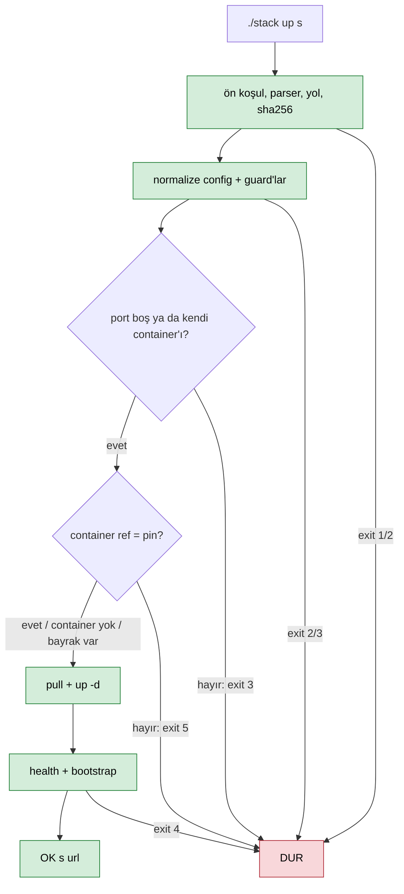
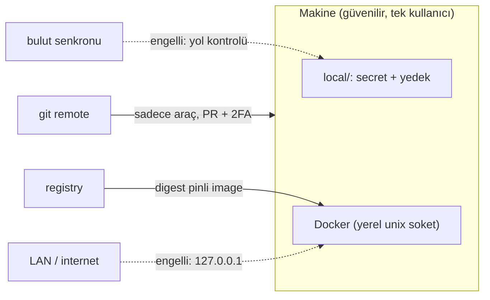

# Spec 0001: selfhost-stack v1 (sadeleştirilmiş): BookStack + Penpot + Plane, her makinede aynı araç

- Status: Awaiting approval
- Tier: full (yeni altyapı, 3 uygulama, ~10 yeni dış bağımlılık, secret ve kimlik bilgileri)
- Revision: 3 (sadeleştirilmiş v1: CEO sertleştirmeyi sürdürmek yerine sadeleştirmeyi seçti. Round-2'nin tam metni arşivde: `docs/spec-r2-full.md`, 32 AC, değiştirilmez)
- Previous spec: `docs/spec-r2-full.md`
- Self-critique: pending (BA düşman okumasını yaptı. Round-3 incelemesi bekleniyor: spec-critic, appsec, architecture-board, talent-capacity)
- Budget ceiling: **provizyonel (K-9)**: 8.5 saat ajan süresi, dağılım §12.1'de. Token tavanı `<TOKEN_CEILING>`, para tavanı `<MONEY_CEILING>` (öneri: 0). Ara kontrol T-6 sonunda. Tavan aşılırsa iş durur ve CEO'ya dönülür.
- CEO decisions: K-1..K-12 (§15). Varsayılanlar **provizyonel** olarak uygulandı. İmza, CEO aksini yazmadıkça bu varsayılanları kabul etmek demektir. Teslim tek fazdır (K-10 kapandı).

> T-0 (upstream doğrulama) yapıldı: `docs/reviews/scout-upstream.md` (2026-11-09). Ölçülmemiş kalanlar **T-0b**'ye bırakıldı (§12). AC'ler mekanizmadan bağımsız yazıldı. T-0b bir AC'yi değiştirmeyi gerektirirse iş T-5'ten önce durur ve spec revize edilir.

## 1. Intent

**CEO'nun kararları (aynen):**
- Araçlar (compose dosyaları, pinlenmiş image versiyonları, CLI script) git'te MERKEZİ yönetilir; her makine bunları `git pull && ./stack up` ile alır.
- Projeler/veri (kitaplar, tasarımlar, Plane projeleri = DB + volume'lar) ve tüm özelleştirmeler MAKİNEYE ÖZELDİR: sadece o makinede yaşar, git ile asla senkronlanmaz. Makine bazlı override'lar (port, domain, volume path) ve secret'lar gitignored `local/` klasöründe durur; repo sadece `local.example/` şablonlarını taşır.
- Makineye özel bir özelleştirme diğer makineleri asla etkilemez.

**Yorumum:** BookStack, Penpot ve Plane her makinede Docker Compose ile, tek komutla ve aynı image'larla (tag + digest) ayağa kalkar. Git araç kutusunu taşır, veri ya da secret taşımaz. Başarı: temiz makinede `git clone` → `./stack init` → `./stack up` sonrası üç uygulama sağlıklı, varsayılan admin ve açık kayıt yok; makineye özel bir değişiklik `git status`'a yansımaz. Yükseltme elle ve belgelenmiş sırayla yapılır (yedek → pin PR'ı → `up`); `up` yedek beyanı olmadan farklı sürüme geçmez. Geri dönüş: eski commit + yükseltme öncesi yedeğin geri yüklenmesi. "Domain" override'ı v1'de yoktur: erişim yalnızca loopback (K-3), domain/TLS ayrı spec.

**Bilerek yapılmayanlar:** LAN/uzaktan erişim modu (sadece `ssh -L`), TLS, domain, makineler arası veri taşıma, yeni makinede felaket kurtarma (secret'lar tasarım gereği makineye özel), mevcut veri göçü (K-1), otomatik yedek/retention, yedek şifreleme, DB major yükseltme, SSO, SMTP, izleme.

## 2. Market summary

Product notu yok. Alternatifler: SaaS sürümleri (veri makinede kalmaz, elendi) ve self-host platformları (Coolify, Dokploy, Portainer, CasaOS: ek sunucu bileşeni ve kendi state'i, `git pull && ./stack up` sadeliğini bozar). Karar: **yap**. Risk: upstream compose takibi (§6.2 vendoring + sha256).

## 3. Requirements (EARS)

- REQ-1: Sistem, desteklenen bir makinede bir init ve bir up komutuyla üç uygulamayı çalışır hale getirecek.
- REQ-2: Sistem her image'ı repo'da versiyon etiketi ve içerik kimliğiyle sabitleyecek. Ne makine ayarları ne shell ortamı çalışacak image'ı değiştirebilecek (K-4).
- REQ-3: İlk init'te sistem her secret'ı makineye özel ve rastgele üretecek; üretilmiş bir secret'ı asla yeniden üretmeyecek ya da değiştirmeyecek.
- REQ-3a: Bir uygulamanın verisi makinede varken o uygulamanın üretilmiş secret'larından herhangi biri eksikse, sistem o uygulama için secret üretmeyi ve başlatmayı reddedecek.
- REQ-4: Sistem secret'ları, makine ayarlarını, veriyi ve yedekleri git'in takip etmediği yerde tutacak.
- REQ-4a: Repo ya da yedek dizini bilinen bir bulut senkron klasörünün altındaysa, sistem açık makine-ayarı onayı olmadan değiştirici işlemleri reddedecek.
- REQ-5: Hiçbir `stack` komutu git'te takip edilen bir dosyayı değiştirmeyecek.
- REQ-6: Takip edilmemesi gereken bir dosya git'e eklenmişse ya da vendored upstream dosyası kayıtlı özetinden farklıysa, sistem değiştirici işlemleri reddedecek. Durdurma ve durum komutları uyarı vererek çalışmaya devam edecek.
- REQ-7: Uygulamalar yalnızca aynı makineden erişilebilir olacak; giriş servisi dışında hiçbir servis host'a açılmayacak. Makine dışına açma modu olmayacak.
- REQ-7a: Sistem host izolasyonunu kaldıran ya da host dosya sistemini açan container ayarlarını reddedecek.
- REQ-8: Sistem yalnızca aynı makinedeki Docker engine ile yerel soket üzerinden konuşacak.
- REQ-9: İstenen port başka bir süreçteyse sistem o uygulamayı başlatmayacak ve portu ve ayarı bildirecek. Uygulamanın kendi container'ı çakışma sayılmayacak; çalışan bir uygulamada tekrar up hiçbir şeyi değiştirmeyecek.
- REQ-10: Sistem makineye özel override'ları merkezi tanımın üstüne, yalnızca o makinede uygulayacak ve makine bazında hangi uygulamaların çalışacağını seçtirecek.
- REQ-11: Mevcut container'lar pinlenmiş image'dan farklı bir image'la oluşturulmuşsa, kullanıcı yedek aldığını açıkça beyan etmedikçe sistem up'ı reddedecek ve yapılacak adımları söyleyecek.
- REQ-12: Sistem her uygulamanın DB'sini ve dosya verisini yerel, bütünlüğü doğrulanabilir biçimde yedekleyecek; yarım yedek geçerli sayılmayacak; yedek komutu hiçbir şey silmeyecek.
- REQ-13: Geri yüklemede sistem önce bütünlüğü doğrulayacak, onay isteyecek, sonra mevcut durumu yedekleyecek. Yedeğin uygulama ya da DB versiyonu şu anki pin'den farklıysa reddedecek ve hangi repo sürümüne geçileceğini söyleyecek.
- REQ-14: Durdurma veriyi silmeyecek. Hiçbir komut uygulama verisini ya da yedekleri silmeyecek; tek istisna, kontrollerden sonra hedef uygulamanın verisini değiştiren geri yüklemedir.
- REQ-15: Sistem her uygulama için çalışma ve sağlık durumunu, adresi, admin kurulum durumunu, pin ile çalışan image farkını ve yedekleri gösterecek.
- REQ-16: Sistem upstream varsayılan kimlik bilgilerini ve açık kaydı önleyecek, admin'i ilk kurulumda kendisi oluşturacak; oluşturamadığı durumda kullanıcıya yapılacak adımı gösterecek.
- REQ-17: Sistem upstream izin veriyorsa telemetriyi kapatacak ve kullanılmayan mail/MCP servislerini devre dışı bırakacak.
- REQ-18: Her hata sıfırdan farklı, belgelenmiş bir çıkış kodu ve düzeltme mesajı verecek. Hiçbir çıktıda secret değeri görünmeyecek.
- REQ-19: Aynı makinede iki değiştirici komut aynı anda çalışırsa sistem ikincisini reddedecek.
- REQ-20: Sistem makine ayar dosyalarını içlerindeki hiçbir ifadeyi çalıştırmadan okuyacak ve beklenmeyen satırda reddedecek.
- REQ-21: Birden çok uygulama için verilen komutta sistem her uygulamayı deneyecek ve ilk başarısızın kodunu döndürecek; ortak ön koşul başarısızsa hiçbirini denemeyecek.

## 4. User experience

UI yok; arayüz `./stack` CLI'ı. Uygulama UI'ları upstream'e ait, kapsam dışı.

| Durum | Davranış | AC |
|---|---|---|
| Boş (init yok) | `up/backup/restore/config` exit 2: `local/ yok: önce ./stack init`. `status` aynı mesajı exit 2 ile verir | AC-15 |
| Yükleniyor | `up` her 5 s'de `bekleniyor <s>: <geçmeyen kontroller> (<geçen>/<HEALTH_TIMEOUT> s)` | AC-1 |
| Hata | §7.3 exit code + Türkçe düzeltme mesajı (stderr) | AC-15 |
| Başarı | Her stack için `OK <s> <url>`; ilk kurulumda `.admin` dosya yolu | AC-1, AC-14 |
| Yetkisiz | Docker erişilemiyor ya da yerel unix soket değil: exit 2 | AC-5, AC-15 |
| Meşgul | Başka değiştirici komut çalışıyor: exit 6 | AC-15 |
| İptal | Restore onayı yok: exit 7, hiçbir şey değişmez | AC-12 |

## 5. Acceptance criteria

`<s>` ∈ {bookstack, penpot, plane}. Varsayılan portlar 8701/8702/8703. "Normalize config" = `stack`'in kendi çağrısıyla (§6.2) üretilen `docker compose config --format json`. "Değiştirici komut" = `init`, `up`, `down`, `backup`, `restore`. "Engelleyici komut" = `init`, `up`, `backup`, `restore`, `config` (guard ve yol kontrolleri bunları durdurur; `down`, `status`, `logs` sadece uyarır).

- [ ] AC-1 (kurulum, idempotent): §7.6 ön koşullarını karşılayan temiz makinede `git clone`, `./stack init`, `./stack up` exit 0 verir ve §9.1 health'i üç stack için `HEALTH_TIMEOUT` (varsayılan 600 s) içinde geçer. Apple Silicon'da hiçbir image `amd64` değildir. Kanıt Docker runtime adını ve versiyonunu içerir. Çalışan stack'te ikinci `./stack up` exit 0 verir, container ID'leri değişmez, port çakışması bildirilmez.
- [ ] AC-2 (secret'lar): `init`, `local/` (700) ve `local/machine.env`, `local/<s>.env` (600) dosyalarını umask'tan bağımsız bu modlarla oluşturur. §7.4'teki her G secret'ı boş değil, tablodaki formatta, birbirinden farklı ve upstream varsayılan listesinde değil. İkinci `init` sonrası `local/*.env` sha256'ları aynı. `selfhost-<s>` volume'u yokken bir G anahtarı silinip `init` çalışırsa yalnızca o anahtar eklenir, diğer satırlar byte düzeyinde aynı. `selfhost-<s>` projesine ait en az bir volume varken `local/<s>.env` yoksa ya da **herhangi bir** G anahtarı eksikse `init` ve `up <s>` exit 2 verir, dosya byte düzeyinde değişmez, mesaj "secret'ı kendi kopyanızdan geri koyun" der; diğer stack'ler normal işlenir.
- [ ] AC-3 (loopback ve port): Varsayılan kurulumda yalnızca `127.0.0.1:8701-8703` dinlenir; LAN IP'sinden `curl` başarısız. `ports` taşıyan servisler yalnızca giriş servisleridir (`bookstack`, `penpot-frontend`, Plane `proxy`), her birinde tek port. 8025, 9000, 9001, 3306, 5432, 5672, 6379, 15672, 80, 443 host'ta dinlenmez. `local/bookstack.env` içinde `BOOKSTACK_PORT=8711` ile `up bookstack` 8711'de dinler ve health 8711'i yoklar; `PLANE_PORT` değişince `WEB_URL` ve `CORS_ALLOWED_ORIGINS` başka dosya düzenlenmeden yeni portu gösterir ve türetilmiş değerler `local/` altında yazılı değildir. Portu başka bir süreç tutuyorsa `up <s>` exit 3 verir, mesaj portu, değişkeni ve dosyasını (ör. `BOOKSTACK_PORT`, `local/bookstack.env`) içerir, o stack'ten container başlamaz. Test macOS ve Linux'ta koşar.
- [ ] AC-4 (guard'lar): `local/<s>.override.yaml` ile şu durumların her biri, hiçbir container başlamadan, belirtilen kodu verir: `host_ip` `127.0.0.1` değil (boş, `0.0.0.0`, `::1`, LAN IP dahil) → 3; giriş servisi dışındaki servise port → 3; `privileged: true` → 3; kaynağı `docker.sock` ile biten mount → 3; `network_mode: host` → 3; boş olmayan `cap_add` → 3; boş olmayan `devices` → 3; kaynağı `/`, `$HOME` ya da `$HOME`'un bir üst dizini olan bind mount → 3; `image:` değeri `versions.env`'den farklı → 2. Aynı override varken `./stack down <s>` ve `./stack status` exit 0 verir ve ihlali uyarı olarak basar; `./stack config <s>` maskeli config'i ve ihlal listesini basıp ihlalin kodunu verir.
- [ ] AC-5 (pin ve ortam izolasyonu): Normalize config'teki her image `ad:tag@sha256:<64 hex>`, tag `latest/stable/main/develop/preview` değil ve `stacks/<s>/versions.env` ile birebir aynı. Shell'de versiyon değişkeni, `COMPOSE_PROFILES`, `COMPOSE_FILE`, `COMPOSE_PROJECT_NAME`, `COMPOSE_ENV_FILES` export etmek servis kümesini ve image'ları değiştirmez. `local/<s>.env` içindeki bir versiyon anahtarı exit 2 verir (izinsiz anahtar). `DOCKER_HOST=tcp://10.0.0.5:2375` ya da endpoint'i `unix://` olmayan bir `DOCKER_CONTEXT` ile engelleyici komutlar ve `down` exit 2 verir. Linux'ta Docker Engine < 28 exit 2 verir.
- [ ] AC-6 (strict parser ve `ENABLED_STACKS`): `local/*.env` ya da `local/machine.env` içinde şu satırların her biri exit 2 ve `<dosya>:<satır>` verir: `export X=1`; `=` içermeyen satır; küçük harfli anahtar; dosyaya ait olmayan anahtar; `ENABLED_STACKS="bookstack"` (tırnak literal okunur, geçersiz ad); `ENABLED_STACKS=bookstack nope`; `ENABLED_STACKS=bookstack bookstack`; boş `ENABLED_STACKS=`. `PENPOT_PORT=$(touch <tmp>/pwn)` ve backtick içeren değerler hiçbir zaman çalışmaz (`<tmp>/pwn` oluşmaz; değer port olarak geçersiz, exit 2). `ENABLED_STACKS=bookstack` ile argümansız `./stack up` yalnızca `selfhost-bookstack`'i başlatır.
- [ ] AC-7 (git hijyeni, iki makine): Her `./stack` komutundan sonra `git status --porcelain` boş. `git ls-files` içinde `local/` ya da `.env.example` dışında `.env` yok. `git add -f local/machine.env` sonrası engelleyici komutlar exit 2 verir. A makinesinde port override'ı varken bir araç değişikliği push edilir, B makinesi `git pull && ./stack up` yapar: B'nin portu, secret'ları ve marker verisi değişmez.
- [ ] AC-8 (vendored bütünlük): `stacks/<s>/upstream/` altındaki bir dosyada tek byte değişince engelleyici komutlar exit 2 verir ve mesaj dosya adını ve beklenen/bulunan sha256'yı gösterir; `down`, `status`, `logs` exit 0 verir ve aynı bilgiyi uyarı olarak basar. `SOURCE` şu alanları taşır: repo, tag, 40 hex commit SHA, her dosya için URL ve sha256, vendoring tarihi.
- [ ] AC-9 (senkron yolu): Sahte bir `HOME` ile repo ya da `BACKUP_DIR` şu yolların altındayken engelleyici komutlar exit 2 verir: `$HOME/Desktop`, `$HOME/Documents`, `$HOME/Library/Mobile Documents`, `$HOME/Library/CloudStorage`, `$HOME/Dropbox`, `$HOME/OneDrive*`, `$HOME/Google Drive`. Yol sembolik bağlantılar çözülerek değerlendirilir (sembolik link ile `$HOME/Desktop`'a giden yol da reddedilir). `local/machine.env` içinde `ALLOW_SYNCED_PATH=1` ile komut çalışır ve her çıktıda uyarı basar. `$HOME/Projects/x` engellenmez.
- [ ] AC-10 (veri kalıcılığı): §9.2 marker verisi oluşturulur; `./stack down` + `./stack up` sonrası sayılar aynı. `stack` ve `lib/` içinde `down -v`, `volume rm`, `volume prune`, `system prune` ve yedek dizini üzerinde `rm` yok (kod incelemesi + `grep -nE 'down +-v|volume +(rm|prune)|system +prune' stack lib/*.sh` boş). Üç ardışık `backup` sonrası üç yedek de durur.
- [ ] AC-11 (yedek): `./stack backup <s>` `$BACKUP_DIR/<s>/<YYYYMMDDTHHMMSSZ>-manual/` altında DB dump'ını, dosya volume tar'larını, `manifest.env` (§7.5) ve `SHA256SUMS` üretir; `shasum -a 256 -c SHA256SUMS` geçer. Dizin 700, dosyalar 600, sahibi komutu çalıştıran kullanıcı. Yazım sürerken yalnızca `<id>.partial/` vardır; başarıda `<id>/` olur; ortada `kill -9` edilirse `.partial` kalır, `status` uyarır, restore onu kabul etmez. Yedekte `local/` dosyası yoktur. Manifest, çalışan/mevcut container'ların image ref'lerini taşır (pin bump'ı sonrası alınan yedek eski ref'leri taşır). Durmuş stack mevcut DB container'ıyla yedeklenir, container ID'leri değişmez ve stack sonra yine durmuş olur. `BACKUP_DIR` göreli → 2; varsayılan dışı ve yok → 2; grup/başkaları yazabiliyor → 2; varsayılan `local/backups` yoksa 700 ile oluşur. Kendi arşivi §7.5 restore kurallarına uymayan yedek (ör. link girişi) `.partial` olarak kalır ve exit 5.
- [ ] AC-12 (restore): `./stack restore <s> <id>` bütünlüğü doğrular, onay ister (stack adını yazdırarak ya da `--yes`), `pre-restore` yedeği alır, uygulama servislerini durdurur, veriyi geri yükler, stack'i başlatır, health'i bekler; yedek sonrası silinen marker veri geri gelir. Şu durumların her birinde volume içeriği değişmez (marker sayıları aynı) ve `pre-restore` yedeği oluşmaz: id regex'e uymuyor (ör. `../x`) → 1; `restore all` → 1; yedek yok ya da `.partial` → 5; `SHA256SUMS` başarısız → 5; tar'da mutlak yol, `..` bileşeni, sembolik ya da hard link girişi → 5; manifest `APP_TAG` ya da `DB_TAG` pin'den farklı → 5 ve mesaj o pin'i içeren commit'i ve `git switch --detach <commit>` komutunu gösterir; onay yok (TTY yok ve `--yes` yok dahil) → 7.
- [ ] AC-13 (yükseltme kontrolü ve geri dönüş): Stack eski pin'le çalışırken ya da durmuşken `versions.env` bump'lanıp `./stack up <s>` çalışınca exit 5 verir, image çekilmez, hiçbir container değişmez; mesaj "önce `./stack backup <s>`, sonra `./stack up <s> --i-have-a-backup`; eski sürüme dönüyorsanız `up` değil `restore`" der. `status` bu durumda `DRIFT` gösterir. `./stack backup <s>` + `./stack up <s> --i-have-a-backup` yeni sürümü sağlıklı başlatır. Geri dönüş: `git switch --detach <bump-öncesi-commit>` + `./stack restore <s> <bump-öncesi-yedek>` sonrası eski sürüm sağlıklı ve marker sayıları bump öncesiyle aynı. Hiç container yokken (ilk kurulum) bayrak gerekmez.
- [ ] AC-14 (admin ve uygulama sertleştirme): İlk başarılı `up` sonrası BookStack'te `admin@admin.com` yoktur ve `admin@admin.com`/`password` girişi başarısızdır; Penpot'ta UI'da kayıt bağlantısı yoktur ve kayıt RPC'si hata döner; Plane'de kimliksiz sign-up isteği başarısızdır ve bir instance admin vardır. Otomatik oluşturulan admin bilgisi `local/<s>.admin` (600) dosyasındadır, terminale yalnızca yol basılır. Plane admin'i CLI ile oluşturulamıyorsa (T-0b) `up` exit 0 verir, `status` `bootstrap pending` ve README'deki loopback `/god-mode` adımını gösterir; adım yapılınca `status` `done` gösterir. Penpot normalize config'inde `penpot-mailpit` ve `penpot-mcp` aktif değildir, `PENPOT_FLAGS` içinde `enable-smtp`, `enable-mcp`, `enable-telemetries`, `enable-registration` yoktur, `PENPOT_TELEMETRY_ENABLED=false`. Normalize config'te upstream varsayılan secret'larının hiçbiri ve `TRUSTED_PROXIES=0.0.0.0/0` geçmez.
- [ ] AC-15 (exit code'lar, kilit, maskeleme, status): §7.3'teki her negatif test beklenen kodu verir ve hiçbirinde istenmeyen container başlamaz. `up all` sırasında bir stack 3 ile düşerse diğerleri denenir, her stack için özet satırı basılır, genel kod `ENABLED_STACKS` sırasındaki ilk başarısızın kodudur; Docker erişilemiyorsa hiçbir stack denenmez. Değiştirici komut çalışırken ikinci değiştirici komut exit 6 verir ve PID ile kilit yolunu gösterir; `status`, `logs`, `config` kilitliyken çalışır; kilit normal çıkış, hata ve SIGINT sonrası kalkar. `local/*.env` ve `local/*.admin` içindeki her secret değeri için `grep -F` şu çıktılarda 0 eşleşme verir: `./stack config all`, `./stack status`, §7.3 negatif testlerinin stdout+stderr'i (türetilmiş değerlerin içinde, ör. `DATABASE_URL`, de `***`). `status` her stack için servis durumu, health, URL, bootstrap `done/pending`, `DRIFT` (container ref ≠ pin), yedek sayısı ve `.partial` uyarısını gösterir; `logs <s> [service]` log akıtır.

## 6. Architecture and technology decision

### 6.1 Kararlar

| Konu | Seçenekler | Seçim ve gerekçe |
|---|---|---|
| CLI dili | (a) bash 3.2 uyumlu script + `lib/*.sh`, (b) Python, (c) Go | **(a)**: macOS ve Linux'ta hazır, ek runtime yok. Maliyet: `set -euo pipefail`, shellcheck ve bash 3.2 test kapısı (G-1). |
| Override merge | (a) `-f upstream -f overlay -f local` + `!override`/`!reset`, (b) env-only, (c) YAML üretmek | **(a)**: Compose'un yerel mekanizması; `ports` eklenerek birleştiği için `!override` gerekir; her engelleyici komut `!override` probunu koşar. |
| Pin | (a) tag, (b) tag + multi-arch index digest | **(b)**: "her makinede aynı image" ölçülebilir olur. |
| Ortam | (a) seçili değişkenleri `unset`, (b) `env -i` + izin listesi | **(b)**: `COMPOSE_*`, versiyon ve secret değişkenleri shell'den gelemez. |
| Yükseltme koruması | (a) kurulu-durum makinesi + otomatik pre-upgrade yedek (r2), (b) container image ref ≠ pin ise exit 5 + `--i-have-a-backup`, (c) koruma yok | **(b)**: tek kontrol, state dosyası yok. Maliyet: downgrade ve DB major ayrımı yok, beyan doğrulanmaz (§14 kalan riskler). (c) veri kaybına açık, reddedildi. |
| Host header / DNS rebinding | (a) uygulamanın kendi ayarı, (b) reverse proxy sidecar, (c) ölçüm + belgelenmiş risk | **(c)**: T-0b her uygulamanın `Host: evil.example` yanıtını ölçer ve raporlar; yerel ayar varsa overlay'de açılır; yoksa risk README ve ADR-0001'de yazılır. Sidecar v1'de yok. |
| Kurulum kaynağı | (a) Plane/Penpot release tag'inden vendor + overlay, BookStack `lscr.io/linuxserver/bookstack` + `mariadb` 11.4 LTS, (b) `setup.sh` / `solidnerd/bookstack`, (c) elle yazmak | **(a)**: tag'e bağlı ve sabit; `setup.sh` interaktif ve `latest` çeker; BookStack'in resmi image'ı yok, linuxserver dokümanların gösterdiği, multi-arch ve aktif. |
| Yedek yardımcısı | (a) pinli `alpine`, (b) DB image'larının tar'ı | **(a)**: tek tar davranışı. Arşiv stdout/stdin ile akar, dosyayı host'taki `stack` oluşturur (sahiplik kullanıcıda). |

### 6.2 Katmanlar ve vendoring

Dosyalar sırayla merge edilir, guard'lar birleşik sonucu (normalize config) inceler: (1) `-f stacks/<s>/upstream/<dosya>` (penpot, plane; önce `SOURCE` sha256'sı doğrulanır), (2) `-f stacks/<s>/compose.yaml` (127.0.0.1 port `!override`, image pin, gereksiz servisler `profiles: [disabled]` + `ports: !reset []`, eksik healthcheck'ler), (3) `-f local/<s>.override.yaml` (varsa; bind path'leri mutlak), (4) `--env-file local/<s>.env --env-file stacks/<s>/versions.env`; versiyon anahtarları yalnızca `versions.env`'de olabileceği için sıraya bağımlılık yok, (5) türetilmiş değerler çağrı ortamına verilir, dosyaya yazılmaz, (6) sabitler `-p selfhost-<s>`, `--project-directory stacks/<s>`, hiç `--profile` yok.

- Plane: `makeplane/plane` v1.4.3 release asset'leri `docker-compose.yml` + `variables.env` (yalnızca referans), değiştirilmeden. Penpot: `penpot/penpot` tag `2.18.6`, `docker/images/docker-compose.yaml`.
- `SOURCE`: `REPO`, `TAG`, `COMMIT` (40 hex), dosya başına `URL` + `SHA256`, `VENDORED_AT`. Kontrol TOFU'dur; asıl inceleme vendor PR diff'idir. `tools/vendor.sh` bakımcı aracıdır, runtime dışıdır.
- Overlay upstream'deki her image'ı `versions.env` değeriyle ezer; kayan varsayılanlar (`${PENPOT_VERSION:-2.18}`, `APP_RELEASE=stable`) etkisizdir.

### 6.3 Pin ve elle yükseltme (ADR-0002)

Yükseltme sırası (README'de): (1) her makinede `./stack backup <s>`, (2) `versions.env` bump'ı (tag + digest, gerekirse yeniden vendor) bir PR'dır, test ortamında §9 geçer, main'e merge CEO onayıyla, (3) makine `git pull` + `./stack up <s>` → exit 5 (AC-13) → yedek alınmışsa `./stack up <s> --i-have-a-backup`. Kontrol: `up`, `selfhost-<s>` projesinin mevcut (çalışan ya da durmuş) her container'ının yapılandırılmış image ref'ini normalize config'teki ref ile karşılaştırır; biri farklıysa ve bayrak yoksa exit 5, image çekmeden. Container yoksa kontrol geçer. Kural: v1 pin PR'ları DB major versiyonunu değiştiremez (PR inceleme maddesi, otomatik kontrol yok). Geri dönüş §10'da.

### 6.4 Upstream gerçekleri ve bağımlılıklar

Kaynak `docs/reviews/scout-upstream.md` (F-1..F-10). Özet: BookStack resmi image yok, varsayılan giriş `admin@admin.com`/`password`, `/status` JSON; Penpot 8 servis (mailpit 8025'i host'a açar, mcp yeni), frontend `9001:8080`, `create-profile` CLI'ı; Plane compose'da healthcheck yok, varsayılan secret'lar ve `TRUSTED_PROXIES=0.0.0.0/0`, admin `/god-mode`'da, object storage `pgsty/silo` (MinIO fork'u). OSV/GHSA taraması T-9'da.

Bağımlılıklar (pin T-1'de digest ile; lisans; çıkış maliyeti): `lscr.io/linuxserver/bookstack` `v26.09.2-ls<N>` (MIT app, GPL-3.0 script; düşük); `mariadb` `11.4.<patch>` (GPL-2.0); `penpotapp/frontend, backend, exporter` `2.18.6` (MPL-2.0; yüksek); `postgres` `15.<patch>` (Penpot) ve `15.7-alpine` (Plane) (PostgreSQL); `valkey/valkey` `8.1.<patch>` / `7.2.11-alpine` (BSD-3); `rabbitmq` `3.13.6-management-alpine` (MPL-2.0); `makeplane/*` `v1.4.3` (AGPL-3.0; yüksek); `pgsty/silo` `RELEASE.2026-09-16T00-00-00Z` (AGPL-3.0 varsayımı, doğrulanmadı; orta, ADR-0004); `alpine` `3.<minor>.<patch>` (yedek yardımcısı); host `jq ≥ 1.6` (MIT), geliştirme `shellcheck` (GPL-3.0). DB major geçişleri ayrı spec.

### 6.5 ADR'ler (T-10)

- **ADR-0001** katman modeli: `-f` sırası, `--project-directory`, `-p selfhost-<s>`, volume adları, `local/` düzeni, Host header ölçüm sonucu.
- **ADR-0002 (kısa)** pin politikası (tag+digest), elle yükseltme ve `--i-have-a-backup` kontrolü, DB major yasağı, `BACKUP_FORMAT=1`.
- **ADR-0004** `pgsty/silo` risk kabulü; çıkış tetikleyicileri: silo'yu etkileyen CVE için 30 gün içinde yama yok, Plane depolamayı değiştirir, uzaktan erişim açılır, 6 ay release yok. Tetiklenirse ayrı spec ile S3 uyumlu muadile göç. ADR-0003 ve ADR-0005 v1'de yazılmaz.

## 7. Data and API contract

ER yok: uygulama şemaları upstream'in. Sözleşme dosyalar, CLI ve env değişkenleridir.

### 7.1 Dosyalar

| Yol | Git | İçerik |
|---|---|---|
| `stack`, `lib/*.sh`, `tools/vendor.sh` | evet | CLI (bash 3.2); `vendor.sh` bakımcı aracı, ağ kullanır, yalnızca `stacks/<s>/upstream/` yazar |
| `stacks/<s>/compose.yaml`, `upstream/*`, `versions.env`, `.env.example` | evet | BookStack tam tanım, Penpot/Plane overlay + vendored + `SOURCE`; tek image kaynağı `ad:tag@sha256:...`; şablon secret'lar `__GENERATE__` |
| `stacks/_helper/versions.env`, `stacks/_probe/*.yaml`, `local.example/` | evet | `HELPER_IMAGE`; `!override` probu; şablonlar |
| `local/` | **hayır** | `machine.env`, `<s>.env` (600), `<s>.admin` (600), `<s>.override.yaml`, `.lock/`, varsayılan `backups/` (700) |

`local/machine.env` (geçerli değer dışı her değer exit 2):

| Anahtar | Varsayılan | Geçerli değer |
|---|---|---|
| `ENABLED_STACKS` | `bookstack penpot plane` | üç addan oluşan, tek boşlukla ayrılmış, tekrarsız, boş olmayan liste; sıra işlem sırasıdır |
| `BACKUP_DIR` | `<repo>/local/backups` | mutlak yol (AC-11) |
| `HEALTH_TIMEOUT` | `600` | 60..3600 |
| `ALLOW_SYNCED_PATH` | `0` | `0`/`1` |
| `ADMIN_EMAIL` | `admin@example.com` | e-posta biçimi |

### 7.2 CLI

`./stack <komut> [bookstack|penpot|plane|all]`; argüman yoksa `ENABLED_STACKS`.

| Komut | Kilit | Guard | Davranış |
|---|---|---|---|
| `init` | evet | engeller | `local/` ve env dosyaları; eksik anahtarları ekler, mevcutlara dokunmaz; AC-2 kuralı |
| `up [--i-have-a-backup]` | evet | engeller | §7.11 |
| `down` | evet | uyarır | `docker compose -p selfhost-<s> stop`; compose dosyası merge etmez; `-v` asla |
| `status` | hayır | uyarır | AC-15 |
| `logs <s> [service]` | hayır | uyarır | log akışı; `all` → 1 |
| `backup [s\|all]` | evet | engeller | AC-11 |
| `restore <s> <id> [--yes]` | evet | engeller | AC-12; tek stack |
| `config <s\|all>` | hayır | raporlar | maskeli normalize config + ihlal listesi; ihlal varsa ihlalin kodu |

### 7.3 Exit code'lar (her biri bir negatif testle; mesajların sahibi `stack`)

| Kod | Anlam | Negatif test |
|---|---|---|
| 0 | başarı | AC-1 |
| 1 | kullanım hatası | `./stack foo`; `./stack up nope`; `./stack logs all`; `./stack restore bookstack ../x`; `./stack up --bilinmeyen` |
| 2 | ön koşul ya da yapılandırma reddi | `local/` yok; Docker durdurulmuş; PATH'ten `jq` çıkarılmış; `!override` probu başarısız sahte compose; Linux'ta 27.x bildiren sahte `docker`; `DOCKER_HOST=tcp://...`; `git add -f local/machine.env`; senkron yolu (AC-9); vendored 1 byte (AC-8); override `image:`; parser satırları (AC-6); `BACKUP_DIR=rel/path`; volume varken eksik G anahtarı (AC-2) |
| 3 | ağ/izolasyon guard'ı ya da port çakışması | AC-3 çakışma; AC-4 durumları |
| 4 | health timeout | `HEALTH_TIMEOUT=60` + override ile DB host'u bozulmuş → 4; mesajda geçmeyen kontrol ve `./stack logs <s> <service>` |
| 5 | veri güvenliği | `BACKUP_DIR` read-only → backup 5; AC-12 bütünlük/tar/manifest retleri; AC-13 bayraksız pin farkı |
| 6 | kilit meşgul | `mkdir local/.lock` (içine PID) sonra `./stack up` |
| 7 | onay verilmedi | `echo hayir \| ./stack restore bookstack <id>` |

Kilit: `local/.lock/` `mkdir` ile atomik alınır, içine PID ve zaman yazılır, normal çıkış, hata, SIGINT ve SIGTERM'de kaldırılır. Sahibi yaşamıyorsa `stack` silmez; mesaj PID'nin yaşamadığını ve `rm -r local/.lock` komutunu gösterir (exit 6).

### 7.4 Env değişkenleri ve secret'lar

Türler: **G** = `init` üretir; **M** = varsayılanlı, makine değiştirebilir; **T** = her çağrıda hesaplanır, dosyaya yazılmaz; **P** = yalnızca `versions.env`.

| Stack | M | T |
|---|---|---|
| bookstack | `BOOKSTACK_PORT=8701` | `APP_URL=http://localhost:<port>` |
| penpot | `PENPOT_PORT=8702`, `PENPOT_FLAGS` (varsayılan `disable-registration disable-email-verification enable-login-with-password disable-secure-session-cookies enable-prepl-server`) | `PENPOT_PUBLIC_URI`, `PENPOT_TELEMETRY_ENABLED=false` |
| plane | `PLANE_PORT=8703` | `WEB_URL`, `APP_DOMAIN`, `CORS_ALLOWED_ORIGINS`, `DATABASE_URL`, `AMQP_URL`, `REDIS_URL`, `TRUSTED_PROXIES` (loopback, değer T-0b) |

"Port" = normalize config'te giriş servisinin yayınlanan portu; health, çakışma kontrolü ve URL'ler bunu kullanır. Uygulamaya özel ek environment `local/<s>.override.yaml` ile verilir.

| G secret (`local/<s>.env`) | Üretim | Tüketenler (tam liste T-2..T-4'te vendored dosyadan) |
|---|---|---|
| `BOOKSTACK_APP_KEY` | `base64:` + `openssl rand -base64 32` (Laravel formatı, T-0b doğrular) | `APP_KEY` |
| `BOOKSTACK_DB_PASSWORD`, `BOOKSTACK_DB_ROOT_PASSWORD` | `openssl rand -hex 32` | bookstack `DB_PASSWORD`, mariadb `MARIADB_PASSWORD` / `MARIADB_ROOT_PASSWORD`, dump |
| `PENPOT_SECRET_KEY`, `PENPOT_DB_PASSWORD` | `openssl rand -hex 32` | backend (ve exporter), postgres |
| `PLANE_SECRET_KEY`, `PLANE_LIVE_SERVER_SECRET_KEY` | `openssl rand -hex 32` | api, worker, beat-worker, migrator, live |
| `PLANE_DB_PASSWORD`, `PLANE_RABBITMQ_PASSWORD` | `openssl rand -hex 32` | db, mq; T `DATABASE_URL`, `AMQP_URL` |
| `PLANE_S3_ACCESS_KEY` / `PLANE_S3_SECRET_KEY` | `openssl rand -hex 10` / `-hex 32` | silo root; api `AWS_*` |
| admin parolası (`local/<s>.admin`) | `openssl rand -hex 16` | bootstrap |

Hex, URL içinde kaçış gerektirmez. Tüm dosyalar `umask 077` ile oluşur. **Asla yeniden üretme kuralı:** `selfhost-<s>` etiketli volume varken herhangi bir G anahtarı eksikse exit 2 (AC-2); volume yoksa yalnızca eksikler eklenir. `up` asla secret üretmez: eksik G anahtarında exit 2 ve `./stack init` yönergesi (volume varsa AC-2 mesajı). Upstream varsayılan listesi: `change-this-key-on-deployment`, `change-this-insecure-key`, `plane`, `penpot`, `access-key`, `secret-key`, `password`, `admin@admin.com` (T-2..T-4 genişletir).

### 7.5 Yedek formatı ve restore

Dizin `$BACKUP_DIR/<s>/<id>/`, `<id>` regex'i `^[0-9]{8}T[0-9]{6}Z-(manual|pre-restore)$`. Yazım `<id>.partial/`'da; `SHA256SUMS` yazılıp kendi arşivleri restore kurallarına karşı doğrulandıktan sonra rename. Aynı id varsa exit 5. `manifest.env`: `BACKUP_FORMAT=1`, `STACK`, `BACKUP_ID`, `REASON`, `CREATED_AT`, `CLI_COMMIT`, `APP_IMAGE`, `DB_IMAGE`, `APP_TAG`, `DB_TAG`, `FILES`. Image alanları mevcut container'lardan alınır; container yoksa `versions.env`'den.

| Stack | DB (dump, gzip) | Dosya volume'ları (tar.gz) | Hariç |
|---|---|---|---|
| bookstack | `mariadb-dump --single-transaction` | `/config` | – |
| penpot | `pg_dump` | assets | valkey |
| plane | `pg_dump` | silo verisi | valkey, rabbitmq, log'lar |

Tutarlılık: yazan uygulama servisleri dump/tar sırasında durdurulur, DB çalışır; durmuş stack'te mevcut DB container'ı `start` edilir (yeniden oluşturulmaz), sonra eski durumuna döner. Tar yardımcısı volume'u read-only bağlar; mutlak yol açılmaz (`-P`/`--absolute-names` hiç kullanılmaz).

Restore sırası: id regex → dizin var, `.partial` değil → `SHA256SUMS` → her tar'ın giriş listesi (mutlak yol, `..`, sembolik/hard link yok) → manifest `BACKUP_FORMAT=1`, `STACK`, `APP_TAG`/`DB_TAG` = pin (farklıysa `git log` ile o pin'i içeren commit önerilir) → onay → `pre-restore` yedek (başarısızsa exit 5, veri değişmez) → uygulama servisleri durur → DB volume boşaltılır, pinli image ile başlatılır, dump yüklenir → dosya volume'ları boşaltılıp açılır → `up -d` + health. Boşaltmadan sonra bir adım başarısız olursa exit 5 ve mesaj `pre-restore` id'sini verir. Restore `local/` dosyalarına dokunmaz; AC-13 pin kontrolü restore'a uygulanmaz.

### 7.6 Ön koşullar ve ortam izolasyonu

Eksik her biri exit 2, adıyla: `bash ≥ 3.2`; `docker` erişilebilir, endpoint yerel `unix://` soket (`DOCKER_HOST` boş ya da `unix://`; aktif context endpoint'i `unix://`); Linux'ta Docker Engine ≥ 28 (28.0, `127.0.0.1`'e yayınlanan portlara LAN'daki başka host'lardan doğrudan erişimi engeller; kaynak T-0b'de kaydedilir); `docker compose` v2 + `!override` probu; `jq ≥ 1.6`; `curl`; `openssl`; `git`; `shasum` (macOS) / `sha256sum` (Linux); `lsof` (macOS) / `ss` (Linux). Testler için `python3`.

`env -i` izin listesi: `PATH`, `HOME`, `USER`, `LOGNAME`, `LANG`, `LC_ALL`, `TMPDIR`, `TERM`, `DOCKER_HOST` (yalnızca `unix://`), `DOCKER_CONTEXT`, `DOCKER_CONFIG`. Diğer her değişken düşer.

Port kontrolü (G-free): önce `selfhost-<s>` giriş container'ı çalışıyor ve bu portu yayınlıyorsa (`docker compose ps` publisher bilgisi) çakışma yok. Değilse port, macOS'ta `lsof -nP -iTCP:<port> -sTCP:LISTEN`, Linux'ta `ss -ltn` bir dinleyici gösterirse ya da `127.0.0.1:<port>`'a TCP bağlantısı kurulabiliyorsa doludur. (macOS'ta Docker Desktop dinleyicisi `com.docker.backend` görünür; bu yüzden kendi container'ı ayrımı compose üzerinden yapılır.) `up -d` yine de "port already allocated" ile düşerse exit 3.

### 7.7 Admin bootstrap

`up` health geçince bootstrap kontrolünü koşar; admin yoksa oluşturur. `status` aynı kontrolü salt okunur koşar. Mekanizma T-0b'de ölçülür.

| Stack | Oluşturma | Kontrol |
|---|---|---|
| bookstack | admin oluşturma CLI'ı (`bookstack:create-admin`, T-0b doğrular), ardından `admin@admin.com` silinir | `admin@admin.com` yok; `ADMIN_EMAIL` admin; kayıt kapalı |
| penpot | `docker compose exec penpot-backend python3 manage.py create-profile` | `disable-registration` var, `enable-registration` yok; profil var |
| plane | T-0b CLI bulursa onunla; yoksa README'deki elle adım: loopback'te `http://localhost:<port>/god-mode`, admin oluştur, signup'ı kapat | ≥ 1 instance admin; signup kapalı |

Makine dışına açma modu olmadığı için bootstrap'a bağlı başlatma kapısı yoktur.

### 7.8 Senkron yolu

Yol `pwd -P` ile çözülür. `$HOME/Desktop`, `$HOME/Documents`, `$HOME/Library/Mobile Documents`, `$HOME/Library/CloudStorage`, `$HOME/Dropbox`, `$HOME/OneDrive*`, `$HOME/Google Drive` altındaysa senkron sayılır (fail closed: Finder ayarı okunmaz). Kural repo yoluna ve `BACKUP_DIR`'e uygulanır; `ALLOW_SYNCED_PATH=1` reddi kaldırır, uyarıyı kaldırmaz. Bu repo şu an `~/Desktop/Projects/` altında: K-2 gereği taşınmalı.

### 7.9 Env parser

`local/*.env`, `local/machine.env`, `versions.env`, `manifest.env` aynı strict parser ile okunur; `source`/`eval` yok. Geçerli satır: boş, `#` ile başlayan, `ANAHTAR=değer` (`^[A-Z][A-Z0-9_]*$`). Değer satır sonuna kadar literal: tırnak soyulmaz, `$`, backtick, `\` genişletilmez. Her dosyanın izinli anahtar kümesi ve değer kuralı vardır (§7.1, §7.4). Diğer her satır exit 2, `<dosya>:<satır>`.

### 7.10 Guard listesi (normalize config üzerinde; yalnızca bunlar)

| Guard | Kural | Exit |
|---|---|---|
| G-src | vendored sha256 = `SOURCE` | 2 |
| G-img | her image `ad:tag@sha256:<64hex>`, kayan tag yok, `versions.env` ile birebir | 2 |
| G-port | yalnızca giriş servisinde port; `host_ip` = `127.0.0.1` | 3 |
| G-iso | `privileged`, `docker.sock` mount'u, `network_mode: host`, `cap_add`, `devices`, `/`, `$HOME` ya da üst dizinlerinin bind'ı yok | 3 |
| G-free | port boş ya da kendi container'ında (§7.6) | 3 |

### 7.11 `up` nerede durur?

Açıklama: hiçbir image çekilmeden önce guard'lar, port ve pin kontrolü geçer. Yeşil otomatik adım, kırmızı ve "DUR" etiketli düğüm durma noktası; kodlar kenar etiketlerinde. Metin karşılığı: (1) ön koşul, parser, senkron yolu, vendored sha256 → başarısızsa 1/2; (2) normalize config + guard'lar → 2/3; (3) port → 3; (4) container ref = pin, ya da container yok, ya da `--i-have-a-backup` → değilse 5, image çekilmez; (5) pull + `up -d` + health + bootstrap → health geçmezse 4.

## 8. Threat model and security

Sensitive area: kimlik bilgileri (uygulama secret'ları, DB/object storage/RabbitMQ parolaları, admin hesapları) ve uygulamalardaki kişisel veri (e-posta, isim).

### Güven sınırları nerede?

Açıklama: dışarıdan yalnızca doğrulanmış araç ve pinli image girer; LAN ve senkron yolları engelli (kesikli çizgi ve "engelli" etiketi). Metin karşılığı:

| Sınır | Geçer | Geçemez | Koruma |
|---|---|---|---|
| git remote ↔ repo | compose, pin, script | secret, veri | `.gitignore`, AC-7, T-11 |
| registry ↔ Docker | digest'i pinli image | kayan tag | G-img, AC-5 |
| LAN ↔ uygulama | hiçbir şey; uzak erişim yalnızca `ssh -L` | her bağlantı | G-port, Engine ≥ 28, AC-3, AC-4 |
| `local/` ↔ bulut | hiçbir şey | secret, yedek | §7.8, AC-9 |
| container ↔ host | tanımlı volume'lar | soket, host ağı, cihaz, `/`, `$HOME` | G-iso |

| # | Tehdit | Önlem | AC |
|---|---|---|---|
| TH-1 | Secret'ın git'e ya da buluta sızması | `local/` gitignored, takipli dosya → 2, fail-closed senkron yolu | AC-7, AC-9 |
| TH-2 | Varsayılan secret/admin, açık kayıt, telemetri | `init` üretir, bootstrap, kayıt kapalı, mailpit/mcp/telemetri kapalı | AC-2, AC-14 |
| TH-3 | Port'un LAN'a açılması, uzak engine | G-port, Engine ≥ 28, yalnızca yerel unix soket | AC-3..5 |
| TH-4 | Secret yeniden üretimi (veri erişimi kaybı) | volume varken eksik G anahtarı → 2 | AC-2 |
| TH-5 | Yedek ifşası, arşivle path traversal | 700/600, sahip, `BACKUP_DIR` kuralları, env yedekte yok; sha256, giriş listesi, link reddi | AC-11, AC-12 |
| TH-6 | Tedarik zinciri, git hesabının ele geçirilmesi, `pgsty/silo` yama almaz | tag+digest, vendored sha256, PR diff, main koruması + 2FA (T-11), `stack` kendi `git pull` yapmaz, ADR-0004 (K-7) | AC-5, AC-8 |
| TH-7 | Ortam/env dosyası ile guard atlatma, komut enjeksiyonu | `env -i`, strict parser, `source` yok | AC-5, AC-6 |
| TH-8 | Yedeksiz yükseltme, kazara silme, eşzamanlı komut | pin farkı → 5 + beyan; `-v`/`rm`/`prune` yok; restore öncesi yedek; kilit | AC-10, 12, 13, 15 |
| TH-9 | Çıktıda secret | değere göre maskeleme | AC-15 |
| TH-10 | DNS rebinding ile loopback'e tarayıcıdan erişim | T-0b ölçümü; yerel ayar varsa açılır, yoksa belgelenmiş risk | T-0b |

**Kabul edilen kalan riskler:** secret'lar `docker inspect`'te görünür (tek kullanıcı); Penpot prepl yalnızca container ağında; bootstrap tamamlanana kadar (Plane'de elle adım yapılana kadar) aynı makinedeki başka bir yerel süreç admin'i alabilir; yedekler şifresiz (K-11); §14'teki sadeleştirme riskleri.

## 9. Test and evidence plan

### 9.1 Health
Her 5 s'de bir tur, her HTTP probu `curl --max-time 5`, hedef `127.0.0.1:<yapılandırılmış port>`. Turdaki tüm kontroller geçerse sağlıklı; `HEALTH_TIMEOUT` dolarsa exit 4 ve geçmeyen kontroller. Tek seferlik servis (Plane migrator) `exited (0)` ise geçer, başka kodla çıkarsa hemen exit 4.

| Stack | Kontroller |
|---|---|
| bookstack | `GET /status` → 200, `database/cache/session` hepsi `true`; mariadb `healthy` |
| penpot | `GET /` → 200; backend probu T-0b'nin ölçtüğü yol (ölçülene kadar `running` + 0 restart); postgres, valkey `healthy` |
| plane | `GET /` → 200; `GET /api/instances/` → 200 JSON (T-0b); overlay healthcheck'leri `healthy`; migrator `exited (0)`; hiçbir servis `unhealthy/restarting` değil |

Apple Silicon: `docker image inspect --format '{{.Architecture}}'` her image için `arm64`.

### 9.2 Marker veri
DB'de sayım: BookStack `pages`, Penpot `file`, Plane `issues` (tablo adları T-0b). Elle: görselli bir sayfa, bir Penpot dosyası, ekli bir Plane issue; görsel URL'i 200.

### 9.3 Kriter ↔ test (tek QA görevi, T-7)

| AC | Test | Katman |
|---|---|---|
| AC-1 | temiz macOS + Linux VM: clone → init → up → §9.1 + arch; `up` ×2 → `docker ps -q` aynı | e2e |
| AC-2 | `init` ×2 sha256 eşit; `stat` modları; format regex; varsayılan listesi `grep -F`; volume yokken anahtar sil → diff tek satır; etiketli `docker volume create` + anahtar sil → `init`=2, `up`=2, sha256 aynı | integration |
| AC-3 | `lsof`/`ss` → sadece 3 port, `127.0.0.1`; LAN IP'den `curl --max-time 3` başarısız; config'te port taşıyan servisler; port 8711 senaryosu; `python3 -m http.server 8701 --bind 127.0.0.1` → 3 + mesaj | integration |
| AC-4 | her durum için ayrı override → kod + `docker ps` boş; aynı override ile `down`/`status` 0 | integration |
| AC-5 | config JSON regex + `versions.env` eşitliği; `export` senaryosu; local env'de versiyon anahtarı; `DOCKER_HOST=tcp://`; sahte `docker` 27.x | integration |
| AC-6 | her satır için ayrı dosya → 2 + `<dosya>:<satır>`; `<tmp>/pwn` yok; `ENABLED_STACKS=bookstack` | unit (script) |
| AC-7 | tüm komutlar sonrası `git status --porcelain`; `git ls-files` filtresi; `git add -f`; iki makine (mac + VM, test remote) | e2e |
| AC-8 | upstream'e 1 byte → engelleyiciler 2, `down/status/logs` 0 + uyarı; `SOURCE` alanları | integration |
| AC-9 | sahte `HOME` ile 7 yol + sembolik link + `ALLOW_SYNCED_PATH=1` + `$HOME/Projects` | unit (script) |
| AC-10 | marker → down → up → sayım; grep; üç backup → üç dizin | integration |
| AC-11 | dosya listesi, `shasum -c`, mod, sahip; yazım sırasında `ls`; `kill -9` → `.partial` + `status` uyarısı; bump sonrası yedek manifest'i eski ref; durmuş stack ID'leri; `BACKUP_DIR` kuralları; link içeren volume → 5 | integration |
| AC-12 | backup → marker sil → restore (ad ve `--yes`) → sayım; her ret için el yapımı arşiv/manifest → kod + sayım + `pre-restore` yok | e2e |
| AC-13 | bump (çalışırken ve durmuşken) → 5, `docker ps` ve image listesi aynı, `status` `DRIFT`; backup + bayrak → yeni sürüm; detach + restore → eski sürüm + sayım | e2e |
| AC-14 | DB sorguları; `admin@admin.com`/`password` form girişi; Penpot kayıt RPC'si; Plane sign-up API; config JSON sorguları; `docker ps` mailpit/mcp yok | e2e |
| AC-15 | §7.3 tablosu; `up all` + bir çakışma; Docker kapalı; `up` sürerken `backup` → 6; SIGINT sonrası kilit yok; secret listesiyle `grep -F`; `status` alanları | integration |
| Kapı G-1 | `shellcheck stack lib/*.sh tools/*.sh tests/*.sh` temiz; testler macOS `/bin/bash` 3.2 ve Linux bash 5'te | statik |

Kanıt: QA fresh komut çıktısını teslim notuna ekler; ekran görüntüsü repo'ya girmez.

## 10. Deployment, upgrade, rollback, DR

Hedef: CEO'nun makineleri (macOS, opsiyonel Linux). Deploy = CEO'nun her makinede `git pull && ./stack up` çalıştırması; hiçbir ajan bunu yapmaz. main'e merge CEO onayıyla. Test: ayrı test remote'u + Linux VM (K-8).

- **Yükseltme:** §6.3 sırası. `up` yedeği kendisi almaz.
- **Uygulama rollback'i:** `git switch --detach <bump-öncesi-commit>` + `./stack restore <s> <bump-öncesi-yedek-id>` (AC-13). Manifest verinin pin'ini taşır; restore uymayan pin'i reddeder ve doğru commit'i söyler. Sorun giderilince `git switch main` + §6.3 sırası yeniden. Eski commit'te `up --i-have-a-backup` downgrade'dir ve desteklenmez (README uyarır).
- **Araç rollback'i** (pin değişmeden): `git switch --detach <önceki-commit>`; pin aynı olduğu için `up` normal çalışır; `BACKUP_FORMAT=1` değişmedikçe eski araç yeni yedekleri okur.
- **Secret kaybı (aynı makine):** `local/<s>.env` yedeğe girmez. README, kullanıcının `local/*.env` dosyalarını parola yöneticisi gibi ayrı bir yerde saklamasını önerir; kopya yoksa elle kurtarma (CEO'nun kendi kararıyla volume silme + `init` + `restore`) `APP_KEY` ile şifreli alanları kurtaramaz.
- **Yedek yönetimi:** elle `./stack backup`; zamanlanmış yedek ve retention yok; eski yedekleri kullanıcı kendisi siler. Disk arızasına karşı koruma yalnızca `BACKUP_DIR` harici diskteyse (K-5).
- **Yeni makinede felaket kurtarma:** kapsam dışı. Secret'lar tasarım gereği makineye özeldir; başka makineye restore desteklenmez ve test edilmez.

## 11. Legal and compliance

- [ ] Plane AGPL-3.0 ve `pgsty/silo` (AGPL varsayımı, T-9'da quality-office doğrular): yalnızca dahili kullanım, dağıtım yok, kod değiştirilmiyor. Repo herkese açılırsa ya da uzak erişim açılırsa avukat görüşü gerekir.
- [ ] Penpot MPL-2.0, BookStack MIT, linuxserver GPL-3.0 script'leri: dağıtım yok, uyumlu.
- [ ] Docker Desktop ticari lisansı (250+ çalışan ya da $10M+ gelir): eşiğin üstündeyse OrbStack/Colima. CEO bilgisine.
- [ ] KVKK: kişisel veri yalnızca yerel; üçüncü tarafa aktarım yok (telemetri kapalı, SMTP yok).

## 12. Task list (atomic)

Ön koşul: CEO imzası. Teslim tek faz.

| ID | Task | AC | Owning unit | Dependency |
|---|---|---|---|---|
| T-0b | Ölçüm (test ortamında, kod değil) → `docs/reviews/t0b-measurements.md`: Penpot backend health yolu; Plane `/api/instances/`, admin CLI, signup ayarı, `TRUSTED_PROXIES`, silo health, telemetri; BookStack admin CLI, `admin@admin.com` silme yolu, `APP_KEY` formatı ve şifreli alanlar; Penpot telemetri kapatma; her uygulamanın `Host: evil.example` yanıtı ve yerel ayarı; `/config` volume'unda link var mı; marker tablo adları; arm64 kapsamı; `!override` probu; `-p` ile dosyasız `stop` çalışıyor mu; Docker Engine 28 port davranışı kaynağı | mekanizma | devops-sre | imza, K-8 |
| T-10 | ADR-0001, ADR-0002 (kısa), ADR-0004 | – | software-architect (yoksa business-analyst); inceleme architecture-board | imza; T-5'ten önce |
| T-1 | Repo iskeleti: `.gitignore`, `local.example/`, `.env.example`'lar, `versions.env`'ler (tag+digest), `stacks/_helper/`, `stacks/_probe/` | AC-2, 5, 7 | devops-sre | T-0b |
| T-2 | `stacks/bookstack/compose.yaml` (app + mariadb, healthcheck, 127.0.0.1) | AC-1, 3, 14 | devops-sre | T-1 |
| T-3 | Penpot vendor + `SOURCE` + overlay (port `!override`, mailpit/mcp devre dışı + `ports: !reset []`, bayraklar, telemetri, pin) | AC-1, 3, 5, 8, 14 | devops-sre | T-1 |
| T-4 | Plane vendor + `SOURCE` + overlay (proxy port `!override`, 443 kapalı, healthcheck'ler, `TRUSTED_PROXIES`, silo pin) | AC-1, 3, 5, 8, 14 | devops-sre | T-1 |
| T-5 | `stack` + `lib/` çekirdek: argümanlar, parser, `env -i`, ön koşullar, yol kuralı, kilit, normalize config + guard'lar, init, up (pin kontrolü dahil), down, status, logs, config, bootstrap, maskeleme, exit code'lar | AC-1..10, 13..15 | polyglot-engineer | T-1, T-10 (T-2..4 ile paralel) |
| T-6 | `lib/` yedek modülü (backup, restore) + `tools/vendor.sh` | AC-11, 12, 13 | polyglot-engineer | T-5 |
| T-7 | Tüm §9.3 testleri + G-1: önce script/integration, sonra temiz makine + Linux VM e2e ve iki makine senaryosu | tümü | qa-engineer | T-2..T-6, K-8 |
| T-8 | README: ön koşullar, kurulum, `.admin` ve Plane `/god-mode` adımı, `ssh -L` erişimi, yükseltme/rollback sırası, restore, secret dosyalarının ayrı saklanması, senkron uyarısı, elle yedek silme, Host header ölçüm sonucu, test edilmeyen runtime'lar | AC-13, 14 | tech-comms | T-6 |
| T-9 | Teslim zinciri: appsec (TH-1..17, OSV/GHSA) → internal-auditor → quality-office (lisanslar) | tümü | appsec, internal-auditor, quality-office | T-7, T-8 |
| T-11 | Git sertleştirme kontrol listesi (kod değil): main branch protection (PR zorunlu, force push ve silme yok), hesapta 2FA, remote özel. devops-sre listeyi hazırlar, **CEO uygular** | TH-6 | devops-sre, CEO | imza; T-1'den önce önerilir |

Dosya sahipliği: devops-sre → `stacks/`, `local.example/`, `.gitignore`, `docs/reviews/t0b-measurements.md`; polyglot-engineer → `stack`, `lib/`, `tools/`; qa-engineer → `tests/`; tech-comms → `README.md`; software-architect → `docs/adr/`. Çakışma yok.

### 12.1 Bütçe (provizyonel, K-9; scorecard n=0, kalibre edilmemiş tahmin)

| T-0b | T-10 | T-1 | T-2 | T-3 | T-4 | T-5 | T-6 | **T-6 sonu** | T-7 | T-8 | T-9 | T-11 | **Plan** | Rezerv | **Tavan** |
|---|---|---|---|---|---|---|---|---|---|---|---|---|---|---|---|
| 0.75 | 0.25 | 0.4 | 0.4 | 0.5 | 0.6 | 1.5 | 0.9 | **5.3** | 1.25 | 0.4 | 0.75 | 0.1 | **7.8** | 0.7 | **8.5** |

Durma kuralları: (1) T-6 sonunda gerçekleşen süre 6.0 saati aşarsa (kalan 2.5 saatlik plan tavana sığmaz) iş durur, CEO karar verir; (2) bir görev kendi bütçesinin 1.5 katını aşarsa sahibi durur ve delivery-manager'a raporlar; (3) toplam 8.5 saatte iş durur. Token/para tavanları CEO doldurana kadar izlenir, durma tetiklemez.

## 13. Out of scope

§1'deki liste, ayrıca: Host sidecar'ı; kurulu-durum kaydı, downgrade algılama, otomatik pre-upgrade yedek, audit log; makineye özel image override (K-4); Windows; uygulama içi özelleştirme.

## 14. Round 3: neler değişti?

| Round-2'den çıkarılan | Yerine | Kalan risk |
|---|---|---|
| Kurulu durum kaydı (`.deployed`), PIN_SEQ/ata kontrolü, downgrade ve DB major algılama, otomatik pre-upgrade yedek | container ref ≠ pin → exit 5 + `--i-have-a-backup` (AC-13); DB major yasağı PR kuralı | beyan doğrulanmaz; eski commit'te bayrakla downgrade mümkün; container'lar elle silinmişse kontrol sessizce geçer; DB major bump'ı yalnızca inceleme yakalar |
| Public bind (`ALLOW_PUBLIC_BIND`), G-boot, iki aşamalı bootstrap kapısı | yalnızca loopback + `ssh -L` | LAN erişimi yok; domain override yok |
| Retention (`BACKUP_KEEP`), env kopyası (`BACKUP_INCLUDE_ENV`), disk alanı ön kontrolü | elle silme; env asla yedekte değil | disk dolabilir (yarım yedek `.partial` kalır); secret kaybı kurtarılamaz (§10) |
| G-vol (volume kaynağı değişimi), G-svc, `pid: host` guard'ı, audit log, `pull` komutu | README uyarısı; `up` çeker | override ile volume kaynağı değişirse uygulama boş veriyle açılır (eski veri silinmez) |
| Host header sidecar'ı | T-0b ölçümü + belge | ölçüm kötü çıkarsa DNS rebinding riski kabul edilir |
| İki fazlı teslim, 32 AC | tek faz, 15 AC | – |

Yaşayan round-2 critic maddeleri: Critical #2 secret silme → AC-2 ve §7.4 kuralı; health yapılandırılmış portu kullanır → §7.4, §9.1, AC-3; `up` idempotent ve kendi container'ı çakışma değil → AC-1, §7.6; macOS port yöntemi → §7.6; `down/status` guard'a takılmaz → §7.2, AC-4, AC-8; Host header yalnızca T-0b ölçümü; `ENABLED_STACKS` ayrıştırma → §7.1, AC-6; AC örnekleri strict parser'la tutarlı (tırnaksız) → AC-6.

## 15. CEO kararları (provizyonel)

Her biri **provizyonel**: spec bu varsayılanla yazıldı; CEO farklı karar verirse etkilenen bölüm revize edilir.

| # | Karar | Provizyonel varsayılan | Etkilediği yer |
|---|---|---|---|
| K-1 | Mevcut veri taşınacak mı? | Hayır, boş kurulum; göç ayrı spec | §1, §13 |
| K-2 | Repo senkron olmayan yolda mı (ör. `~/Projects/selfhost-stack`)? | Evet; senkron yolda exit 2, `ALLOW_SYNCED_PATH=1` ile açılır | §7.8, AC-9 |
| K-3 | Başka cihazlardan erişim? | Hayır; yalnızca loopback, gerektiğinde `ssh -L`. Public bind modu yok | REQ-7, AC-3, AC-4 |
| K-4 | Makineye özel image override? | Hayır, exit 2 | REQ-2, G-img |
| K-5 | Yedekler makine dışına otomatik kopyalansın mı? | Hayır; `BACKUP_DIR` harici diski gösterebilir | §10 |
| K-6 | Yedekler otomatik silinsin mi? | Hayır; `backup` hiç silmez, kullanıcı elle siler | REQ-12, AC-10 |
| K-7 | Plane object storage `pgsty/silo` kabul mü? | Evet: pin + loopback + ADR-0004 çıkış tetikleyicileri | TH-6, ADR-0004 |
| K-8 | Test ortamı | Ayrı test remote'u + Linux VM (amd64), CEO sağlar; macOS testi bir test Mac'inde | T-0b, T-7 |
| K-9 | Bütçe tavanı | 8.5 saat ajan süresi (§12.1); token/para placeholder, para önerisi 0 | başlık, §12.1 |
| K-10 | Bölme ve faz | **Kapandı:** tek spec, 15 AC, tek faz | §12 |
| K-11 | Yedek şifreleme | Hayır: düz metin, yalnızca yerel, risk kabul | TH-5, §8 |
| K-12 | Plane admin CLI yoksa | Loopback'te elle `/god-mode` adımı, README'de belgeli; public bind desteklenmez | §7.7, AC-14 |

---
## Signature record (CEO only)
Approved by / on:

## Assumptions (for the end-of-job report)
- Her makine tek kullanıcılı; backup/restore sırasındaki kısa kesinti kabul.
- macOS'ta Docker Desktop, OrbStack ya da Colima; `!override` probu geçmesi yeterli; test edilmeyen runtime README'de "doğrulanmadı".
- Mac'te Docker VM için ≥ 8 GB RAM önerilir (Plane ~12 container); ölçülmedi.
- Yükseltmeler yalnızca PR + CEO merge onayıyla; `stack` kendi `git pull` yapmaz. Git remote özeldir.
- Spec, playbook'taki `specs/active/NNNN-*.md` yerine çağıranın istediği `docs/spec.md` yolunda.

## Scorecard (end of job)
| Measure | Value |
|---|---|
| Spec revisions | 2 (round 2, round 3 sadeleştirme) |
| Fix rounds | |
| Findings: real / noise / deferred | |
| Regressions | |
| Escaped defects | |
| Estimated / actual time and quota | 8.5 saat tavan, 7.8 plan (provizyonel) / |
